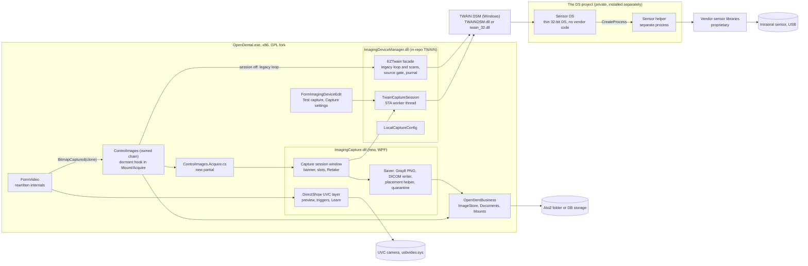

# Native intraoral X-ray and camera capture: design and scope

Status: 2026-11-01. CAP-TW, CAP-0 to CAP-4 and the ControlImages hook are implemented and on `main` (docs/port-notes/CAP.md). CAP-W1, CAP-W2 and CAP-DR are not started, and the owner decisions are pending (section 15). Nothing has run on hardware, and no capture window has been opened at runtime. The rest of this document is the design and scope as written on 2026-10-24 (baseline `main` at 33dc92789, before wave A2 merged), with the contract citations updated to twain-contract 1.1 on 2026-10-31. This edition names no vendor, product or private project: it says the clinic's sensor vendor, the vendor's imaging software and the private TWAIN source project instead. The names, the private repository's location and where its knowledge came from stay in the coordination record, outside this repository. VendorNeutralityTests scans this file.

Evidence is given as `file:line` on `main` unless marked otherwise. `decouple/twain:` means the held branch. "twain-contract" is the versioned TWAIN contract that the private TWAIN source project ("the DS project" below), which builds the clinic's sensor DS, publishes in answer to ask W1. The cited version is **twain-contract 1.1 (the DS project's `main` 2c96a4d, draft)**. The first 1.1 text was `main` f42da35; 2c96a4d corrects it, and for this design the change that matters is section 10.2, where the way out of a refused disable now applies only after the sensor software has ended and its notification was sent (W13, section 7.1). The first version was twain-contract 1.0 (the DS project's `main` dce2b0e, 2026-10-24); this document cites 1.0 only where it describes 1.0 history on purpose. The contract describes only behaviour observable through TWAIN, is written to be shared with this project, and is cited as "twain-contract 1.1 section N". Relative to 1.0, 1.1 splits section 6 into 6.1 to 6.4, puts the custom capabilities in section 10 and the condition codes and planned semantics in section 11, lists the changes from 1.0 in section 12, and moves conformance to section 13. Later versions are cited by their version. "DS answers" means the written answers and the review of section 11 that the DS project's session gave on 2026-10-24. They are cited only for facts the contract does not cover, and only for behaviour at the DS's TWAIN surface. Nothing in this document describes how the vendor's software works inside. The DS project is a private repository. This document does not cite it by file and line. Line-level evidence from it stays in the coordination record, outside this repository (section 11.1).

## 1. Summary

**What.** Take intraoral X-rays from a digital sensor and intraoral photos from a camera inside the Imaging module. Use only code in this repository plus the standard Windows interfaces for TWAIN and UVC.

**Why.** Fork builds cannot capture today. Mount/Acquire and the Scan buttons call the proprietary `ImagingDeviceManager.dll` and `Eztwain4.dll`, and Video calls the proprietary `VideoCamLib.dll`. The build copies none of these native DLLs (third-party-binaries-audit.md:34), so Video throws on load (FormVideo.cs:133-143). The clinic has an intraoral sensor and an intraoral camera from one vendor. A separate private project, the DS project, builds a TWAIN data source for the sensor that keeps all of the vendor's code out of process.

**Recommendation.**

1. Land the in-repo TWAIN client from `decouple/twain`, an EZTwain-compatible facade over direct DSM calls. Harden it in place:
   - thread-modal device acquisitions with a small Cancel window;
   - a gate on which sources may be opened;
   - a recovery journal of transferred images;
   - correct TWAIN state handling, so a fork-initiated stop never throws away images it can still get.
   X-rays then work through today's Mount/Acquire with the DS project's sensor DS. The device is configured as ordinary data.
2. Replace `VideoCamLib.dll` with a small in-repo DirectShow layer behind the unchanged `FormVideo` surface. It provides generic UVC preview and generic, configurable control-polling triggers. The clinic finds the trigger values by black-box observation with the Learn tool alone; no config fragment from the private repository is used.
3. Pull the schema-free 16-bit windowing fix (v25_4) into M1. Read existing stored windowing values compatibly, and give DICOM explicit thumbnail branches.
4. Ask the owner of ControlImages, as a line item in its wave, for one dormant hook of at most 10 lines in `ToolBarMountAcquire_Click`. The hook opens a new modal capture session, built in new files. The session adds:
   - a patient banner with a deliberate confirmation step;
   - Retake;
   - provider stamping;
   - a machine-wide quarantine;
   - per device and only after verification, lossless 16-bit DICOM.
   When the session is switched off, the legacy loop runs unchanged and serves as the rollback.

**Scope by phase.**

| Phase | Packages | What the clinic gets | Owned-file edits |
|---|---|---|---|
| 0 | CAP-TW, CAP-1, CAP-0 | 8-bit sensor X-rays into BWX and FMX mounts, one exposure per slot, through the legacy Mount/Acquire loop. While the sensor software is open, the main window is locked and a small Cancel window is shown. A gate limits which TWAIN sources can be opened, and a journal holds a copy of every transferred image. Patient use waits for asks W4 and W13 (implemented in twain-contract 1.1, not yet run on hardware) to pass their acceptance tests, and for acceptance. | none |
| 1 | CAP-2 | A native, vendor-neutral UVC camera in the existing Video window. Generic triggers whose values are learned by observation. The window closes on patient change. `VideoCamLib.dll` is deleted. | none |
| 2 | CAP-W (and CAP-DR if chosen) | Correct windowing for true 16-bit DICOM, legacy stored values read compatibly, DICOM thumbnails, and a swappable DICOM reader | none (BitmapDicom, ImageHelper and Documents have no owner between A2 and C1) |
| 3 | hook line item, CAP-3, CAP-4 | Modal capture session: patient banner and deliberate confirmation, status indicator, Retake/Skip, provider and date stamping, quarantine, sounds, key bindings, 8-bit gray PNG, standard mount templates, Test capture, Setup-gated capture settings | the hook (at most 10 lines), inserted by the ControlImages owner of that wave |
| 4 | per device, no new package | Lossless 16-bit DICOM intra-oral radiographs, once the conditions in section 7.8 hold | none |
| Later | not scoped | Continuous sensor mode, TWAIN device events, camera slot stepping, standby on lift, calibrated measurement, a Media Foundation camera backend | as needed |

Total: about 54 dev-days, or about 50 without CAP-DR. This excludes the DS project's work and clinic time.

**Recommended, awaiting the owner.** The owner has not decided any of these yet:

- TWAIN is the only sensor contract.
- No new enum values and no runtime program or programproperty rows (decision 4).
- `imagingdevice.TwainName` keeps meaning the TWAIN ProductName.
- Per-workstation settings go in a local INI file, with the settings that change images behind Setup permission and an audit entry (decision 3).
- The 16-bit master format is DICOM, written by an in-house writer, with an in-house reader before it becomes the master (decisions 7 and 8).
- The fork makes no programmatic camera control writes (decision 13).
- No DSM binary is vendored.
- No interim camera route for patients (decision 11).

**Fixed by the project's constraints:** no new tables, columns, migrations or preference rows. Nothing proprietary, and nothing derived from a vendor's binaries, goes into the repository. The vendor's code stays out of process.

**Coordinator decisions:** the fate of `decouple/twain`, the hook line item and its wave, the 16-bit windowing move, and the package slots in section 12.1 (section 12.3, item 4). The full list of decisions is in section 15.

## 2. Background

### 2.1 Open Dental's paid and proprietary capture stack

- **Sensor and scanner capture.** It goes through `ImagingDeviceManager.dll`, an Open Dental wrapper over the commercial EZTwain 4 library (`Eztwain4.dll`, `EZT4Jpeg.dll`, `EZT4Pdf.dll`). It runs synchronously on the UI thread (ControlImages.cs:3622-3674).
  - Mount/Acquire opens `FrmMountAndAcquire`, which returns a mount definition, an imaging device, or both (FrmMountAndAcquire.xaml.cs:99-143).
  - For a TwainRadiograph device, the loop calls `OpenSource` and then `Acquire` once per empty slot. For TwainMulti, one multi-transfer session places every image (ControlImages.cs:3685-3734).
  - Each image is saved as an 8-bit-content, 32bpp TIFF with ImgType Radiograph and PrintHeading set (ControlImages.cs:3742-3749; ImageStore.cs:552-602).
- **Video.** `FormVideo` uses `VideoCamLib.dll`, a native x86 DLL from Open Dental with no source. Its imports point to DirectShow, although a comment calls it Media Foundation (VideoCamLib.cs:9-27). It reads no hardware button: only the on-screen button and Space trigger a capture (VideoCamLib.cs:22-26; ControlImages.cs:219-227).
- **Old module.** A direct sensor path for one vendor's sensors uses `xImageDeviceManager.dll` and that vendor's USB DLL (ControlImagesOld.cs:143-183, 506-572).
- **Support-plan gate.** In upstream 24.3, a support-plan check gated Imaging Devices, both Mount/Acquire buttons and Video.

### 2.2 What main already removed

- Commit ed1bcf27f removed the support-plan gate (`ODHelp.IsEncryptedKeyValid`) from FormImagingDevices, FrmMountAndAcquire and the Video button. Commit 1dd732fd1 deleted `OpenDentalHelp.dll`. The only check left on these paths is `ImageCreate` (ControlImages.cs:2857-2861, 3553-3557).
- Main's schema is Open Dental 25.3.48. The schema verifier requires an exact match (OpenDentBusiness/Misc/ForkMigrations/README.md).

### 2.3 What is broken in fork builds today

- `Required dlls/ImagingDeviceManager.dll` stands in for a missing sibling project (Directory.Build.targets:5-7; OpenDental.csproj:9303-9305), but `Eztwain4.dll` is not copied. Scan, Scan Multi-Page and Mount/Acquire therefore cannot work in a fork build.
- No project item references `VideoCamLib.dll` and nothing copies it, so Video throws `DllNotFoundException` on load (FormVideo.cs:135).
- Where these paths do run, they have known defects:
  - The main window stays live during a TWAIN acquire, because a hidden form is the parent (ControlImages.cs:3620-3626).
  - Video and Import Automatically keep running across patient changes and save to the last patient Imaging loaded (ControlImages.cs:517-533, 1527-1644, 1646-1670).
  - Retake calls an empty `butStart_Click` (ControlImages.cs:2073-2125, 900-902).
  - A save failure disposes the image, shows a message box and ends the series, so the exposure is lost (ControlImages.cs:3742-3747).
  - Acquired images get no ProvNum, no Description and no windowing (ControlImages.cs:3750-3759).
- No TWAIN path keeps 16-bit data. Only DICOM import does (BitmapDicom.cs:103-166).

### 2.4 The private TWAIN source project and the clinic hardware

**Clinic hardware.**

- **Sensor:** an intraoral sensor built on a CMOS detector with a 20 µm pixel pitch, which is 1270 dpi (the detector's public FDA 510(k) record, cited in the coordination record). It comes in three sizes: 1000x1500, 1200x1650 and 1300x1800 pixels. The DS delivers 8-bit gray by default and, from twain-contract 1.1, 16-bit gray over memory transfer when the host asks for it. The 16-bit polarity and effective bits are published only after the clinic hardware run (twain-contract 1.1 section 6.2).
- **Camera:** the same vendor's intraoral camera, a standard UVC device (reported by the user through the DS project's session). The fork uses nothing else about this camera. Section 8.4 explains how the clinic finds the button behaviour by observation.

**The DS project** is private and owned by another session. It builds:

- **The sensor DS**, a 32-bit TWAIN 2.4 data source for the sensor. Its ProductName is published in twain-contract 1.1 section 1 and is stored as data (section 9.3). Its TWAIN behaviour is published as twain-contract 1.1 (sections 1-9 describe today's build, sections 10 and 11 its custom capabilities and condition codes).
  - On `MSG_ENABLEDS` it starts the sensor software in its own process and window (the helper process). Nothing is announced while that session runs (twain-contract 1.1 section 5).
  - When the session ends, the DS sends exactly one notification: `MSG_XFERREADY` if it delivered at least one image, otherwise `MSG_CLOSEDSREQ` (a cancel, a session timeout or a failure). In 1.0 a cancel and a failure looked the same; from 1.1, `DAT_STATUS` read after `MSG_CLOSEDSREQ` gives a distinct code for each failure and for the timeout (twain-contract 1.1 sections 8 and 11.1). With safe disable, a refused disable can be followed by one more `MSG_XFERREADY` (its section 10.2). Images are transferred by native DIB or memory transfer.
  - `CAP_XFERCOUNT=1` ends the session after one image. N>1 ends it after N images, or earlier at Done. `-1`, the default, ends it when the operator clicks Done or closes the window, and all images arrive at once. An installation setting of the DS can override this, and another, off by default, ends any session after a set time (twain-contract 1.1 sections 3, 5 and 7).
  - It delivers 8-bit gray at 1270 dpi by default, and 16-bit gray over memory transfer on request. It ignores ShowUI, and from 1.1 reports `CAP_UICONTROLLABLE` FALSE to say so (twain-contract 1.1 sections 4, 5, 6 and 9).
- **A camera TWAIN source and a camera helper with a folder mode.** These are not covered by the contract and are not on the fork's path (section 11.1).

All of the vendor's DLLs load only in the helper processes. Nothing has run on real hardware yet. The DS project's own stated rule is that no images enter patient records until its hardware comparison against the vendor's imaging software passes.

The user asked the two sessions to coordinate and to work independently on separate parts. Section 11 is the interface agreement between them, and twain-contract (1.0 first, now 1.1) is the DS project's published side of it.

## 3. Goals and non-goals

**Goals**

1. Capture intraoral radiographs from any 32-bit TWAIN data source into mounts, safely, with no proprietary library in the fork.
2. Capture intraoral photos from any UVC camera, including hardware buttons found by observation, with no proprietary library.
3. Make wrong-patient filing hard: bind every capture to an explicit, deliberately confirmed patient.
4. Never lose an image that reached the fork, and never make staff believe an exposure was lost when it can still be recovered.
5. Keep the full sensor bit depth once the source, the viewer and the export paths support it, without schema changes.
6. Fix the clinical gaps on the capture path: Retake, provider, date, status feedback and audit.
7. Make every behaviour testable without hardware.

**Non-goals**

- Sensor control: whether and when the sensor arms, trigger thresholds, exposure settings and calibration. These stay in the DS and its helper. The fork only uses the TWAIN Enable/Disable lifecycle and transfer negotiation (section 4, Regulatory).
- Image enhancement or processing in the fork.
- Hardware-specific UI or defaults in core Imaging.
- A second sensor protocol beside TWAIN, such as a helper protocol or a folder provider. Both are deferred.
- Changes to the document-scanning paths beyond what the TWAIN client replacement and the source gate need.
- Capture in the old Imaging module.
- DICOM export, PACS and AI.

## 4. Constraints

| Area | Constraint | How this design meets it |
|---|---|---|
| Schema and prefs | No new tables, columns, migrations or preference rows. The verifier needs an exact 25.3.48 match. | Uses only existing columns. New rows are ordinary data only: documents, mounts and securitylog entries. Settings for one machine go in a local file (section 9.3). Whether settings may use runtime programproperty rows instead is decision 3. |
| Enum values | `TableTypes/ImagingDevice.cs` is foundation-owned (port-backlog.md:30). FormImagingDeviceEdit rewrites unknown types to TwainRadiograph (FormImagingDeviceEdit.cs:72-91). | Recommends no new `EnumImgDeviceType` values. Cameras have no imagingdevice row (decision 4). |
| Licensing | The repository is GPLv2. fo-dicom 4.0.7 is MS-PL, which the FSF lists as GPL-incompatible. It already ships, and the audit plans to keep it. Whether code reads or writes does not matter: the problem is distributing the combined work. | This design makes DICOM the 16-bit master format and adds new call sites that read through fo-dicom (CAP-W thumbnails). That deepens an existing problem. Mitigation: a small `IDicomPixelReader` interface in CAP-W, so the reader can be swapped. An in-house reader for the uncompressed subset the writer emits (CAP-DR) is in place before 16-bit DICOM becomes the master (decision 7). The writer is in-house, written from NEMA PS3.5, PS3.6 and PS3.10 only. Writer tests do not depend on fo-dicom. |
| LGPL interop | TWAINDSM is LGPL-2.1+. DirectShowLib and MF.NET are LGPL-2.1. AForge is LGPLv3, which is not GPLv2-compatible on its own. | The DSM is used at runtime and never shipped (section 7.1). The DirectShow interop is about 14 hand-written `[ComImport]` declarations from the public Windows SDK documentation. No LGPL or MS-PL code is copied. DirectShow, qedit and WIC are operating-system components. |
| Provenance | Nothing proprietary. No decompiling. | The fork embeds no vendor names, name matching, key or bit layouts, property choices, timing values or other device constants. Section 8.4 says how the fork avoids depending on any knowledge of a particular camera. Every camera default has an independent justification, written next to it. Site values come only from the Learn tool (black-box observation at the clinic). No config fragment from outside this repository is imported (W11, withdrawn). Where the camera ideas came from is in the coordination record. A deny-list test covers code, tests and capture docs, this document included (section 13). |
| Vendor neutrality | Ground rule 7 (decoupling-plan.md:28-33). | Only generic TWAIN and UVC code. Device names come from data the user picks. The UI has no vendor text. Optional DS features are reached through custom capability numbers entered as data in the device profile. |
| Offline, local | Ground rules 5 and 6. | All capture is local. Images go through `ImageStore` to the configured storage. The journal and quarantine are local folders under `%ProgramData%`. |
| Vendor stack out of process | The vendor's DLLs never enter the fork and are never loaded by fork code. | The fork talks only to the TWAIN DSM. The sensor DS is a thin DLL that the DSM loads into the host. It contains no vendor code and is installed separately, like any vendor TWAIN source. twain-contract 1.0 had one gap: the DS briefly changed the host process's PATH while it started the sensor software, and then restored it. The change was process-wide, so during that time a DLL loaded by name on any host thread could resolve from the vendor folder. Ask W14 removes this: in twain-contract 1.1 the sensor software is started with its own environment block, and the host's environment, PATH included, is never changed (its section 7; implemented in 1.1, fake-mode tests only, no hardware run). |
| Ownership | ControlImages.cs: A-CL (A1), A-IMG (A2), B-IMG (B1), V-PEARL1 (B2), B-SHELL (B3) (port-backlog.md:1709). ImageStore.cs: A-CL, A-IMG, B-DBM (B2), B-SHELL (port-backlog.md:1718). ControlImageDisplay: A-IMG, B-IMG, then M2-IMG (C1). FormImagingSetup: B-IMG (port-backlog.md:574). BitmapDicom, ImageHelper and UserControlImagingGeneral: M2-IMG (C1) (port-backlog.md:1013-1016). FormImageSelectClaimAttach: B-CLAIM (B2) (port-backlog.md:682). ProgramL and FormProgramLinkEdit: V-BRIDGE1, B-SHELL and later owners (port-backlog.md:1725). Only the owner edits a file while its wave runs, and ownership passes on merge (port-backlog.md:28-29). | No CAP package edits ImageStore.cs, ControlImageDisplay.cs, FormImages, FormImagingSetup, ProgramL, FormProgramLinkEdit or FormImageSelectClaimAttach. The ControlImages hook is a line item for that file's owner in its wave (section 7.3). Other edits are in new files or in files no package owns in that wave: FormImagingDevices, FormImagingDeviceEdit, FormVideo, UI/VideoCamera, BitmapDicom, ImageHelper and Documents (between A2 and C1), and ControlImagesOld (after A2). |
| csproj wiring | Packages in one wave must not both own OpenDental.csproj, OpenDental.sln or OpenDental.Local.slnf. | Project wiring goes through commits the coordinator merges. New projects use wildcard Compile and Page includes. OpenDental.csproj changes are limited to: re-pointing the existing ImagingDeviceManager ProjectReference to `..\ImagingDeviceManager\` and, if the old module's direct sensor path is removed, deleting the xImageDeviceManager reference (CAP-TW); one ProjectReference to ImagingCapture and removal of the UI/VideoCamera items (CAP-2); one Compile item for the partial (hook). OpenDentBusiness.csproj lists its Compile items explicitly, so it gets one each for `IDicomPixelReader` (CAP-W1) and the DICOM reader (CAP-DR). |
| Regulatory | The fork stays on the image-management side (FDA MDDS guidance, 28 Sep 2022; 21 USC 360j(o)(1)(D)). That means acting "without controlling or altering the functions or parameters of any connected medical devices". Intraoral sensors are Class II devices (21 CFR 872.1800, product code MUH). Some are cleared together with their acquisition software. Others are cleared as a bare sensor with an API, which leaves the acquisition software to the integrator (public 510(k) records of both kinds are cited in the coordination record). No clearance record was found for the clinic's sensor as sold, and the sensor helper is the DS project's own program, not cleared vendor software. Who carries acquisition-software responsibility, and whether the fork-computed presentation window falls under 21 CFR 892.2050, go to counsel (decision 18). | The fork does not set exposure, trigger, calibration or image-processing parameters. It does drive the TWAIN Enable/Disable lifecycle: it enables the source for each slot and disables it on cancel, timeout, idle and patient change. The DS and its helper decide whether and when the sensor arms. It also negotiates transfer parameters (XFERCOUNT, mechanism, bit depth, UI flags) and selects the camera stream format. It writes no camera control or ProcAmp values programmatically and opens no driver property pages. The lifecycle, stream-format selection and rendering choices are review flags (sections 7.6, 7.8 and 8.7, decision 18). Section 13 lists exactly which features are gated before review. |
| 32-bit | The host is x86, and the DSM loads only 32-bit sources. | Every new project is x86. |
| NuGet | NuGet restore is unavailable in the sandbox. | No new NuGet packages. The interop is written in the repository. |

## 5. Current state, with evidence

| Fact | Evidence |
|---|---|
| The new Imaging module is the default. FormImages always hosts ControlImagesOld. | FormOpenDental.cs:557-575; FormImages.designer.cs:27,54 |
| Mount/Acquire checks only ImageCreate. It creates and logs the mount for `_patient` from the def (copying RotateOnAcquire, ToothNumbers and FlipOnAcquire), then reads the device. | ControlImages.cs:3553-3586; Mounts.cs:64-106 |
| The device check that the hook follows is `if(imagingDevice is null){ return; }`. `mountDef` is a local variable at that point. | ControlImages.cs:3563, 3584-3586 |
| Device-only acquire calls PreselectFirstItem. If a mount is showing in the tree, the image goes into its next empty slot and the loop continues to the remaining empty slots. The loop ends after one image only when no mount is showing. | ControlImages.cs:3587-3590, 3670-3672; ControlImageDisplay.cs:578-585 |
| TwainRadiograph loop: a hidden minimized form is the parent ("prevents ControlImages from being disabled"). OpenSource plus Acquire run per slot. | ControlImages.cs:3620-3674 |
| Device acquisitions open the source by name (`OpenSource(TwainName)`). Scans open the default source (`OpenDefaultSource`) and force pixel type and memory transfer. | ControlImages.cs:3631, 3686; 2587-2602, 2717-2730 |
| Cancel (19) or a closed UI (0, 5) ends the loop silently and leaves the unmounted bar open. | ControlImages.cs:3635-3666 |
| A save failure disposes the bitmap, shows "Unable to save" and ends the series. | ControlImages.cs:3742-3747 |
| Slot order is ItemOrder. The next slot is the first empty, non-text slot, wrapping around. Overflow goes to unmounted items (ItemOrder -1). TwainMulti places extras in unmounted items. | MountItems.cs:43-49; ControlImageDisplay.cs:395-436; ControlImages.cs:3761-3814 |
| Placement sets MountItemNum, DegreesRotated=RotateOnAcquire, IsFlipped and ToothNumbers. It is a display transform; pixels are never rotated. | ControlImageDisplay.cs:291-321 |
| Mount and MountItem have no link back to MountDef or MountItemDef. | OpenDentBusiness/TableTypes/Mount.cs:13-44; MountItem.cs:11-32 |
| Retake moves the image to unmounted, then calls an empty `butStart_Click`. | ControlImages.cs:2073-2125, 900-902 |
| No ProvNum, Description or windowing is set on acquired images. | ControlImages.cs:3750-3759; ImageStore.cs:552-602 |
| Pearl auto-upload runs on acquired radiographs when the category is configured for it. | ControlImages.cs:3753-3756 |
| Video saves the frame as a Photo JPEG into VideoImageCategoryDefault before it checks the mount. On a full mount, or with no empty slot selected, it shows a message box and leaves an unplaced document. | ControlImages.cs:1646-1670; ControlImageDisplay.cs:351-361 |
| The mount path disposes the bitmap it was passed, which is the live PictureBox image. The non-mount path never disposes it. | ControlImageDisplay.cs:377; ControlImages.cs:1667-1669 |
| FormVideo derives from FormODBase, which lives in the OpenDental assembly. It stays open across patient changes, and `_patient` refreshes only when Imaging is reselected. | FormVideo.cs:16; ControlImages.cs:517-533, 3305-3328 |
| FormVideo is opened through FormLauncher, and its only link back is the `BitmapCaptured` event. Slot selection is private to ControlImages. | ControlImages.cs:2862-2864, 1642 |
| Space typed in the main window is routed to FormVideo by reflection. | ControlImages.cs:219-227; FormOpenDental.cs:902-906 |
| Import Automatically handles only Created events, keeps running across patient changes, ignores files present at Start, stops on a failed import and deletes source files. | ControlImages.cs:838-875, 1527-1644 |
| The `PatNumCur` setter fires `ODEvent(ODEventType.Patient, long)`. `Patients` also fires it with a `Patient` object. | FormOpenDental.cs:251-261; Patients.cs:5428 |
| Auto-logoff runs through `Invoke` from a background thread. It closes every open form, modal ones included, and disposes any form still open after about 1 s (FormOpenDental.cs:6699-6767). PatNumCur becomes 0 only after the next login, and only in some multi-clinic cases (6852, 6864). | FormOpenDentalThreads.cs:424-427, 496-505; FormOpenDental.cs:6699-6767, 6844-6864 |
| `GlobalFormOpenDental.LockODForMountAcquire` exists and FormOpenDental subscribes to it, but nothing raises it. | OpenDentBusiness/UI/GlobalFormOpenDental.cs:16-29; FormOpenDental.cs:233, 972 |
| `ImageStore.Import(byte[] ..., fileExtension)` saves bytes unchanged with any ImgType. | ImageStore.cs:605-636 |
| The DICOM loader accepts BitsStored 8, 12 or 16 and rejects 14. | BitmapDicom.cs:103-166 |
| `ApplyWindowing` divides by 16 whenever BitsAllocated is 16, so true 16-bit data saturates once a window of 255 or less is stored (the slider clamps to 255). | BitmapDicom.cs:32-74; WindowingSlider.xaml.cs:113-118 |
| Import sets WindowingMax=4095 for BitsStored 16, outside the 0-255 range. Documents.InsertMissing writes those values for .dcm files found in AtoZ. | BitmapDicom.cs:168-224; Documents.cs:537-595 |
| `HasImageExtension` excludes .dcm, so GetThumbnail returns the placeholder. GetImageCropped calls `new Bitmap` on anything the check accepts. GetThumbnail swallows exceptions. | ImageHelper.cs:513-517, 538-544; Documents.cs:389, 431-438 |
| Claim attachment rejects any file `HasImageExtension` does not accept, so a .dcm cannot be attached. | FormImageSelectClaimAttach.cs:155-175 |
| Email attachment does not reject .dcm. It blocks only a document with no image extension that is neither a PDF nor ImgType Photo or Radiograph, and imported DICOM is Radiograph. It loads .dcm through the DICOM loader with windowing and attaches a JPEG. | EmailAttachL.cs:109, 139-157; ImageHelper.cs:461-474, 552-570; ImageStore.cs:525-526; Documents.cs:575-576 |
| Mount rendering already handles DICOM. | ControlImageDisplay.cs:4512-4516, 4554-4566 |
| GDI+ converts 16-bit PNG and TIFF to 32bpp. | ImageStore.cs:306-354; ImageHelper.cs:572-576 |
| `LogDocument` dereferences the category without a null check. | ImageStore.cs:1332-1349 |
| imagingdevice has 7 columns and no free-form settings column. | ImagingDevice.cs:9-46 |
| The clinic database shows no mount or device use. | Office schema dump: no AUTO_INCREMENT on imagingdevice, mount, mountitem, mountdef or mountitemdef |
| `decouple/twain` is 4 commits ahead of main and 292 behind. Against main and against A2 the only textual conflict is OpenDental.csproj; ControlImagesOld.cs (182 changed lines) and UnitTests.csproj are changed on both sides but merge cleanly. It has 69 MSTest tests, 34 of them through FakeTwainDsm. Every EZTwain member used on main exists in it. | `git merge-tree` (read-only) against main and m1/integration-a2-patch; `git show decouple/twain:ImagingDeviceManager.Tests/*.cs`; decouple/twain:ImagingDeviceManager/EZTwain.cs:26-337 |
| The library's project file lists Compile items explicitly. | decouple/twain:ImagingDeviceManager/xImagingDeviceManager.csproj |
| The library disables only the root of the hwnd it is given, which on the device path is the hidden form. | decouple/twain:TwainSession.cs:716-728 |
| Its nested `GetMessage` loop dispatches every message. There is no app-side cancel. The timeout is test-only. | decouple/twain:TwainSession.cs:833-905 |
| `TransferOne` calls `EndTransfer` right after each transfer. `AbortToState4` already performs the correct ENDXFER/RESET/DISABLEDS order. | decouple/twain:TwainSession.cs:817, 940, 1164 |
| When the pending count reaches 0, the library disables the source at once. `-1` counts as more pending. Single mode takes one image and resets the rest of the batch. | decouple/twain:TwainSession.cs:602-607, 1162-1182 |
| Each single Acquire unloads the DSM. | decouple/twain:TwainSession.cs:573-626 |
| 16-bit gray is reduced to 8-bit with an adaptive shift. | decouple/twain:TwainSession.cs:948-951; DibImage.cs:185-230 |
| DSM search order: app-local TWAINDSM.dll, then system TWAINDSM.dll, then twain_32.dll. | decouple/twain:NativeTwainDsm.cs:37-81 |
| The sensor DS sends exactly one notification per enable, when the session ends, and every enable starts with a fresh notification state. With safe disable, a refused disable can be followed by one more MSG_XFERREADY. `CAP_XFERCOUNT` N>1 is honoured, and setting 0 stores -1. An installation setting of the DS can override CAP_XFERCOUNT. | twain-contract 1.1 sections 3, 4, 5 and 10.2 |
| Other installation settings of the DS change the delivered 8-bit pixels, including a rotation and flip of the delivered image that is not `ICAP_ROTATION`. None of them applies to 16-bit images. Each has a neutral default. A host never reads them. | twain-contract 1.1 sections 0, 3 and 6.2 |
| The sensor waits a configured time for each exposure and is re-armed when that time expires. An overall session timeout, an installation setting that is off by default, ends the session: the images taken so far are delivered, otherwise it ends with MSG_CLOSEDSREQ and the timeout code. Without it, a session ends only through the operator, its own count, a disable or a close. twain-contract 1.0 had no overall timeout. | twain-contract 1.1 sections 3, 7 and 11.1 |
| MSG_DISABLEDS is accepted in states 5, 6 and 7. Without safe disable, if the sensor software is still running, the DS asks it to close, waits up to 15 s, then ends it forcibly; the call blocks for that time. An exposure being read out when the close is requested is finished and saved first (at most 10 s). Images the session took but the host did not transfer are not delivered after such a disable, but a redelivery can still offer them. With safe disable the call never blocks and can be refused. | twain-contract 1.1 sections 7, 9, 10.2 and 10.3 |
| Sensor failures (no sensor, no calibration, a sensor that is not accepted) show the reason in the sensor software's window. When the operator closes it, or the session timeout expires, the session ends with MSG_CLOSEDSREQ. DAT_STATUS then returns a distinct end-reason code, kept until MSG_DISABLEDS succeeds, and DAT_STATUSUTF8 returns English text for it. A plain cancel keeps TWCC_SUCCESS. In 1.0 every failure looked like a cancel. | twain-contract 1.1 sections 8 and 11.1; ask W4 |
| MSG_SET on the fixed-value capabilities (CAP_INDICATORS, ICAP_PIXELFLAVOR, ICAP_BITORDER, ICAP_PLANARCHUNKY, ICAP_SUPPORTEDSIZES, ICAP_UNDEFINEDIMAGESIZE) succeeds with the fixed value and fails with TWCC_BADVALUE for any other, except that CAP_INDICATORS FALSE returns TWRC_CHECKSTATUS and changes nothing, and ICAP_UNDEFINEDIMAGESIZE accepts TRUE or FALSE. In 1.0 any value succeeded and changed nothing. DAT_EXTIMAGEINFO and DAT_STATUSUTF8 are supported; in 1.0 both returned TWCC_BADPROTOCOL. | twain-contract 1.1 sections 2, 4, 6.3, 8 and 12 |

## 6. Architecture

### 6.1 Components

| Component | Where | New or existing | Role |
|---|---|---|---|
| ImagingDeviceManager | `ImagingDeviceManager/` (from `decouple/twain`) | new to main | In-repo TWAIN client. Provides the EZTwain facade for legacy callers, the source gate, the journal, thread-modal device acquisitions and, from CAP-3, `TwainCaptureSession`, a worker-thread API. Holds the shared `LocalCaptureConfig` reader. |
| ImagingCapture | `ImagingCapture/xImagingCapture.csproj` | new WPF-enabled class library (net48, x86, C# 7.3, WPF ProjectTypeGuids, wildcard `Compile` and `Page` includes) | DirectShow UVC layer, triggers, Learn tool, DICOM writer, capture-metadata parser, placement helper, session window, saver, quarantine, Test capture window and capture settings screen. Windows are `FrmODBase`, like FrmMountAndAcquire. |
| ControlImages.Acquire.cs | `OpenDental/Main Modules/` | new partial file | Called by the hook. Checks PatNumCur, opens the session or falls through to the legacy loop, and refreshes the module afterwards. |
| FormVideo | `OpenDental/Forms/` | rewritten internals | Same class, FormLauncher name, `BitmapCaptured(Bitmap)`, `Parent_KeyDown` and `VideoRectangle`. Now built on ImagingCapture. |
| FormImagingDevices | `OpenDental/Forms/` | small edit (no owner) | "Add standard templates" action (CAP-4), calling ImagingCapture Templates (FrmMountAndAcquire is in WpfControlsOD and cannot reference ImagingCapture) |
| FormImagingDeviceEdit | `OpenDental/Forms/` | small edit (no owner) | "Test capture" and "Capture settings" buttons (CAP-3, CAP-4) |
| BitmapDicom, ImageHelper, Documents | `OpenDentBusiness/` | small edits (CAP-W, CAP-DR) | 16-bit windowing with legacy values read compatibly; explicit .dcm thumbnail branches through `IDicomPixelReader`; DICOM reads try the in-house reader first |
| capture.ini | `%ProgramData%\OpenPMS-Dental\Imaging\` | local file | Settings for one workstation (section 9.3) |
| Journal and quarantine | `%ProgramData%\OpenPMS-Dental\Imaging\Capture\` | local folders | Recovery copies (journal) and unfiled images (quarantine) (sections 7.1 and 7.12) |

### 6.2 Process boundaries

| Process | Contains | Owner |
|---|---|---|
| OpenDental.exe (x86) | Fork code; the TWAIN DSM; any TWAIN `.ds` the DSM loads (for the clinic, the sensor DS, which contains no vendor code); DirectShow filters from Windows | this repository, Windows, the DS vendor |
| Sensor helper (the sensor software, a separate process) | The vendor's sensor libraries. Sensor arming, trigger and calibration. | the DS project (private) and the sensor vendor (proprietary) |

The fork never starts the helper, never reads its command line, configuration, manifests, logs or session folders, and never loads a vendor DLL. None of these is part of twain-contract 1.1 (its section 0). The camera helper and camera TWAIN source are not used by the fork (decision 11).

### 6.3 Diagram



### 6.4 Assembly layering

- ImagingCapture references ImagingDeviceManager, OpenDentBusiness, CodeBase and WpfControlsOD. OpenDental.exe references ImagingCapture.
- ImagingCapture never references the OpenDental assembly, so it cannot see `FormOpenDental`, `ControlImages` or `ControlImageDisplay` (that would be a circular reference). Its windows derive from `FrmODBase` (WpfControlsOD/Frame/FrmODBase.cs), so the WinForms base `FormODBase` in OpenDental is not needed.
- The partial file in OpenDental passes the session everything it needs:
  - `PatNum` and the `Patient`;
  - `Func<long> getPatNumCur`, which returns `FormOpenDental.PatNumCur` and is used at start and at every re-enable;
  - the target `Mount` or null, and the `MountDef` or null;
  - the `ImagingDevice`;
  - the category;
  - an owner window.
- ImagingCapture tracks patient changes through `ODEvent` (`ODEventType.Patient`). A `long` Tag that differs from the bound PatNum counts as a patient change, and a Tag of 0 means no patient. A `Patient` Tag (Patients.cs:5428) is ignored unless its PatNum differs. Logoff raises no Patient event in a typical office (section 5); FormClosing is the logoff signal.
- Placement rules live in ControlImageDisplay (DocumentAcquiredForMount, GetAvailSlots: ControlImageDisplay.cs:291-321, 395-436), which ImagingCapture cannot call. A small `MountPlacement` helper in ImagingCapture copies those rules onto OpenDentBusiness calls. Tests pin it to the same results.
- The hardware-facing parts of ImagingCapture (UVC, triggers, config, DICOM writer) do not touch OpenDentBusiness, so they can be unit-tested with no database.

## 7. X-ray capture design

### 7.1 TWAIN client

**CAP-TW.** Land `decouple/twain` with its behaviour unchanged, after wave A2 merges.

- Point `OpenDental.sln` and OpenDental.csproj's ProjectReference (OpenDental.csproj:9303) at `ImagingDeviceManager\xImagingDeviceManager.csproj`. Switch it and its test project to wildcard `Compile` includes.
- Add the dependency-free `LocalCaptureConfig` reader (about 80 lines, section 9.3), so CAP-1 and CAP-2 can both start after CAP-TW.
- Move the tests to `tests\ImagingDeviceManagerTests` and add them to the slnf.
- Remove the `Directory.Build.targets` substitution (lines 5-7 and 19-34).
- Re-run the conflict check against `main` after A2 merges, and list every conflict in the PR. Known overlaps are OpenDental.csproj, UnitTests.csproj and ControlImagesOld.cs.
- Removing the old module's direct sensor path, with `xImageDeviceManager.dll` and its vendor USB DLL, depends on owner decision 2.
  - If the owner keeps that path for now, CAP-TW keeps those two DLLs and its ControlImagesOld code, and deletes only the EZTwain DLLs.
  - If it is removed, FormImagingSetup's direct sensor group box (FormImagingSetup.cs:68-80, 130) becomes dead UI. Its cleanup is handed to B-IMG (B1) or a later owner as a coordinated item.
- Changes to the planning documents (decoupling-plan.md:47 and 93, the binaries audit) go to the coordinator as proposed text. They are not part of the package.
- If the coordinator declines the held branch, the same library and tests are ported fresh (about 5-6 days instead of 3).

**CAP-1.** Extend the library in place, in files no package owns.

- **Thread-modal device acquisitions.** This applies only when the open source was opened by name (`OpenSource(productName)`), which is the Mount/Acquire path. Scans open the default source and keep today's behaviour (ControlImages.cs:2587, 2717).
  - From `MSG_ENABLEDS` until the acquire ends, the library disables every visible, enabled top-level window of the calling thread (EnumThreadWindows), not only the root of the hwnd passed in.
  - It re-enables exactly those windows on every exit path.
  - Windows the DS creates after enable stay enabled, and the out-of-process helper window is unaffected.
  - Opt-out: `EZTwain.DisableThreadWindowsDuringAcquire`, or the administrator-set `[Twain] ThreadModal=0` (Setup-gated from CAP-4, section 9.3).
- **Status and Cancel window.** While thread windows are disabled, the library shows its own small, topmost, enabled window: "Sensor software is open. Cancel ends this series." Cancel posts a private message to the nested loop, which stops in the safe order described below. The app therefore never looks frozen if the helper window ends up behind it. Without safe disable, Cancel first warns. With XFERCOUNT=1: "If an exposure was just taken, wait until it appears before cancelling." In a batch: "Cancel here may lose images already taken in this series; use Done in the sensor software to keep them." Closing the sensor software's window ends a batch with every image taken delivered; a disable without safe disable does not deliver them, although a redelivery can still offer them afterwards (twain-contract 1.1 sections 5, 7 and 10.3).
- **Activation.** The library records the foreground window before it disables anything. It does not force the foreground between acquisitions, so each new helper window can come to the front. After the acquire ends, it restores the recorded window only if no new acquire starts within about 1 s and no other program has the foreground. Ask W7 lets the helper grant foreground rights before it exits; twain-contract 1.1 implements it (its section 7), but it is not yet tested, not even in fake mode, and has not run on hardware.
- **Safe stop order (TWAIN 2.4 pp.3-27 to 3-28 and p.7-103: MSG_DISABLEDS is valid in state 5 only).** Every stop the library starts uses `AbortToState4`, extended to drain first:
  - in state 7, finish the transfer, then send `MSG_ENDXFER`;
  - in state 6, transfer each remaining pending image into the journal and quarantine instead of sending `MSG_RESET`;
  - in state 5, send `MSG_DISABLEDS`.
  This applies to Cancel, timeout, a destroyed parent window and `WM_QUIT`.
- **Refused disable (W13).** With safe disable in effect (next item), the DS may refuse MSG_DISABLEDS with one of two "disable refused" codes, "images pending" or "sensor software closing", and then send a notification (twain-contract 1.1 sections 10.2 and 11.2). The library reads the code with DAT_STATUS. A code listed in `[Twain] RefusedDisableCodes` (on the session path, `[Device.N] RefusedDisableCodes`; the two codes from the published contract, entered as data) means "wait for the notification". Any other refusal while the capability is set is logged as a contract deviation and handled the same way, because waiting never loses an image.
  - It keeps its loop running for at most 30 s, its own bound (the contract asks hosts to allow at least 20 s). The status window says "Waiting for the sensor software to finish."
  - On MSG_XFERREADY it transfers the images into the quarantine (on the legacy path; the capture session places them, CAP-3), then sends MSG_DISABLEDS again.
  - On MSG_CLOSEDSREQ (for example, the sensor software was idle and closed without an image) it sends MSG_DISABLEDS again.
  - It sends MSG_DISABLEDS again only after a notification or a bound, never at once: the DS refuses every MSG_DISABLEDS the same way, at once, until its notification (twain-contract 1.1 section 10.2).
  - If neither arrives in time, it sends a second consecutive MSG_DISABLEDS, the contract's way out: it succeeds, and undelivered images can still be redelivered (W15; its sections 10.2 and 10.3). Since 2c96a4d the way out applies only once the sensor software has ended and its notification was sent. So if this MSG_DISABLEDS is refused with a "wait" code, the library does not treat the source as disabled: it waits for the notification for a second bound of the same length and handles a notification as above. Only when that bound passes too does it send a last MSG_DISABLEDS and, if that is refused, treat the source as disabled and log a contract deviation (the DS itself ends sensor software that has not closed after 15 s, so the notification should always come).
  - A way-out MSG_DISABLEDS refused with any other code means the source is treated as disabled at once.
  - When the session ends without the DS having offered what it held (the way out or the last MSG_DISABLEDS succeeded, or the source was treated as disabled), the library logs this case and shows its own non-modal notice: "The sensor software may still hold images from this series. Do not re-expose. See the runbook." When the DS offers its images within the second bound, they are received and no notice is shown; the capture event of section 7.13 is still logged, saying the source then delivered what it held.
- **Safe disable (W13).** On the by-name Mount/Acquire path, when the source's ProductName is listed in `[Twain] DisableIsSafeSources` and `[Twain] SafeDisableCap` is set, the library sets that capability to TRUE in state 4 before each MSG_ENABLEDS (MSG_QUERYSUPPORT first; TWCC_CAPUNSUPPORTED is tolerated and logged, and the feature counts as absent). The capability stays set until MSG_CLOSEDS, so setting it again before each enable is harmless. Phase 0 therefore gets W13 from a DS that implements it. twain-contract 1.1 does (its sections 10.1 and 10.2; implemented in 1.1, fake-mode tests only, no hardware run); twain-contract 1.0 only reserved the number. The library treats a disable as safe only when that MSG_SET succeeded. These keys are matched by ProductName because the legacy loop passes the library only the TwainName and a window handle, so the library cannot find a `[Device.N]` profile.
- **Parent destroyed or logoff.** On each pass of the nested loop, the library checks `IsWindow` on the hwnd passed to Acquire and watches for `WM_QUIT`. If either fires (for example, auto-logoff closes the hidden parent form), it stops in the safe order. Any image that arrives after that goes to the quarantine, not back to the caller. This reduces the wrong-patient gap of ControlImages.cs:3620-3626 without editing ControlImages. It does not close the gap completely, because work dispatched by Invoke still runs inside the nested loop.
- **Quarantine in phases 0-2.** CAP-1 has a minimal quarantine writer. Whenever it puts an image into the quarantine (W13 rescue, state-6 drain, parent destroyed, `WM_QUIT`, extra single-mode images), it shows its own non-modal, topmost notice: "N image(s) received after the series stopped were saved to the capture quarantine folder (<receive time>). Do not re-expose. Ask an administrator to recover them (see the runbook)."
  - Its sidecars record receive time, source ProductName, computer, Windows user, the reason and "patient unknown", because the legacy loop passes no patient.
  - An administrator recovers these files as the CAP-0 runbook describes (section 12.1). From CAP-4, files marked "patient unknown" are offered only through Reassign (section 7.12).
- **Extra images in single mode.** If the pending count is above 0 after a single-mode transfer (for example, because a DS setting overrides XFERCOUNT), the library does not reset the batch. It transfers the extra images into the quarantine, logs a warning and shows the quarantine notice.
- **Journal.** Before returning a transferred DIB to the caller, the library writes a copy to `Capture\journal\` with a sidecar: receive time, source ProductName, computer, Windows user, the gated `[Twain]` values in effect, and the PatNum the caller passed (if any). Today's loop discards an image whose save fails (ControlImages.cs:3742-3747), and the journal lets it be recovered. The journal is a recovery buffer of copies, not the record. It keeps the most recent `[Twain] JournalKeep` images (default 200, administrator-set, Setup-gated from CAP-4).
  - In phase 0 a journal file can be the only copy of an image whose save failed, because the library cannot see the caller's save result. Rotation would remove it after JournalKeep further transfers, so the runbook requires recovery by Import before the series is restarted.
  - Recovery is by Import in phase 0 and by the session's "Recover recent captures" view in phase 3. The view lists only journal copies whose sidecar PatNum equals the session's patient and that have no matching document yet (matched by receive time and pixel size), and files them like a quarantine Assign.
  - Journal copies with no PatNum (every phase-0 copy) or with another PatNum are offered only through Reassign (ImageEdit, explicit patient search, both names and dates of birth, a reason, logged).
  - In phase 0, import a journal copy only after matching its receive time to the failed save, with a second person checking the image against the patient.
- **Source gate.** When the administrator-set `[Twain] RestrictSources=1` (Setup-gated from CAP-4, section 9.3) is set, `OpenSource` and `OpenDefaultSource` refuse any ProductName not listed in `[Twain] AllowedSources`, and show "This TWAIN source is not enabled on this computer." The default is 0, so general installs are unaffected. The clinic runbook sets 1 on every PC until acceptance. On each PC, AllowedSources first lists every TWAIN scanner that PC already uses. The sensor's ProductName is added only on PCs that passed acceptance (the test PC first).
- **Honest CAP_UICONTROLLABLE.** Read it. If it is FALSE, always send ShowUI=1 and log it.
- **Optional acquire timeout.** `[Twain] AcquireTimeoutMinutes` defaults to 0 (off) and is administrator-set (Setup-gated from CAP-4). It is honoured only on PerSlot acquisitions (XFERCOUNT=1) of a source listed in `[Twain] DisableIsSafeSources`, which lists the sensor only on the test PC for the CAP-0 test of ask W13 and on other PCs only after it passes, and only when the safe-disable MSG_SET succeeded. The runbook keeps it at 0 on the test PC until that test passes. When it expires, the library stops in the safe order.
  - The runbook sets it below the automatic logoff time. Time spent in the helper window and pedal presses do not count as activity in Open Dental, so the runbook also checks that the logoff time that applies to capture staff (the office-wide setting, or a per-user override where the office allows one) is longer than the longest series, for example 30 minutes. In phase 3 the session sets `Security.DateTimeLastActivity` on every enable, received image, hotkey and status change while it is open.
  - The DS has its own session timeout from twain-contract 1.1 (W4; an installation setting, off by default; its sections 3 and 7). The runbook sets it shorter than AcquireTimeoutMinutes, so the DS ends the session cleanly with its timeout code before the library stops it.
  - The runbook also warns that, without safe disable, the DS can take up to about 15 s to close the sensor software, during which the UI waits (twain-contract 1.1 section 7).
- **Handle ownership.** The library frees native DIB handles, `DAT_STATUSUTF8` text handles, and from CAP-3 metadata handles, with the DSM's `DSM_MemFree` when the DSM supplied its DSM2 entry points (`DAT_ENTRYPOINT`), otherwise with `GlobalFree`. This matches how the DS allocates all three (twain-contract 1.1 sections 2 and 6.4). Fake tests cover both cases.
- **Keep the DSM loaded** between single acquisitions instead of calling `FreeLibrary` after every image (decouple/twain:TwainSession.cs:573-626).
- **Never force a pixel type on the Mount/Acquire path.** This is already true; tests pin it, because the sensor DS rejects mismatched pixel types (twain-contract 1.1 section 4).
- **Error notice.** A notification carries no condition code. So after every MSG_CLOSEDSREQ, and before MSG_DISABLEDS, the library calls `DG_CONTROL / DAT_STATUS / MSG_GET` on the DS (with the DS identity). twain-contract 1.1 reports distinct end reasons (ask W4) and keeps the code until MSG_DISABLEDS succeeds (its sections 8 and 11.1). DAT_STATUS returns the code of the most recent failed call and clears it, and returns the end reason only when there is none (twain-contract 1.1 section 8), so the library reads it after every TWRC_FAILURE as well; the code read after MSG_CLOSEDSREQ then belongs to the session's end.
  - For any code other than TWCC_SUCCESS, the library asks for `DAT_STATUSUTF8` text and shows its own non-modal notice: "Sensor software ended without an image: <reason>. Do not re-expose until you have checked the sensor software." DAT_STATUSUTF8 is optional: twain-contract 1.1 answers it with English text (its section 8), but 1.0 returned TWCC_BADPROTOCOL for it, and the legacy twain_32.dll may not pass it through. Without text, <reason> is the condition code in hex; its meaning is in the DS's published contract.
  - A plain cancel (TWCC_SUCCESS) stays silent, as today. In twain-contract 1.1 a plain cancel keeps TWCC_SUCCESS, and each sensor failure and the session timeout have their own code (its section 11.1); in 1.0 every sensor failure also read TWCC_SUCCESS. On the named-source path, the library sets LastErrorText for transfer failures to "Image not received. Do not re-expose until you have checked the sensor software.", which today's loop shows in its message box (ControlImages.cs:3645, 3662). For EZTEC_DS_FAILURE, which the loop ignores, it shows the same text in its own non-modal notice.

**CAP-3.** Add new files, plus small edits to TwainSession, TwainConstants and TwainStructs.

- **Raw 16-bit memory path.** `AcquiredImage {Width, Height, BitsPerPixel, BitsPerSample, PixelType, PixelFlavor, XDpi, YDpi, ushort[] Gray16 or byte[] Dib, MetadataJson, ReceivedAt}`.
  - When the caller asks for 16-bit and `ICAP_PIXELTYPE` is GRAY, the library negotiates in this order, in state 4: set `ICAP_XFERMECH=TWSX_MEMORY` first; then the depth asked for: for 16, 16 if MSG_GET lists it, else 14 if it lists 14, else 8; for 14, 14 if listed, else 8. A refused SET goes on to the next depth, ICAP_BITDEPTH=8 is confirmed before native transfers, and more than 8 bits are never set with native transfer. The depth in effect, and why it is lower than asked, is reported per enable and per image and recorded in the sidecars (BitDepthInEffect, BitDepthReason). 14-bit samples come right-justified in 16-bit containers. An image of more than 8 bits in any other layout (BitsPerPixel not 16, packed or compressed samples) is not read: the transfer fails ("N-bit layout not usable: ...") and the session asks for 8 bits for the rest of that session. It never sets 16 while the mechanism is native. twain-contract 1.1 implements this order: 16 while native returns TWCC_BADVALUE, and setting native while the depth is 16 resets it to 8 with TWRC_CHECKSTATUS (its sections 4 and 6.2; implemented in 1.1, fake-mode tests only, no hardware run). At 16 bits the DS's installation adjustments never apply (twain-contract 1.1 sections 3 and 6.2). With a DS that lists 8 bits only, as twain-contract 1.0 did, the library stays at 8. The session asks for [Device.N] Bits (16 by default since 2026-11-01; 14 when the matching record's Test capture asked for 16 and passed at 14) only when [Twain] Allow16Bit=1 (the default), the capture settings check holds, the latest Test capture record for the device row matches the row's TWAIN source, the driver identity the source reports at open and the image settings (Bits, ByteOrder16, Polarity), and passed at that depth, and the target can be written as DICOM (sections 7.8, 7.10, 9.3); Test capture asks for it to measure. Capabilities return to their defaults only at MSG_OPENDS (twain-contract 1.1 section 4), so when the session asks for 8 bits after an earlier 16-bit enable on the same open source, the library sets `ICAP_BITDEPTH=8` in state 4 before MSG_ENABLEDS. Otherwise the library leaves the bit depth as the source delivers it.
  - **8-bit images in a 16-bit enable.** twain-contract 1.1 delivers an image that has no 16-bit original as 8-bit, and `DAT_IMAGEINFO` says so (its section 6.2). CAP-3 therefore reads `DAT_IMAGEINFO` for every image, not once per enable. An image that reports 8 bits goes down the 8-bit save path (Gray8 PNG, section 7.8), never the 16-bit DICOM path.
  - It never asks for a 16-bit native DIB, because a 16bpp DIB is RGB555/565 by definition (TWAIN 2.4 p.12-7; BITMAPINFOHEADER).
  - The legacy facade keeps its 16-to-8 shift for scanners. The capture API never uses that shift; its preview uses a fixed LUT built from the window.
- **Extended image info.** In state 4, set `ICAP_EXTIMAGEINFO=TRUE` when MSG_QUERYSUPPORT allows it (TWAIN 2.4 p.10-145: FALSE by default). The fork reads 0x124B only when `ICAP_SUPPORTEDEXTIMAGEINFO` lists it. twain-contract 1.1 supports both, and its `ICAP_SUPPORTEDEXTIMAGEINFO` lists 0x123A-0x123F and 0x124B (its sections 4 and 6.3; W6, implemented in 1.1, fake-mode tests only, no hardware run). A DS that supports neither, as twain-contract 1.0 did (`ICAP_EXTIMAGEINFO` TWCC_CAPUNSUPPORTED, `DAT_EXTIMAGEINFO` TWCC_BADPROTOCOL), is treated as giving "no metadata".
  - Split `TransferOne` so that, after `TWRC_XFERDONE` and before `MSG_ENDXFER` (state 7), it calls `DAT_EXTIMAGEINFO` for `TWEI_TWAINDIRECTMETADATA` (0x124B, a UTF-8 JSON handle the app frees as in CAP-1's handle ownership rule) and `TWEI_PIXELFLAVOR` (0x123F). Both numbers are standard twain.h constants. twain-contract 1.1 answers only in state 7 and fails with TWCC_SEQERROR in any other state (its section 6.3).
  - Missing items are accepted (TWAIN 2.4 pp.8-24 to 8-26, 9-19).
  - The parser accepts the first JSON object anywhere in the 0x124B JSON whose `schema` is `"capture-metadata/1"`, at the top level or nested (W6). twain-contract 1.1 sends it at the top level (its section 6.3); a later TWAIN Direct wrapping would nest it (section 7.9). Any other JSON counts as absent.
- **`MSG_GET` and `MSG_QUERYSUPPORT`** for the capabilities the session reads, and `MSG_SET` for custom capabilities named in the device profile (section 9.3).
  - Custom capabilities: MSG_QUERYSUPPORT first; set in state 4 before each MSG_ENABLEDS (they stay set until MSG_CLOSEDS, and setting them again is harmless); TWCC_CAPUNSUPPORTED is tolerated and logged, and the feature counts as absent. twain-contract 1.1 implements safe disable, redelivery and no-activate, and returns TWCC_CAPUNSUPPORTED for the continuous-mode number, which it only reserves (its section 10.1). In twain-contract 1.0 every custom capability returned TWCC_CAPUNSUPPORTED.
  - The redelivery capability (`RedeliverCap`, W15) is the exception: once it is set, the next enable starts no capture. In twain-contract 1.1 it is cleared by the enable that uses it (its sections 4 and 10.3); 1.0 had planned to keep it until MSG_CLOSEDS. The session therefore sets it TRUE in state 4 right before each redelivery enable. It still sets it FALSE again in state 4 as soon as that enable ends, before any other enable, which is harmless with 1.1 and covers a DS that keeps it set. A failed transfer is ended with MSG_ENDXFER like any other; twain-contract 1.1 counts an image whose transfer failed or was abandoned as undelivered (its section 10.3).
  - Fixed-value capabilities (CAP_INDICATORS, ICAP_PIXELFLAVOR, ICAP_BITORDER, ICAP_PLANARCHUNKY, ICAP_SUPPORTEDSIZES, ICAP_UNDEFINEDIMAGESIZE) are read and never set. In twain-contract 1.1, MSG_SET on them fails with TWCC_BADVALUE for any value but the fixed one, with the exceptions its section 4 lists (CAP_INDICATORS FALSE returns TWRC_CHECKSTATUS), and MSG_QUERYSUPPORT reports them as not settable (its section 4). In 1.0 any MSG_SET on them succeeded and changed nothing.
- **`TwainCaptureSession`**, a public API in new files. It runs on a dedicated STA worker thread with its own message loop and proxy window. The thread-modal rule disables only that thread's windows, so the session window stays usable.
  - `Open(productName, options)` reaches state 4 and keeps the DS open across slots.
  - `Enable()` sends MSG_ENABLEDS.
  - `Disable(reason)` stops in the safe order (state 7: ENDXFER; state 6: transfer each pending image; state 5: DISABLEDS, with the bounded wait for MSG_XFERREADY or MSG_CLOSEDSREQ after a refused disable, section 7.1). Images transferred during the stop are raised as `ImageAcquired`, tagged with the enable they came from and the stop reason. The session places them in the target of that enable (sections 7.6 and 7.11), and quarantines them only after a patient change, a forced close or the end of the session.
  - `Cancel()` is a private message posted to the worker. It uses the same order.
  - After each MSG_CLOSEDSREQ it reads DAT_STATUS before disabling, as in section 7.1, and passes the code and any text in `Ended(reason)`.
  - It supports an optional overall timeout per device (`[Device.N] SessionTimeoutMinutes`, honoured only with DisableIsSafe=1; section 7.6).
  - Events: `ImageAcquired(AcquiredImage)` per image, `Ended(reason)` and `StatusChanged`. They are raised on the worker, and the session marshals them to the UI thread.
  - Database and document writes happen on the UI thread while the session window is open. The worker writes the journal copy of every image before raising ImageAcquired. Once FormClosing starts, the worker runs the safe stop itself, FormClosing does not wait for it, and the worker writes every later image straight to the quarantine (file and sidecar) on its own thread, without marshalling to the window.
  - It stays in state 5 after Count=0 **only** when the device profile says `SessionMode=Continuous` (section 7.4).
- **Fake DSM additions:**
  - 16-bit memory strips with padded rows;
  - EXTIMAGEINFO that fails after ENDXFER;
  - DISABLEDS that fails outside state 5;
  - DISABLEDS rejected with images pending, followed by XFERREADY (W13);
  - DISABLEDS rejected while the sensor software closes, followed by CLOSEDSREQ, then the next DISABLEDS succeeding (W13);
  - DISABLEDS rejected with no notification, and the second consecutive DISABLEDS succeeding (W13);
  - the second consecutive DISABLEDS rejected because the sensor software is still closing, then the notification within the second bound (W13, twain-contract 1.1 (main 2c96a4d) section 10.2);
  - a custom condition code kept for DAT_STATUS after CLOSEDSREQ (W4), and DAT_STATUSUTF8 returning TWCC_BADPROTOCOL;
  - MSG_SET on fixed-value capabilities succeeding and changing nothing;
  - BITDEPTH 16 refused while native, and native resetting 16 to 8 with CHECKSTATUS (W5);
  - repeated XFERREADY (in Continuous mode, and after a refused disable in any mode);
  - a redelivery capability kept until MSG_CLOSEDS (W15);
  - CHECKSTATUS on enable;
  - DEVICEONLINE=FALSE;
  - a source that ignores XFERCOUNT;
  - a source that never answers;
  - DSM2 entry points, with handles allocated through DSM_MemAllocate.

**DSM delivery.** Use whichever DSM is present: TWAINDSM.dll next to the exe or in SysWOW64, otherwise `%windir%\twain_32.dll` (decouple/twain:NativeTwainDsm.cs:37-81). twain_32.dll exists on Windows 11.

- If the DS's 2.4 `DF_DS2` identity fails under twain_32.dll, the clinic installs the signed TWAINDSM 2.5.1 (LGPL), or the DS project rebuilds with a 1.9 identity.
- No DSM binary goes into the repository or the build output before an installer exists. The build copies no native DLLs (audit:34).

### 7.2 Phases 0 to 2: legacy Mount/Acquire with the sensor DS

There is no fork code beyond CAP-TW and CAP-1.

1. On every PC the clinic sets `RestrictSources=1`, with that PC's existing TWAIN scanners listed in `AllowedSources`. On the test PC only, it also adds the sensor's ProductName. It creates an imagingdevice row as data:
   - DeviceType TwainRadiograph (0);
   - TwainName = the DS ProductName picked from the dropdown;
   - ShowTwainUI checked;
   - ComputerName = the test PC until acceptance.
2. Select a non-mount node, then Mount/Acquire. Pick a mount and the device, then Create Mount and Acquire.
3. For each empty slot, the loop calls `OpenSource` and `Acquire`. The library sets `CAP_XFERCOUNT=1`, so the DS starts its helper for one exposure. The helper window shows the sensor state, and the library's status window offers Cancel. The operator exposes, the session ends by itself after that image, and one 8-bit DIB at 1270 dpi arrives and is copied to the journal.
4. The image is saved as today and placed in the next slot with that slot's RotateOnAcquire, FlipOnAcquire and ToothNumbers.
5. Closing the helper, or Cancel, ends the series. With a DS that reports end reasons (W4, implemented in twain-contract 1.1), a sensor failure shows a notice instead of looking like a cancel.

**Batch mode (TwainMulti).** A second device row of type TwainMulti on the same DS gives batch-on-Done (`XFERCOUNT=-1`): all images arrive after Done and are placed in arrival order (ControlImages.cs:3685-3734, 3803-3806). One skipped or repeated exposure shifts every later image, together with its tooth numbers and rotation. If an image in a batch cannot be read, MSG_ENDXFER returns 0, as at the end of the batch, and the remaining images are not delivered (twain-contract 1.1 sections 5 and 9). Until there is a post-batch review step, batch mode is not used for tooth-labelled mounts in patient use (decision 23). If per-slot relaunch proves too slow, continuous mode (W8) is the preferred alternative.

**Not fixed in this phase:** Retake (owned file), provider and windowing on images, and 16-bit.

### 7.3 Hook phase: the capture session

**The hook.** At most 10 inserted lines in `ToolBarMountAcquire_Click`, right after `if(imagingDevice is null){ return; }` (ControlImages.cs:3584-3586):

```csharp
if(TryAcquireWithCaptureSession(imagingDevice,mountDef)) {
	return;
}
```

- **Proposed slot.** The hook is a named line item that the coordinator adds to the scope of the package that owns ControlImages in the chosen wave: B-IMG (B1), or V-PEARL1 (B2) as the alternative. That owner inserts it, together with a stub partial `ControlImages.Acquire.cs` that returns false, while its wave runs.
  - V-PEARL1 changes Pearl display and retry handling, which `PlaceAcquiredBitmapInUI` calls (ControlImages.cs:3753-3756). The hook sits earlier, in `ToolBarMountAcquire_Click`, and calls nothing in that code. The coordinator still checks this against V-PEARL1's planned diff.
  - Fallback: a separate CAP-HOOK package that owns ControlImages.cs after B3, in the first wave in which no other package owns it.
  - The backlog records that, after the hook lands, `ControlImages.Acquire.cs` is owned by CAP-4, not by the ControlImages chain.
- `TryAcquireWithCaptureSession` returns false when `[Session] Enabled=0` (the default, Setup-gated) or when the session cannot start. The legacy loop and `AcquireMulti` then run unchanged; this is the rollback.
- The hook deletes nothing. A later owner of ControlImages may remove the legacy loop after clinic acceptance.
- The partial checks the patient: if `_patient.PatNum` differs from `FormOpenDental.PatNumCur`, it refuses to start. If `mountDef` is not null, the mount showing was created in this call; if it is still empty, the partial deletes it and logs the refusal under ImageCreate.
- The partial may raise `GlobalFormOpenDental.LockODForMountAcquire`, which exists but has no callers, as extra locking.

**Session flow (modal window in ImagingCapture):**

1. **Bind.** The partial passes the values in section 6.4. The session shows the target mount's description and date. If the mount is dated before today, it asks for explicit confirmation before targeting it.
2. **Confirm.** A banner shows the patient picture (Documents.cs:278), name, date of birth, age and the provider (editable).
   - With no mount, the banner also shows a tooth picker. Each image becomes a separate document with those ToothNumbers, and "Take another" re-enables for one more image until End.
   - Starting needs a deliberate action: the on-screen "Start X-rays for <name>" button, or a separate Confirm key held for about 1 s (`[Keys] Confirm`, empty by default).
   - The session keys and pedals never confirm.
   - Key presses in the first 2 s after the banner appears are ignored.
   - The same rule applies to every re-enable after a disable.
3. **Enable.** `TwainCaptureSession.Open`, then `Enable`. The indicator shows "Sensor software open, waiting for exposure", with the target slot's label and tooth numbers. A slot mini-map highlights the target.
   - While the session is enabled, the configured keys are registered with `RegisterHotKey`, so a pedal works even when the helper window has the foreground. They are released on disable and close.
   - Where the DS offers it, the session asks for a helper window that does not take activation (W16). That only avoids focus theft; the pedal keys already reach the session through RegisterHotKey.
4. **Receive.** On each `ImageAcquired`:
   - the saver writes the document (section 7.8) and places it in the target slot with `MountPlacement`;
   - a sound plays;
   - the image is shown briefly with the slot's rotation applied as a display transform;
   - the target advances to the next empty slot in ItemOrder;
   - in PerSlot mode the session enables again for the next slot.
5. **Operator controls**, each with a key or pedal binding:
   - Retake (section 7.11) and Skip;
   - Next and Previous target slot, or tap any empty slot;
   - Rotate (90-degree display steps).
   After a correction, "Always rotate this slot" updates `MountItemDef.RotateOnAcquire` (Setup permission). It is offered only when `mountDef` is not null, and finds the MountItemDef by MountDefNum and ItemOrder.
6. **Finish.** When the mount is full, or on End, the session disables in the safe order and closes. It then shows a summary: N images, R retakes, patient, provider, and any images quarantined. The partial refreshes the module:
   - `_isAcquiring=false`, `SetUnmountedBarVisibility()`, `LayoutControls()`;
   - `FillImageSelector(false)`, `SelectTreeNode1` on the mount, `ThumbnailRefresh()`;
   - `AdjModeAfterSeries`.
7. **Forced close.** On FormClosing (for example, a forced logoff), the session disables in the safe order, quarantines anything that arrives later and closes. An `ODEvent` Patient Tag of 0 is handled as a patient change (section 7.6).

Feedback is visual and audible. `[Sounds]` sets saved, not-received or error, and disabled sounds per workstation, using Windows system sounds by default. No message boxes appear while the source is enabled; errors show in the indicator area. The session does not use the Space key routed through FormOpenDental.

### 7.4 Per-exposure delivery

- **PerSlot (default).** `XFERCOUNT=1`. Each slot runs one enable/disable cycle while the DS stays open in state 4. Every enable starts a fresh session with a fresh notification state (twain-contract 1.1 section 5), so this works with today's DS.
- **Continuous (later, explicit opt-in on both sides).**
  - The DS project adds a continuous mode, selected by a custom capability (W8; twain-contract 1.1 section 10.1 reserves the number and section 11.3 records the planned semantics; not implemented in 1.1). After each image the DS reports Count=0 and stays enabled until `MSG_DISABLEDS`. It is built together with the device events of W9 (twain-contract 1.1 section 11.3).
  - The fork sets `[Device.N] SessionMode=Continuous` and `ContinuousCap=<number from the published contract>`. This is the only thing that makes the session wait in state 5 after Count=0.
- **Batch semantics stay unchanged.** `XFERCOUNT=-1` keeps meaning batch-on-Done, so the TwainMulti path keeps working.
- **The host never waits in state 5 unconditionally.** Today's DS notifies once per enable and reports Count 0 after its batch. An unconditional wait would show "waiting for exposure" while no helper is running, and a false status is a safety defect.
- **The DS's installation settings** (twain-contract 1.1 section 3) must have their neutral values, so that XFERCOUNT decides. The one exception is the DS's session timeout, which the runbook sets (section 7.6). The runbook checks this (section 11.2).
- **When to ask for continuous mode.** Only if the clinic measures the per-slot cycle (helper start plus sensor ready) at more than about 5 s.

### 7.5 Headless operation and the status indicator

- Ask for ShowUI=FALSE only when `CAP_UICONTROLLABLE` is TRUE **and** the device profile allows headless operation (`Headless=1`, Setup-gated). Otherwise send ShowUI=TRUE. With ShowUI=FALSE, `CAP_INDICATORS` must read TRUE unless the DS delivers TWDE_DEVICEREADY (W9); if it reads FALSE, send ShowUI=TRUE instead. With CAP_INDICATORS=FALSE the source may show no ready indicator and no error dialog at all (TWAIN 2.4 p.4-37). The fork reads CAP_INDICATORS and never sets it (section 7.1, CAP-3). In both cases, treat `TWRC_CHECKSTATUS` from MSG_ENABLEDS as success with the source's UI shown: the source is in state 5 (pp.3-28, 4-36).
- The sensor DS ignores ShowUI today, and the clinic keeps `Headless=0` for it. twain-contract 1.0 reported UICONTROLLABLE=TRUE inaccurately. Ask W3 makes it report FALSE until headless operation works, and twain-contract 1.1 does (its sections 4, 5 and 9; implemented in 1.1, fake-mode tests only, no hardware run), so the fork sends ShowUI=TRUE whatever the profile says. Headless operation itself is still planned (its section 11.3). CAP_INDICATORS stays TRUE, truthfully, because the sensor software always shows its window. In 1.1 a MSG_SET of FALSE returns TWRC_CHECKSTATUS and changes nothing (its section 4); in 1.0 it returned TWRC_SUCCESS. The fork never sends one.
- **Indicator states:**
  - Connecting;
  - "Sensor software open, waiting for exposure" (after a successful MSG_ENABLEDS);
  - Receiving;
  - Saved to slot N;
  - Disabled;
  - Sensor software closed;
  - "Image not received";
  - Error.
- The text never says the sensor is armed based on the fork's own inference. Real ready and exposure states come later from `CAP_DEVICEEVENT` (TWDE_DEVICEREADY, TWDE_IMAGECAPTURED), once the DS supports them (W9, built together with W8; planned in twain-contract 1.1 section 11.3).

### 7.6 Cancel, timeout, idle and patient change

The DS may hold exposed images that it has not delivered. twain-contract 1.1 offers safe disable (W13, its section 10.2; implemented in 1.1, fake-mode tests only, no hardware run). Until it is recorded as `DisableIsSafe=1` after the CAP-0 test, and in effect only when the MSG_SET on the W13 capability succeeded, the fork treats every disable it starts as possibly losing images. It therefore starts none on its own, except when Open Dental force-closes the session or the TWAIN parent window (logoff, `WM_QUIT`); those stops are logged under section 7.13. The fork-driven Enable/Disable lifecycle in this section is a review flag (decision 18).

- **Cancel and End** disable in the safe order. Images already received are saved or quarantined. Without `DisableIsSafe=1`, Cancel first warns: "If an exposure was just taken, wait until it appears before cancelling."
- **Idle disable.** After `[Session] IdleDisableMinutes` (default 10) with no exposure, the session disables. This happens only with `DisableIsSafe=1`. Re-enabling needs the deliberate confirmation from section 7.3.
- **Patient-change monitor.** On `ODEvent` Patient (a `long` Tag with a different PatNum, including 0), the session stops placing images at once and shows a red bar: "Patient changed in the main window. This session is still for <name>."
  - Anything that arrives after that goes to the quarantine, tagged with the bound patient.
  - With `DisableIsSafe=1` the session disables at once. Without it, it offers End.
  - It also offers Re-enable for <name>, with confirmation.
  - The modal window makes this rare, but other code can change PatNumCur.
- **Overall timeout.** Optional, per device: `[Device.N] SessionTimeoutMinutes` (default 0, none), honoured only with `DisableIsSafe=1`. Ask W4 asks the DS project for one inside the DS as well, and twain-contract 1.1 has it: an installation setting, off by default, that delivers the images taken so far or ends the session with its timeout code (its sections 3, 7 and 11.1; implemented in 1.1, fake-mode tests only, no hardware run). twain-contract 1.0 had none.
- **Timeout order.** The runbook sets the DS's own session timeout shorter than the fork's own timeouts (SessionTimeoutMinutes, IdleDisableMinutes and, in phase 0, AcquireTimeoutMinutes). The DS then ends the session cleanly with its timeout code before the fork starts a disable. IdleDisableMinutes, like AcquireTimeoutMinutes (section 7.1), stays shorter than the automatic logoff time that applies to capture staff.
- **Phase 0.** The library's optional `AcquireTimeoutMinutes` (section 7.1) is the fork's only idle protection, beside the DS's own session timeout, under the same rule, keyed by ProductName (`[Twain] DisableIsSafeSources`).
- **Images the DS took but did not deliver.** After a disable without safe disable, twain-contract 1.1 does not deliver them to the host, but a redelivery can still offer them (its sections 7 and 10.3). With W15, implemented in 1.1 (fake-mode tests only, no hardware run), the fork can ask the DS to deliver them again (section 7.12). That also covers a batch dropped by a disable without safe disable: it can be redelivered on the next enable. 1.1 offers only the undelivered images of this Windows user's most recent session, and only within a configured age (its section 10.3). There is no other recovery route: the separate recovery tooling that 1.0 mentioned was never built (DS answers, 2026-10-31). The fork never reads the DS's own records.

### 7.7 Device online

- Query `CAP_DEVICEONLINE` before enabling. If it is FALSE, show "Sensor not connected" and do not enable. The operator retries with a button; there is no automatic retry loop.
- The sensor DS always reports TRUE today (twain-contract 1.1 sections 4 and 9), so failures appear only after the helper runs and ends with MSG_CLOSEDSREQ. Ask W9 asks for a probe in state 4; it is still planned (twain-contract 1.1 section 11.3). It can only be a USB presence check, so TRUE will mean "plugged in", not "ready"; a missing calibration, for example, still shows only after enable.

### 7.8 16-bit master format and phasing

**Format.** DICOM Digital Intra-Oral X-Ray Image Storage, For Presentation (SOP 1.2.840.10008.5.1.4.1.1.1.3), Explicit VR Little Endian (1.2.840.10008.1.2.1), uncompressed. The alternative, For Processing (1.2.840.10008.5.1.4.1.1.1.3.1), is a review flag and part of decision 8. For Presentation means the fork's window becomes the presentation step for the 16-bit image the DS delivers: the sensor software's stored original, not windowed or enhanced (twain-contract 1.1 section 6.2).

**Attributes.**

- **Patient module:** Patient's Name, Patient ID, Patient's Birth Date and Patient's Sex are written as Type 2 empty values. The header then never disagrees with the database after a document is moved to another patient. Any later export must fill them in (decision 8).
- **General Study module:** Study Instance UID, Study Date and Time, Referring Physician's Name (empty), Study ID (empty) and Accession Number (empty). One Study per mount.
- **General and DX Series:** Modality IO; Series Instance UID, one Series per session; Presentation Intent Type (0008,0068) "FOR PRESENTATION".
- **General, DX and Intra-Oral Image:** Image Type (0008,0008) `"ORIGINAL\PRIMARY\"` (Value 3 present and empty, PS3.3 C.8.11.3.1.1); MONOCHROME2; BitsAllocated 16; BitsStored = 12 or 16 per the BitsStored rule below (never the raw effective depth, which is recorded in metadata `effectiveBits`); HighBit = BitsStored-1; PixelRepresentation 0; Rescale 0/1/US; Pixel Intensity Relationship LIN (LOG if W5 reports values that are not linear in detector signal) with Pixel Intensity Relationship Sign -1 (stored values follow the W5 polarity after any verified inversion: higher = more radiopaque = less beam intensity); Presentation LUT Shape IDENTITY; Burned In Annotation NO; Lossy Image Compression 00.
- **Detector:** Imager Pixel Spacing = 25.4/dpi (0.02\0.02 mm at 1270 dpi); Detector Type from metadata or empty (Type 2); Positioner Type NONE.
- **Anatomy:**
  - Image Laterality from the slot's teeth: Universal 1-8 and 25-32 give R, 9-24 give L, teeth on both sides give B (both, i.e. midline). DICOM has no "unknown" laterality. The Intra-oral Image module also needs either Primary Anatomic Structure Sequence or Anatomic Region Modifier Sequence (CID 4017) (PS3.3 C.8.11.9). A target that has no mount slot (7.10), or whose slot has no tooth numbers of one view, is captured at 8 bits as a fallback (ICAP_BITDEPTH 8 in state 4) whatever Bits says, and is never written as DICOM.
  - Anatomic Region Sequence (CID 4016).
  - Primary Anatomic Structure Sequence, with tooth codes mapped from Universal to ISO 3950 (CID 4026).
  - Patient Orientation (0020,0020) for the stored, unrotated rows and columns (section 7.10).
- **Rendering:** ImageComments records `rendering=original`, and configured exposure if any (section 7.9).
- **UIDs:** `2.25.<uuid>`.
- **Window Center/Width:** the 0.5/99.5 percentile window of the raw values, excluding zero-valued pixels.
- **Other mandatory modules:** General Series Series Number (Type 2, may be empty); General Equipment Manufacturer (Type 2); General Image Instance Number (Type 2); Image Pixel Rows, Columns, Samples per Pixel 1 and Pixel Data; Acquisition Context Sequence (0040,0555) (Type 2, empty); SOP Common SOP Class UID and SOP Instance UID; PS3.10 File Meta with Media Storage SOP Class and Instance UID, Transfer Syntax UID and a 2.25 Implementation Class UID. Window Center/Width (VOI LUT) is written only for FOR PRESENTATION and must be absent for FOR PROCESSING (decision 8b).

(DICOM PS3.3 A.28.3 Table A.28-1; C.7.1.1, C.7.2.1, C.7.3.1, C.7.5.1, C.7.6.1, C.7.6.3, C.7.6.14, C.7.10.1, C.8.11.1, C.8.11.2, C.8.11.3, C.8.11.4, C.8.11.8, C.8.11.9, C.11.2, C.12.1; PS3.5 B.2; PS3.10.)

**BitsStored rule.** Store 12 when every value is 4095 or less and the source reports 12 or fewer effective bits. Otherwise store 16. 14-bit data is stored as 16, because the loader rejects 14 (BitmapDicom.cs:103-166). Values are never rescaled. 14-bit data (ICAP_BITDEPTH 14) is stored with BitsAllocated 16 and BitsStored 16, unchanged; effectiveBits=14 is recorded in Image Comments when no sample is above 16383.
- Limitation: data that fills only 14 bits uses about 64 of the 256 slider steps under the x256 rule. Windowing is then coarse, and the stored 0-255 window loses precision.
- Test capture measures the effective range; its passed record is what lets the session take more than 8 bits (16 by default since 2026-11-01).
- A finer slider scale is listed as a follow-up for M2-IMG.

**Writer and reader.**
- `DicomIntraOralWriter`, in-house in ImagingCapture, is written from NEMA PS3.5, PS3.6 and PS3.10 only. Its tests check bytes and attributes with the in-house reader and do not depend on fo-dicom.
- While fo-dicom still ships, one compatibility test also reads the files back through `BitmapDicom` and checks the pixels are identical.
- The in-house reader (CAP-DR, decision 7) lives in OpenDentBusiness and handles only uncompressed Explicit VR Little Endian, the subset the writer emits. It sits behind `IDicomPixelReader`, and `DicomHelper.GetFromFile` and `GetFromStream` try it first, so every DICOM display path uses it for that subset. Other DICOM files keep going through fo-dicom until the owner decides otherwise.

**Storing.** `ImageStore.Import(bytes, cat, ImageType.Radiograph, pat, "application/dicom", ".dcm")` (ImageStore.cs:605-636), then one `Documents.Update` that sets PrintHeading, ProvNum, DateCreated and WindowingMin/Max. WindowingMin/Max are stored on the 0-255 scale (CAP-W reading rule below).

**When 16-bit is enabled.** Per device ([Device.N] Bits: 16 by default, 14 or 8, with the per-computer switch [Twain] Allow16Bit, 1 by default, 0 keeps the computer at 8; both Setup-gated; owner decision 2026-11-01), and only once all of these hold:

1. the sensor DS delivers 16-bit GRAY over memory transfer (W5; implemented in twain-contract 1.1 section 6.2, fake-mode tests only, no hardware run; polarity and effective bits are published after the clinic run);
2. the clinic has verified byte order, polarity and effective bits with Test capture, and the latest verification record for the device row, made on any computer, matches its TWAIN source, the sensor driver's identity and the image settings, and passed at the depth asked for (section 9.3);
3. CAP-W1 is present, and CAP-W2 as well unless the device's data fits BitsStored 12;
4. the hook, CAP-3 and CAP-4 have landed;
5. claim attachment can export a .dcm as a windowed 8-bit image. Today it rejects .dcm (FormImageSelectClaimAttach.cs:155-175). This needs its file owner (B-CLAIM in B2) or a later package. Email attachment already sends a .dcm as a windowed JPEG (EmailAttachL.cs:109, 139-157), and CAP-W's windowing change applies there too;
6. counsel has reviewed the For Presentation labelling and the fork-computed window (decision 18);
7. the DICOM reader decision (decision 7) is settled.

Conditions 3, 5 and 7 (CAP-W1/W2, claim attachment of DICOM X-rays, the DICOM reader) ship on main in the same merge step as the 16-bit default (2026-11-01). Condition 6 (counsel) is an owner sign-off the program does not check: until counsel and the clinic run sign off, the runbook sets Allow16Bit=0 on computers that capture for patients.

If the owner declines pulling the windowing fix forward (decision 6b), only CAP-W1 ships, and sources of 12 bits or fewer can still ship as BitsStored 12, because today's divide-by-16 is correct for them. Deeper data then waits for M2-IMG in C1.

**Until then.** Radiographs stay 8-bit:
- TIFF through the existing path in phases 0-2;
- once the session saver exists, lossless 8-bit grayscale PNG encoded with WIC, about 4 times smaller than today's 32bpp TIFF;
- a capture of more than 8 bits in unassigned captures goes into its own empty slot as DICOM when the 16-bit rules hold now, and otherwise as an explicit 8-bit PNG copy through the 0.5/99.5 window: into that slot when it is empty, else as a "Recovered: <slot>" item (a single document when the mount is gone), and for Reassign. The 16-bit original is kept in quarantine-resolved (owner decisions 2026-11-01).

8-bit PNG and TIFF attach to claims as today.

**Display fixes (CAP-W).**

- (CAP-W2) `BitmapDicom.ApplyWindowing` scales by BitsStored: x16 for 12-bit, x256 for 16-bit. `CalculateWindowingOnImport` returns values on the 0-255 scale for 16-bit.
- **Legacy stored values (CAP-W2).** Existing document rows for 16-bit DICOM may hold values on the 12-bit scale, for example WindowingMax=4095 from import (BitmapDicom.cs:168-224; Documents.cs:537-595). CAP-W reads them without rewriting them:
  - a stored WindowingMin or WindowingMax above 255 is treated as 12-bit scale and divided by 16 for display;
  - nothing is written back to the database;
  - tests cover 4095, other 12-bit-scale minimums and maximums, and 0/0. A document whose stored window came from import (0/4095 on BitsStored 16) must render as it did before CAP-W. Two groups change on purpose, and the read-only pre-deployment query counts both: 16-bit documents whose window was later set with the slider (0-255 values that were applied to raw/16 and are now applied to raw/256, as features-25.4.md:1794 intends), and 12-bit documents with a mixed-scale window (min on the 0-255 scale, max 4095 from GetWindowingMax's default, BitmapDicom.cs:216-224), which render nearly black today.
  - Before CAP-W ships to the clinic, a read-only query counts the .dcm documents and their stored windows.
- (CAP-W1) `Documents.GetThumbnail` and `ImageHelper.GetImageCropped` get explicit `.dcm` branches. These load through `IDicomPixelReader` (initially `ImageStore.OpenBitmapDicom`, ImageStore.cs:258) plus `ApplyWindowing`, before cropping, rotating and flipping.
- `ImageHelper.HasImageExtension` and `ImageStore.HasImageExtension` stay unchanged. Adding .dcm there would make 16 callers treat DICOM as loadable by GDI+, for example FormImageSelectClaimAttach.cs:155/191, ControlChart.cs:857, ControlImages.cs:2464 and ControlImagesOld.cs:1626. It would still not give thumbnails (ImageHelper.cs:513-517; Documents.cs:431-438).
- Print category keeps skipping DICOM until a later owner of ControlImages fixes it.

**Review flags:**
- the For Presentation label;
- the fork-computed presentation window written into DICOM;
- inversion of VANILLA polarity;
- the polarity and byte-order options.

Stored pixels change only through a documented lossless inversion, and only when Polarity=Invert has been verified and logged.

### 7.9 Metadata storage

- **Capture-metadata v1.** A versioned JSON schema documented in the fork (`docs/specs/capture-metadata-v1.md`) and carried in the JSON of `TWEI_TWAINDIRECTMETADATA` (0x124B; W6). The fork reads it only when `ICAP_SUPPORTEDEXTIMAGEINFO` lists 0x124B. twain-contract 1.1 lists 0x123A-0x123F and 0x124B (its sections 4 and 6.3). twain-contract 1.0 had no extended image info and returned TWCC_BADPROTOCOL for DAT_EXTIMAGEINFO.
  - **Parser.** It accepts the first JSON object anywhere in the 0x124B JSON whose `schema` is `"capture-metadata/1"`, at the top level or nested. Any other JSON counts as absent.
  - **Layout.** twain-contract 1.1 sends the capture-metadata object at the top level of the 0x124B JSON, one object per image (its section 6.3; W6, implemented in 1.1, fake-mode tests only, no hardware run). Wrapping it as a vendor-specific object inside TWAIN Direct metadata, as W6 first asked, stays a later conformance ask at low priority, with no key name or date promised. The parser accepts either layout, so that change needs no fork change.
  - **Fields** (agreed with the DS project and published in twain-contract 1.1 section 6.3):
    - `schema` (`"capture-metadata/1"`), `manufacturer`, `model` (may be null), `serial`;
    - `captureId`: unique per image and stable when the image is delivered again under W15. It lets the journal and the quarantine match a redelivered image (W15) to an earlier copy, without the fork reading the DS's own records;
    - `sequence`: the image's 1-based number within its DS session. A redelivered image keeps its original number;
    - `acquiredAt` (ISO 8601 with milliseconds and the UTC offset), `pixelSpacingMm` [x,y];
    - `bitsStored`; `effectiveBits` (may be null, and is null until measured); `byteOrder` (`"LE"` at 16 bits, null at 8 bits); `photometric`; `window` {low, high} (null at 8 bits);
    - `rendering`: one of `original`, `vendor8`, `vendor8-hd` or `window8` (twain-contract 1.1 section 6.3). For an 8-bit image it names which delivered rendering of the contract's section 6.1 the image is. The 16-bit image is always `original`. When `adjustments` is present, `rendering` names the image they were applied to;
    - `adjustments` {brightness, contrast, rotate, flip}, present only when the DS's installation adjustments (twain-contract 1.1 sections 3 and 6.1) were applied. Brightness and contrast are 0-100, where 50 means unchanged. Rotate is clockwise, one of {0, 90, 180, 270}. Flip is one of {none, h, v, both} and is applied after the rotation. The fork warns when rotate or flip is not neutral, because the slot's own rotation would then be applied on top (section 7.10);
    - `detectorType`, which may be null (this DS reports null);
    - `redelivered`: always present, true when the image is delivered again under W15, otherwise false;
    - `configuredExposure` {kv, ma, s, dap, `source: "configured"`} or null. Units are kV, mA, seconds and mGy·cm². Keys that are not set are left out, never null, and the whole object is null when nothing is set;
    - `dsVersion`;
    - a free `vendor` object that the fork ignores.
- **DICOM captures.** The header holds Manufacturer, Manufacturer's Model Name, Device Serial Number, Detector ID, Acquisition DateTime, Imager Pixel Spacing and Detector Type. Configured kV, mA, s and DAP appear only in ImageComments, labelled "configured, not measured". They are never written to KVP or tube-current tags, because they are configured values, not measurements (W6: `source: "configured"`).
- **8-bit captures.** Serial, model and `captureId` go into an extra ImageCreate security-log entry with FKey=DocNum.
- **Sidecars.** Journal and quarantine sidecars record `captureId` and `sequence` when present.
- **`document.Note`** stays for users.

### 7.10 Orientation

- Orientation is set per slot: `RotateOnAcquire` and `Mount.FlipOnAcquire`, applied as display transforms (`DegreesRotated`, `IsFlipped`).
- DICOM captures also carry Patient Orientation (0020,0020), which the DX Image module requires for intra-oral images (PS3.3 C.8.11.3, C.7.6.1.1.1). It describes the stored, unrotated rows and columns. At capture time, the writer derives it from the slot's labial-mount direction as displayed (anterior slots L\F, patient-right posterior slots A\F, patient-left posterior slots P\F), with RotateOnAcquire and FlipOnAcquire undone.
  - A target with no mount slot (a single PA with no mount) has no known orientation. The session therefore negotiates 8 bits for it, and it is never written as DICOM.
  - A test pins the value for every slot of the standard templates. The phantom check (section 13, step 4) confirms the values before a Test capture record for the device passes (16 bits are the default since 2026-11-01; the session takes them once a record passes).
  - A later rotation in Imaging changes only DegreesRotated, so any export must recompute Patient Orientation (decision 8).
- The DS's own rotate and flip installation settings stay neutral: a host that applies its own orientation per slot needs them neutral (twain-contract 1.1 section 3). They are not `ICAP_ROTATION`, but they do rotate or mirror the delivered 8-bit image, and they never apply at 16 bits (twain-contract 1.1 sections 3 and 6.2). The runbook checks them, and metadata `adjustments` reports them (W6, implemented in 1.1; section 7.9). The DS project agreed not to add `ICAP_ROTATION` (DS answers d).
- Template rotations are starting values. The clinic confirms them for each sensor size against a phantom with radiopaque orientation markers (section 13). The vendor's imaging software is not the reference for orientation; only the phantom markers are.

### 7.11 Retake

- Retake moves the rejected document to a new unmounted MountItem (ItemOrder -1, 100x100, the existing convention at ControlImages.cs:3772-3786) with the label "Retake: <slot>".
- It writes a security-log entry (ImageEdit, FKey=DocNum) and targets the same slot again. In PerSlot mode the source has usually already been enabled for the next slot. A target change while the source is enabled (Retake, Skip, Next, Previous or a tapped slot) never moves the image of the current enable:
  - with DisableIsSafe=1, the session disables in the safe order, places any image that arrives in the slot that was the target when that enable started, then enables for the new target;
  - without it, the change is queued and the indicator shows "Next image: <slot N+1>, then retake <slot N>" until the current enable delivers or ends;
  - if the source is in state 4, the session enables for the new target.
  In continuous mode, Retake only changes the target; nothing is disabled.
- Exposures that reached the fork are never deleted automatically. Deleting them needs the normal, date-restricted ImageDelete permission.
- What is recorded: every received image (as a document, a quarantined file or a journal copy), plus a security-log entry for each event that may stand for an exposure with no stored image (section 7.13). Exposures the DS took but never delivered are not recorded by the fork. Asks W13 and W15 shrink that gap; twain-contract 1.1 implements both (fake-mode tests only, no hardware run).
- In the legacy path, Retake stays dead until a later owner of ControlImages fixes `butStart_Click`. Phase 0 workaround: section 10.1.

### 7.12 Errors

| Condition | Detection | User sees | State after |
|---|---|---|---|
| No DSM | DSM load fails | "TWAIN is not installed on this computer" and a runbook link | Error, Retry |
| Source not enabled here | source gate | "This TWAIN source is not enabled on this computer." | Error |
| DS missing or renamed | MSG_OPENDS fails | "Imaging device '<TwainName>' not found. Check Setup > Imaging > Devices." | Error |
| Sensor offline | CAP_DEVICEONLINE FALSE | "Sensor not connected" and Retry | Connecting |
| Helper cannot start | MSG_ENABLEDS returns TWCC_OPERATIONERROR | condition-code text | Error |
| Helper closed, cancelled or failed | MSG_CLOSEDSREQ, then DAT_STATUS on the DS before MSG_DISABLEDS (W4), and DAT_STATUSUTF8 text where the DSM passes it through | TWCC_SUCCESS (a plain cancel): "Sensor software closed". Any other code: "Sensor software closed without an image: <reason or code>. Do not re-expose until you have checked the sensor software." | Sensor software closed, Re-enable |
| Disable refused (W13) | MSG_DISABLEDS fails while the safe-disable capability is set | "Waiting for the sensor software to finish". After a second MSG_DISABLEDS, offers "Request undelivered images again" when the device profile names a redelivery capability (W15), handled as for a failed transfer (next row). | waits at most 30 s for MSG_XFERREADY or MSG_CLOSEDSREQ, then a second MSG_DISABLEDS (section 7.1) |
| Transfer fails mid-image | DAT_IMAGEMEMXFER or DAT_IMAGENATIVEXFER failure | "Image not received. Do not re-expose yet." Offers "Request undelivered images again" when the device profile names a redelivery capability (W15). It returns every undelivered image of the DS's most recent session, not only the last one, whatever XFERCOUNT says (twain-contract 1.1 sections 5 and 10.3). A redelivered image is placed only after the operator confirms it, with its `acquiredAt` and `captureId` shown, because the DS has no patient context. A declined image goes to the quarantine marked "patient unknown". With nothing to redeliver, the DS ends with MSG_CLOSEDSREQ and a code, shown like any other reason. The slot does not advance. | Paused |
| 16-bit refused | ICAP_BITDEPTH MSG_GET does not list 16, or MSG_SET returns TWCC_BADVALUE | silent fallback to 14 if listed, else 8, logged; the session and Test capture show the depth used ("14-bit in a 16-bit file" or "8-bit (fallback: ...)") | normal |
| 14- or 16-bit layout not usable | DAT_IMAGEINFO BitsPerPixel not 16, packed or compressed samples, or more than one sample per pixel | "Image not received: <N>-bit layout not usable: ..."; nothing of it kept; 8 bits for the rest of that session | as for a failed transfer |
| Save fails (disk, SFTP, database) | exception in the saver | red strip "Could not save: <message>". The image goes to quarantine. | Paused (disabled) |
| Image arrives after the session ended or after a patient change | session state | moved to quarantine, tagged with the bound patient | none |
| Extra images in single mode | pending count above 0 | "The sensor software sent more images than expected; they are in unassigned captures." | normal |
| Invalid category | `Defs.GetDef` returns null before writing | "Image category missing; choose a category" | not enabled |
| Patient changed elsewhere | ODEvent Patient | red bar (section 7.6) | Paused or Disabled |
| Idle | timer (only with DisableIsSafe) | "Sensor software closed after N minutes without an exposure" | Disabled |

**Quarantine.** `%ProgramData%\OpenPMS-Dental\Imaging\Capture\quarantine\<session-guid>\`, outside the AtoZ folder.

- **Access and backup.** The local Users group has Modify rights, because the app runs as an ordinary user. Administrators have full control, and Everyone and Guests have no access. Every Windows user of the workstation therefore sees the same quarantine. The runbook adds the folder to the PC backup.
- **Contents.** It receives any image that arrives after a session ended or after a patient change, any image that failed to save, extra single-mode images, images drained during a stop, and redelivered images (W15) the operator declined. Each file has a sidecar with device or source, computer, Windows user and receive time. Only session captures also record the originating PatNum, patient name, session GUID and slot. Files from the CAP-1 library (phases 0-2, and the legacy loop after a rollback) record "patient unknown" instead (section 7.1), and so do declined redelivered images, with their `acquiredAt` and `captureId`, because the DS has no patient context.
- **Visibility.** The capture session window, Test capture and FormVideo show "N unassigned captures on this computer" when they open while the folder is not empty, and in phases 0-2 the CAP-1 status window shows it at each acquire. After 30 days the count turns into an escalating warning in those places. A count on every Imaging load needs a ControlImages edit and is listed under Later for a ControlImages owner.
- **Assign.** Offered only to the original patient. The dialog shows the thumbnail, the patient's name and date of birth, and needs an explicit confirmation. It needs ImageCreate and logs under ImageCreate with the session GUID. Assign files the image into its original slot only if that slot is still empty; otherwise it becomes an unmounted item of the original mount labelled "Recovered: <slot>". Files marked "patient unknown" are never offered for Assign.
- **Reassign to a different patient.** A separate action that needs ImageEdit. The target patient is never preselected, not even the session's patient: the user finds the patient with the patient search. The dialog shows both patients' names and dates of birth, the thumbnail and the receive time, and needs a typed reason. The image is filed as an unmounted item with no tooth numbers. The security-log entry names both patients and the reason. Files marked "patient unknown" are offered only through Reassign.
- **Discard.** Needs ImageDelete. It writes a security-log entry naming the session, the bound patient and the file.
- **No automatic purge.** Files stay until they are assigned, reassigned or discarded.
- **Saving.** Images are never filed silently to another patient. MyISAM gives no transaction for insert plus file plus placement (ImageStore.cs:552-637), so the saver deletes the row when the update fails and quarantines the image.

### 7.13 Events logged without a stored image

The session writes a security-log entry under the bound patient (ImageCreate, LogText starting "Capture event:") for each of these:

- MSG_CLOSEDSREQ after an enable without an image;
- a transfer failure;
- a disable started while the DS might hold images (no `DisableIsSafe`);
- a second consecutive MSG_DISABLEDS after the wait bound (W13), which may leave images with the DS;
- extra single-mode images;
- a quarantine move.

These entries are how the fork accounts for exposures it may not have stored.

## 8. Camera capture design

### 8.1 In-repo UVC layer (CAP-2)

ImagingCapture holds hand-written `[ComImport]` declarations from the public Windows SDK documentation:

- ICreateDevEnum, IMoniker, IPropertyBag;
- IFilterGraph2, ICaptureGraphBuilder2, IMediaControl, IMediaEventEx;
- IBaseFilter, IPin, IAMStreamConfig;
- ISampleGrabber and ISampleGrabberCB (qedit.dll);
- IAMCameraControl and IAMVideoProcAmp (Get and GetRange only).

There is no NuGet package and no native binary. DirectShow is the public Windows API that delivers the UVC still-pin trigger, and it exposes IAMCameraControl on the same source filter. Media Foundation documents no hardware-button event (Microsoft Learn, still-image pin and MF_DEVICESTREAM pages).

An `IFrameSource` / `IUvcBackend` seam leaves room for a later Media Foundation backend in case the deprecated Sample Grabber disappears. qedit.dll is still in SysWOW64 on Windows 11.

**FormVideo** is rewritten in place. It keeps:

- the class name and `EnumFormName.FormVideo`;
- `BitmapCaptured(Bitmap)`;
- `Parent_KeyDown(Keys)`, which is called by reflection (ControlImages.cs:219-227);
- `computerpref.VideoRectangle`.

It stays non-modal. `ControlImages.formVideo_BitmapCaptured` keeps saving a Photo JPEG into VideoImageCategoryDefault and filling mount slots (ControlImages.cs:1646-1670), so no ControlImages edit is needed.

`OpenDental/UI/VideoCamera/*.cs`, `Required dlls/VideoCamLib.dll` and the unreferenced `MediaFoundation*.dll` are deleted.

### 8.2 Preview and frame handling

1. Enumerate `CLSID_VideoInputDeviceCategory`. Preselect the camera saved in capture.ini (`[Camera] Moniker`, `Name`), otherwise the first device. The user can pick any device. There is no name-matching rule.
2. Graph: source filter from the moniker. `IAMStreamConfig` on the capture pin selects the stream format (a review flag, section 8.7). RenderStream renders that same capture pin (PIN_CATEGORY_CAPTURE) to a Sample Grabber set to RGB32, then a Null Renderer. A preview pin, if present, is not used, so the selected format is the one shown and saved. DirectShow inserts the MJPEG decompressor.
3. `BufferCB` copies each frame into a back buffer, honouring stride and bottom-up order. The UI swaps buffers with BeginInvoke and disposes the frame it replaces. No single Bitmap is shared between the streaming thread and the UI. This fixes the per-frame leak and the ignored stride in FormVideo.cs:36-84.
4. `IMediaEventEx`: on `EC_DEVICE_LOST` the window shows "Camera disconnected" and Reconnect; on `EC_ERRORABORT` it shows the error.

### 8.3 Still pin

- When a still trigger is enabled and `FindPin(PIN_CATEGORY_STILL)` succeeds, the graph also renders the still pin to a second grabber. Each still sample counts as one press.
- The graph never depends on the still pin. Preview works without it.
- `IAMVideoControl` is not used, because no software trigger is needed.

### 8.4 Generic control-polling triggers

**No camera knowledge from outside.** A camera may report hardware keys through standard UVC control values, and putting the handpiece down or picking it up may change such a value (Baseline B and level inputs, section 8.5; standby on lift, section 8.6). The fork takes no value about any particular camera from outside black-box observation at the clinic: no property, bit, polarity, timing or key set. Where these ideas came from is in the coordination record. Every camera default, including the format order in section 8.8 and the photo source in section 8.4, rests only on the justification written next to it, and decision 10's provenance sign-off names each default. The mechanism is built as a generic black-box discovery. The Learn tool reads every standard CameraControl and VideoProcAmp property while the user presses keys, and keeps whatever changes. It would find any key mapped to a standard property on any camera, and it finds nothing on a camera that has none. Decision 10 asks for a provenance sign-off.

Two trigger types pass through one debounce gate:

- **StillPin:** one still sample is one press.
- **ControlPoll:** read a configured property with `Get` only, at `PollMs` intervals, on the capture source filter. The property is any `IAMCameraControl` (0-6) or `IAMVideoProcAmp` (0-9) property. A press fires on the edge of `(value & Mask)` toward the configured active level, followed by the debounce lockout.

Settings and their independent justification:

- `PollMs` defaults to 50 ms. That is 20 Hz, about twice the rate needed to see the shortest deliberate human key press (roughly 100 ms). It was chosen for that reason alone.
- `DebounceMs` is set by Learn: twice the longest press it observed, with at least 200 ms. If nothing was learned, the default is 300 ms, chosen as a value above typical key bounce and below a deliberate second press.
- An unsupported property (`E_PROP_ID_UNSUPPORTED`) disables the trigger and logs a warning once.
- The gate takes one photo per lockout window, whichever trigger fires first.
- While FormVideo is disabled (for example, while a message box from the save path is open), presses are ignored.

**The repository ships no property, mask, polarity or interface defaults.** Every trigger value in the sample capture.ini is empty. Values come only from the Learn tool (section 8.5). No trigger or level fragment from outside this repository is imported (W11, withdrawn).

**Actions.** In CAP-2 a trigger has one action: Capture. Stepping the selected mount slot from the camera needs a new FormLauncher event (for example `SlotStepRequested`) with a subscriber in ControlImages. That is listed under Later for a ControlImages owner and is not in CAP-2.

**Photo source.** `[Camera] PhotoSource=Preview` (default) uses the newest full-resolution preview frame. That works on every camera, with or without a still pin. `Still` uses the still sample when the still pin is connected.

**Hand-off safety.** FormVideo has a re-entrancy guard: it raises no new `BitmapCaptured` while the previous handler is still running. It disposes its clone after the handler returns (disposing a Bitmap twice is harmless).

Known limitation, documented in the runbook: with a photo mount selected but no empty slot, the unchanged ControlImages saves the photo first and then shows a message box (ControlImages.cs:1646-1665; ControlImageDisplay.cs:351-361). That leaves an unplaced document. Staff select an empty slot, or no mount. A later ControlImages owner fixes the order.

### 8.5 Learn tool and Button test

`FrmCaptureLearn` (ImagingCapture) opens from FormVideo's settings button. It uses Get only and never Set.

1. **Baseline A:** 3 s with the handpiece held in the hand, no keys pressed. It polls every readable CameraControl and VideoProcAmp property and excludes properties whose value drifts.
2. **Baseline B (optional):** 3 s in the resting position used between photos (on the tray, or in a holder if there is one). Any bit that differs between A and B is excluded from key masks and offered as a level input. Justification, independent of any camera: a value that changes when the handpiece is put down or picked up, without a key press, must not be taken as a key.
3. **Key capture:** "Press and release the key you want to use for Capture", three times. It records which property changed and which bits differ. A mask is accepted only if it is a single bit, or the same bit set on all three presses. The active level follows from the observed change.
4. **Optional level input:** a generic level, for example "put the handpiece down / pick it up". It records a level mask and level (section 8.6).
5. **Live test page:** raw values in decimal, hex and binary, and a tile that lights for each trigger and level. Save writes to capture.ini.

Learn is the only source of trigger and level values. It has no import step.

FormVideo's settings also offer the resolution choice (section 8.8). They do not open the driver's property pages (decision 13).

Every page after the first offers "Video image category". It warns when that category carries the 'P' (patient picture) letter (Documents.cs:278-303). FrmTestCapture shows the same warning for the X-ray category.

### 8.6 Level inputs and auto-preview

- `[Level.N]` is an optional generic level input: interface, property, mask, active level, and one action. The only action in scope is "pause preview while active". It is off by default and has no vendor wording.
- **Standby on lift** (opening the window when a level changes while Imaging shows a patient) is not in the initial scope. It would conflict with device exclusivity, and it needs a check that the property reads correctly on a stopped graph.

### 8.7 Camera control writes and review flags

- The fork makes no programmatic writes to CameraControl or ProcAmp properties: no illumination, gain, exposure or focus values. Learn and Button test use Get only.
- The driver property-page button is out of scope. Those pages expose writable controls, including any illumination control a camera offers.
- Stream-format selection (`IAMStreamConfig::SetFormat` for resolution and subtype) is the one write the fork does make to the camera. It is a review flag.
- A future opt-in write would be a generic `[Camera] SetProperty=` that needs regulatory review before it is enabled (decision 13).

### 8.8 Resolution and format

- Default: among modes that reach at least 15 frames/s, the largest frame size. Among modes of equal size, prefer compressed MJPG, then YUY2, then RGB24. If no mode reaches 15 frames/s, take the fastest mode at the largest size.
- Justification, independent of any vendor: a USB 2.0 UVC isochronous endpoint carries at most 3 x 1024 bytes per 125 µs microframe, about 196.6 Mbit/s. 1920x1080 YUY2 needs about 33 Mbit per frame (at most about 6 frames/s), and RGB24 about 50 Mbit, so uncompressed modes at high resolution cannot run at useful preview rates. Photos want the largest size that still gives a usable preview.
- Both can be overridden in capture.ini (`Width`, `Height`, `Subtype`).

### 8.9 Exclusivity and errors

| Condition | User sees |
|---|---|
| No camera | "No camera found" and Refresh |
| Camera held by another program | "Camera is in use by another program. Close other camera software and click Refresh." (no vendor names) |
| Camera unplugged | "Camera disconnected" and Reconnect |
| Trigger property unsupported | trigger disabled; one log line; a note in settings |
| capture.ini missing or corrupt | defaults: first camera, no trigger |

Only one program can hold the camera. Other camera software must be closed while Video is open.

### 8.10 Patient binding and hand-off

- On load, FormVideo records `FormOpenDental.PatNumCur` and shows the patient's name in its title.
- It subscribes to ODEvent Patient (a `long` Tag with a different PatNum, or 0) and closes itself, stopping the graph and releasing COM objects. Reopening requires Imaging, which refreshes `_patient`.
- A capture requested while the window is closing is dropped.
- `BitmapCaptured` is raised with a clone of the frame, never the live PictureBox image, because ControlImageDisplay.cs:377 disposes the bitmap it receives.
- Space routed from the main window keeps working for parity (`Parent_KeyDown`). `[Camera] MainWindowSpace=0` turns it off, because any Space typed in the main window triggers it.

## 9. Configuration and data mapping

### 9.1 Existing schema used

| Table.column | Use | Values |
|---|---|---|
| imagingdevice.Description | device label | for example "Intraoral sensor" |
| imagingdevice.ComputerName | workstation binding | the operatory PC name, or blank after acceptance (FrmMountAndAcquire.xaml.cs:49-55). Use one row per PC when PCs need different verified device settings. |
| imagingdevice.DeviceType | session mode | 0 TwainRadiograph (one image per slot; continuous only if the device profile says so); 2 TwainMulti (batch-on-Done, not for tooth-labelled mounts in patient use). 1, the device type of a vendor bridge that nothing implements, stays unused. |
| imagingdevice.TwainName | **TWAIN ProductName only** | picked from the DS list. Never a provider URI. |
| imagingdevice.ShowTwainUI | show the source's window | checked |
| imagingdevice.ItemOrder | list order | unchanged |
| mountdef / mountitemdef | templates | ItemOrder = exposure order; RotateOnAcquire; ToothNumbers; DefaultCat = X-ray category; FlipOnAcquire; AdjModeAfterSeries; ScaleValue "50 1 mm" only for mounts whose slots match one sensor size 1:1 |
| mount.ProvNum | session provider | set by the session saver |
| document.ImgType | Radiograph (1) or Photo (2) | from TW_IMAGEINFO PixelType (GRAY or BW gives Radiograph, RGB gives Photo) |
| document.DateCreated | exposure time | metadata `acquiredAt`, otherwise receive time |
| document.ProvNum | provider | today's appointment provider (ProvHyg for hygiene appointments, else ProvNum), otherwise Patient.PriProv; editable on the banner |
| document.PrintHeading | radiographs | true |
| document.WindowingMin/Max | display window | 0/0 for 8-bit; percentile window for DICOM on the 0-255 scale (legacy values above 255 read as 12-bit scale) |
| document.MountItemNum, DegreesRotated, IsFlipped, ToothNumbers | placement | through `MountPlacement`, which copies the existing rules |
| document.Description | label | empty in a slot; "Retake: <slot>" for retakes |
| pref VideoImageCategoryDefault | photo category | existing row. FormVideo settings and FrmTestCapture warn if the category carries the 'P' letter (Documents.cs:278-303). |
| computerpref.VideoRectangle | Video window bounds | unchanged |
| securitylog | audit | ImageCreate per document (automatic); session summary; capture events (section 7.13); Retake (ImageEdit); quarantine Assign, Reassign and Discard; serial and model for 8-bit captures; capture settings changes and Test-capture verification records (Setup) |

### 9.2 Not used, on purpose

- New `EnumImgDeviceType` values. The file is foundation-owned, FormImagingDeviceEdit overwrites unknown values, and new values could collide with future Open Dental numbers.
- Program or programproperty rows inserted at runtime (recommended against; see decision 3 option b).
- computerpref `Sensor*` columns. They have the old direct sensor path's semantics, and FormImagingSetup misreads them.
- `document.ImageCaptureType`, `ChartLetterStatus`, `Thumbnail` and `IsCropOld`.
- Provider URIs in TwainName. Without the hook, or after a rollback, the legacy loop would call `OpenSource("uvc:...")` and fail, and the device editor would show URIs.
- `ImagingDefaultScaleValue` (office-wide).
- pref AutoImportFolder for capture (no interim camera route, decision 11).

### 9.3 Local file: capture.ini

**Path:** `%ProgramData%\OpenPMS-Dental\Imaging\capture.ini`.

- It is created with an ACL that gives the local Users group Modify rights, because the app runs as an ordinary user and must be able to write the hardware bindings. If that fails, the file goes to `%LOCALAPPDATA%\OpenPMS-Dental\Imaging\capture.ini` with a warning.
- The parser is dependency-free INI, about 80 lines (`LocalCaptureConfig`, CAP-TW). Every read and write is wrapped. Capture works with defaults when the file is missing, unreadable or corrupt.

**Two kinds of setting.**

- **Hardware bindings** (camera moniker, resolution, triggers, level inputs, keys, sounds) can be edited in FormVideo settings, Learn or the file itself. They do not change stored pixels.
- **Gated settings** are the ones marked `; gated` below. They change pixels or display, or safety behaviour. From CAP-4, they change only through the "Capture settings" screen in ImagingCapture, which is opened from FormImagingDeviceEdit and needs Setup permission.
  - Each save writes a securitylog entry (Setup): computer name, device, old and new values, and a SHA-256 hash of the gated block. The hash function ships with Test capture in CAP-3.
  - A missing or empty Bits or Allow16Bit hashes as its default (16, 1).
  - At start, ImagingCapture (CAP-4) compares the gated block's hash with the latest such entry for this computer; LocalCaptureConfig itself has no database access. On a mismatch (a hand edit, or a missing file when a logged configuration exists), the session path ignores the gated block. Safe values are used instead:
    - Session off, ThreadModal on, no timeout, no session timeout;
    - 8-bit, AsDelivered, Headless off, PerSlot;
    - RestrictSources as last logged;
    - DisableIsSafe off, DisableIsSafeSources empty, no custom capabilities.
  - The capture session and Test capture then show "Capture settings were changed outside Open Dental; review them in Setup."
  - When CAP-4 first runs on a PC that has a gated block but no logged entry, it shows the values and requires a Setup save before the session can be enabled. RestrictSources and AllowedSources keep their file values.
- **Before CAP-4, and on the legacy path.** In phases 0-2 there is no Capture settings screen and no hash check. The clinic administrator sets the `[Twain]` gated keys by hand, following the CAP-0 runbook, and ImagingDeviceManager reads them without a hash check, because the library has no database access. The EZTwain facade used by the legacy loop keeps reading them that way after CAP-4, including after a rollback with `[Session] Enabled=0`. A hand edit there is neither prevented nor detected, because the file is user-writable (see above). The acceptance report records the values, and each journal sidecar records the gated values in effect. The source gate guards against accidental use; it is not access control.
- **Verification records.** Test capture writes a verification record (securitylog, Setup, FKey=ImagingDeviceNum, capture-verification/2) naming the device row, its TWAIN source, the driver identity the source reported at open (TW_IDENTITY ProductName and Version: MajorNum, MinorNum, Info), a hash of the image settings ([Device.N] Bits, ByteOrder16, Polarity), the depth verified and the date; the computer name and the whole gated-settings hash are kept for the audit trail only. The session uses the latest record for the device row made on any computer, and refuses more than 8 bits, or an inverted capture, unless that record matches and passed at the depth asked for (owner decision 2026-11-01: one test covers every computer that runs the same driver version with the same image settings). capture-verification/1 records never match. The per-computer capture settings check above stays a separate gate.
- Effective values are shown in Test capture and in the session summary.

```ini
[General]
Version=1

[Session]                 ; hook phase
Enabled=0                 ; gated. 0 = legacy Mount/Acquire loop runs (rollback)
IdleDisableMinutes=10     ; gated. Used only with DisableIsSafe=1. Longer than the DS's own session timeout, shorter than auto-logoff

[Twain]
ThreadModal=1             ; gated
AcquireTimeoutMinutes=0   ; gated. 0 = none. PerSlot and DisableIsSafeSources only. Longer than the DS's own session timeout, shorter than auto-logoff
Allow16Bit=1              ; gated. More than 8 bits allowed on this computer; 0 forces 8 (the key keeps its name)
RestrictSources=0         ; gated. 1 = only AllowedSources can be opened
AllowedSources=           ; gated. ProductNames separated by |
JournalKeep=200           ; gated
DisableIsSafeSources=     ; gated. ProductNames separated by |. Test PC for the CAP-0 test of W13, elsewhere after it passes
SafeDisableCap=           ; gated. W13 capability number from the DS's published contract (hex), empty = not used. Set only on DisableIsSafeSources
RefusedDisableCodes=      ; gated. The two W13 "disable refused" condition codes from the same contract (hex, separated by |)

[Device.12]               ; imagingdevice.ImagingDeviceNum
SessionMode=PerSlot       ; gated. PerSlot | Continuous
Bits=16                   ; gated. 16 | 14 | 8 (16 falls back to 14 or 8 by what the source lists)
ByteOrder16=LE            ; gated. LE | BE (review)
Polarity=AsDelivered      ; gated. AsDelivered | Invert (review)
Headless=0                ; gated
DisableIsSafe=0           ; gated. Effective only when SafeDisableCap is set, MSG_SET on it succeeds, and the CAP-0 test of W13 passed
SessionTimeoutMinutes=0   ; gated. 0 = none. DisableIsSafe only. Longer than the DS's own session timeout
SafeDisableCap=           ; gated. W13 capability number from the DS's published contract (hex), empty = not used
RefusedDisableCodes=      ; gated. The two W13 "disable refused" condition codes from the same contract (hex, separated by |)
ContinuousCap=            ; gated. Custom capability numbers from the DS's
RedeliverCap=             ; gated. published contract (hex), empty = not used. RedeliverCap is set TRUE only for one redelivery enable (section 7.1, CAP-3)
NoActivateCap=            ; gated

[Camera]
Moniker=
Name=
Width=0
Height=0
Subtype=auto              ; auto | MJPG | YUY2 | RGB24
PhotoSource=Preview       ; Preview | Still
MainWindowSpace=1

[Trigger]
DebounceMs=               ; empty = learned value, else 300
[Trigger.Still]
Enabled=0
[Trigger.ControlPoll]
Enabled=0
Interface=                ; CameraControl | VideoProcAmp
Property=
Mask=
ActiveLevel=              ; High | Low
PollMs=50

[Level.1]
Enabled=0
Interface=
Property=
Mask=
ActiveLevel=
Action=PausePreview

[Keys]                    ; registered while the X-ray session is enabled
Confirm=                  ; empty = on-screen button only; held about 1 s
Retake=
Skip=
NextSlot=
PreviousSlot=
Rotate=
Disable=
End=

[Sounds]
Saved=SystemAsterisk
NotReceived=SystemHand
Disabled=SystemExclamation
```

### 9.4 Options needing an owner decision

| Need | Options | Recommendation |
|---|---|---|
| Settings for one workstation | (a) local capture.ini: hardware bindings editable; gated settings only through a Setup-gated screen with a securitylog entry, hash-checked at start, with safe values on mismatch. (b) programproperty rows for the gated keys only, under a runtime-inserted program row. That needs a program row and helper additions for per-computer rows (ProgramProperties.cs:278-341), and it shows up as a program link. (c) Reuse computerpref Sensor* columns. (d) Provider URIs in TwainName. (e) Plain INI with no gate. | (a). These are hardware facts about one machine. It adds no rows, works offline, and keeps values observed at the clinic out of the shared database. The trade-off: a Windows user can still hand-edit the file. From CAP-4, a hand edit is detected on the session path and falls back to safe values; it is not prevented, and the legacy path does not detect it (section 9.3). Option (b) gives the database's normal permission model at the cost of runtime rows. |
| Device typing | (a) existing TwainRadiograph/TwainMulti, cameras with no row; (b) new value VideoCamera=3 | (a) |
| Standard mount templates | (a) explicit, user-initiated "Add standard templates" action (Setup permission, idempotent by Description); (b) runbook only; (c) seeded by migration | (a), plus the runbook for phase 0. Never (c). |
| "Always rotate this slot" updating MountItemDef.RotateOnAcquire | (a) allowed with Setup permission when the mount def is known; (b) not offered | (a) |

## 10. User flows, safety, audit

### 10.1 FMX or BWX, phases 0 to 2

1. Select the patient and open Imaging. Select a category or other non-mount node, then Mount / Acquire. Pick "FMX-18" (or "BWX-4") and "Intraoral sensor", then Create Mount and Acquire.
2. The helper window appears for slot 1. The main window is disabled, and a small status window offers Cancel. Expose. The image appears in slot 1.
3. The helper reappears for slot 2, and so on. After the last slot the loop ends, and Adj mode opens if `AdjModeAfterSeries` is set.
4. **Cancel:** close the helper window, or click Cancel in the status window. The series stops and the unmounted bar stays open. Without safe disable, wait until a just-taken exposure appears before cancelling; in a batch (TwainMulti), end with Done in the sensor software, because Cancel may lose images already taken (section 7.1).
5. **Sensor failure:** with a DS that reports end reasons (W4, implemented in twain-contract 1.1), a notice gives the reason. Do not re-expose until the cause is checked (runbook).
6. **Retake:** move the bad image to unmounted, select the now-empty slot, then Mount/Acquire, Acquire (device only). The loop fills that slot and then continues to any other empty slot of that mount. Close the helper to stop.
7. **Save failure:** the message box appears and the series ends. The image is in the journal, possibly as its only copy. Recover it with Import before re-exposing or restarting the series, after matching its receive time to the failed save, with a second person checking the image against the patient (runbook).
8. **Images in quarantine:** if the notice says images were saved to the capture quarantine folder, do not re-expose. An administrator recovers them as the runbook describes (section 12.1, CAP-0).

### 10.2 FMX or BWX, hook phase

1. Mount / Acquire as above. The session window opens with the patient banner and the target mount. Tap "Start X-rays for <name>", or hold the Confirm key.
2. The indicator shows the slot label ("1 of 18: Max R canine PA, #6"). Expose. The image is saved and placed, a sound plays, and the target advances. In PerSlot mode the helper relaunches.
3. Retake, Skip, Next/Previous slot, tap-to-target and Rotate work by touch, key or pedal. No message boxes appear while the source is enabled; errors show in the indicator area and play the error sound.
4. When the mount is full, a summary appears and the session closes. The tree refreshes and the mount is selected.

Standard templates group ItemOrder by sensor size, so the sensor is swapped at most twice. Rotation defaults are confirmed at the clinic with the phantom.

### 10.3 Single PA

- **Legacy:** first select a category or other non-mount node, then Mount/Acquire, Acquire (device only). One image goes to the current category and the loop ends (ControlImages.cs:3670-3672).
  - If a mount is selected, the image goes into that mount's next empty slot, with that slot's rotation and tooth numbers, and the helper relaunches for the remaining empty slots.
  - If that mount is full, the image becomes an unmounted item of it (ControlImages.cs:3587-3590, 3761-3786).
  - The runbook states this rule.
- **Hook phase:** the same entry. With no mount, the session runs with one target. "Take another" stays available until End. Each image is a separate document whose teeth are set with the banner's tooth picker. With an older mount selected, the session asks for confirmation (section 7.3).

### 10.4 Camera session

1. Imaging, then Video. The preview opens on the remembered camera, and the title shows the patient.
2. A configured trigger, Space or Capture takes a photo. It is saved immediately. With a photo mount and an empty slot selected, it fills the selected slot and advances.
3. Changing patient anywhere closes the window.
4. **First-time setup:** Video, settings, Learn. Follow the baseline and key steps, test, then Save.

### 10.5 No interim camera route

The recommendation is that photos stay in the vendor's imaging software until CAP-2 passes clinic acceptance step 8 (decision 11). Import Automatically keeps running across patient changes, ignores files present at Start, and stops on the first failed import with a message box, and later photos are not imported (ControlImages.cs:838-875, 1527-1644). As an interim route for patient photos it would be a known wrong-patient and lost-photo path. Ask W17 asks the DS project's own documentation not to recommend that route while decision 11 is pending.

If the owner chooses an interim route anyway:
- it runs on one workstation only, with a per-photo on-screen patient check and a runbook check for a stopped watcher;
- it is retired when CAP-2 passes acceptance;
- its instructions live in the DS project's private package, not in this repository.

### 10.6 Safety rules

| Risk | Rule |
|---|---|
| Wrong patient, TWAIN | **Phase 0-2:** thread-modal device acquire with a Cancel window. The acquire stops when the parent window is destroyed or on logoff, and late images go to quarantine (CAP-1). This reduces the gap but does not close it. **Hook phase:** modal session bound to an explicit PatNum, checked against PatNumCur at start and at every re-enable, with deliberate confirmation (never by a session key or pedal), ODEvent monitoring, forced-close handling and quarantine. Every save uses the session's PatNum, never `ControlImages._patient`. |
| Wrong patient, camera | FormVideo closes on any patient change. No interim route. |
| Wrong patient, quarantine | Assign only to the originating patient, shown with name, date of birth and thumbnail. Reassignment needs ImageEdit, an explicit patient search and a reason, and is logged. Files with no originating patient (phases 0-2, and declined redelivered images) and journal copies of other patients go only through Reassign. |
| Module switch | The TWAIN session is modal. FormVideo stays open across a module switch while the patient is unchanged, and its saves go to the bound patient. |
| Duplicate capture | One debounce gate for all camera triggers, a re-entrancy guard, and presses ignored while FormVideo is disabled. One document per TWAIN transfer. The library rejects re-entrant acquires (EZTEC_INTERNAL). |
| Lost image | Journal copy of every transferred image (by the library in phases 0-2, by the session worker in phase 3). Each image is saved on arrival. Failures, late images and drained images go to quarantine. No fork-initiated disable without `DisableIsSafe`, except a forced close (logoff, WM_QUIT, destroyed parent, FormClosing; section 7.6), which is logged as a capture event (section 7.13). Batch mode is not used for tooth-labelled mounts. |
| Needless re-exposure | "Image not received. Do not re-expose yet", redelivery where offered (placed only after operator confirmation, W15), distinct failure reasons (W4), and runbook steps. |
| Source left enabled | Idle disable or session timeout (session), or AcquireTimeoutMinutes (library), all only when disable is safe. Re-enabling needs deliberate confirmation. |
| Wrong orientation or slot | Slot order is ItemOrder, and orientation is set per slot and visible at once. Rotation is a display transform. Clinic acceptance uses a phantom with orientation markers. |
| Photo becomes the patient picture | Warning when the photo category has the 'P' letter. |
| Third-party upload | The Pearl gate is kept exactly as today: it runs only for categories the office configured (decision 17). |
| Untested source used on patients | Source gate (`RestrictSources`) and the device row bound to the test PC until acceptance. |

### 10.7 Audit and permissions

| Action | Permission | Log |
|---|---|---|
| Start a capture session, Video | ImageCreate (no date restriction), as today | ImageCreate per document with FKey=DocNum (automatic in SaveDocument); one session summary under ImageCreate: device, N images, R retakes, quarantined count, provider |
| Capture events without a stored image | none (automatic) | ImageCreate "Capture event:" entries (section 7.13) |
| Retake (move to unmounted) | within the session | ImageEdit entry, FKey=DocNum |
| Delete a retake or bad image | ImageDelete (date-restricted; SignedImageEdit for signed images after A-IMG) | existing |
| Add standard templates; Always rotate this slot; device setup; capture settings; Test-capture verification | Setup | Setup entries with old and new values and the settings hash |
| Assign from quarantine (original patient) | ImageCreate | ImageCreate (automatic) plus the session GUID |
| Reassign from quarantine (different patient) | ImageEdit | entry naming both patients and the reason |
| Discard from quarantine | ImageDelete | entry naming the session, the bound patient and the file |

### 10.8 Provider and date

The default provider is the provider of today's appointment for the patient (ProvHyg for hygiene appointments, otherwise ProvNum), else Patient.PriProv. It is shown and editable on the banner before Start. It is applied to `document.ProvNum` and `mount.ProvNum`. DateCreated is the exposure time from metadata when present, otherwise the receive time. Radiographs get PrintHeading.

## 11. Interface contract with the private TWAIN source project

### 11.1 Principles

- The two sessions work independently against this contract. Each builds its own side, tests against a fake of the other, and meets the other at the acceptance tests below. Changes to the contract go through both sessions and the coordinator.
- The fork depends only on the standard TWAIN surface of the sensor DS and on behaviour published in twain-contract 1.0 and its later versions, now 1.1 (W1). It never depends on helper command lines, installation settings, manifests, logs or session folders, and never reads them (twain-contract 1.1 section 0).
- The DS's installation settings that change TWAIN-visible behaviour are listed in twain-contract 1.1 section 3 with their neutral values. The runbook has a person check them against those values, directly or from the DS log, except the DS's session timeout, which is checked against the value the runbook sets (section 7.6). The fork never reads them.
- The fork detects optional behaviour at runtime (MSG_GET, MSG_QUERYSUPPORT), never by version strings. Where the DS offers optional behaviour through a custom capability, the capability number is entered as data in the device profile (section 9.3), taken from the published contract. Fork code contains no DS-specific numbers. Custom capability numbers, and the condition codes the fork must recognise (the W13 "disable refused" codes), are device-profile data. Other condition codes are shown and logged as received.
- Values the fork needs about the camera, in code, docs, issues, test data or config defaults, come only from black-box observation at the clinic with the Learn tool. No private config fragment is used (W11, withdrawn).
- Committed fork documents cite the private repository only through its published contract and its written answers about the DS's TWAIN surface. They describe nothing about how the vendor's software works inside. Line-level evidence from the private repository stays in the coordination record, outside this repository.
- The camera TWAIN source and camera helper are not on the fork's path. The fork drives UVC cameras natively.

### 11.2 What the fork relies on today

twain-contract 1.1 sections 1-9 describe the DS as built today, and sections 10 and 11 its custom capabilities and condition codes. Section numbers in this list refer to it. 1.1 implements asks W3, W4, W5, W6, W7, W13, W14, W15 and W16. Only continuous mode (W8), device online and device events (W9) and headless operation remain planned (its section 11.3). Everything 1.1 added has been tested only in the DS's fake mode, and the foreground hand-back (W7) not yet at all; nothing has run on hardware (W2). The fork still detects every optional feature at runtime and takes capability and condition-code numbers from the device profile, so it behaves the same against a DS without them, such as a 1.0 build.

- A 32-bit TWAIN 2.4 DS (`DF_DS2`; `DAT_ENTRYPOINT` accepted) listed by the DSM, with the ProductName its section 1 publishes. The ProductName is stored as data in `imagingdevice.TwainName`. That the legacy twain_32.dll lists the 2.4 identity is not yet confirmed on the clinic PC (section 1; W2).
- `CAP_XFERCOUNT` sets how a session ends (section 5). 1 ends it by itself after one image, then pending 0. N>1 ends it after N images, or earlier when the operator clicks Done. -1, the default, ends it when the operator clicks Done or closes the window; setting 0 stores -1 (section 4). Nothing is announced while a session runs. In a batch, MSG_XFERREADY comes once, after the session ends, and the pending count decreases on each MSG_ENDXFER.
- The DS's installation settings listed in section 3 have their neutral values, except the session timeout, which the runbook sets (section 7.6 of this document). One of them can override XFERCOUNT. Others change the delivered 8-bit pixels, including a rotation and flip of the delivered image that is not `ICAP_ROTATION`; none of these applies at 16 bits (section 6.2). The CAP-0 runbook checks every setting section 3 lists, by a person or from the DS log. The fork never reads them. Metadata `adjustments` reports adjustments that were applied (section 6.3).
- Exactly one notification per enable, and a fresh notification state on each enable (section 5). With safe disable, a refused disable can be followed by one more MSG_XFERREADY (section 10.2).
- Capabilities (section 4): ICAP_PIXELTYPE GRAY only; ICAP_BITDEPTH 8 by default, and 16 only after ICAP_XFERMECH=TWSX_MEMORY; other values TWCC_BADVALUE; ICAP_PIXELFLAVOR TWPF_CHOCOLATE (0 = black); X and Y resolution 1270, where setting another value returns TWRC_CHECKSTATUS and keeps 1270; CAP_UICONTROLLABLE FALSE; MSG_ENABLEDSUIONLY unsupported. Every capability returns to its default at each MSG_OPENDS, and MSG_SET works only in state 4. MSG_SET on a fixed-value capability fails with TWCC_BADVALUE for any value but the fixed one, with the exceptions section 4 lists (CAP_INDICATORS FALSE returns TWRC_CHECKSTATUS), and MSG_QUERYSUPPORT reports those capabilities as not settable. The fork reads them and never sets them.
- Native transfer: 8-bit gray DIB with a 256-entry palette, bottom-up, biX/YPelsPerMeter = dpi/0.0254. Memory transfer: top-down rows, no padding. Native DIB handles, DAT_STATUSUTF8 text handles and DAT_EXTIMAGEINFO handles come from DSM_MemAllocate when the DSM supplied its entry points, otherwise from GlobalAlloc, and the host frees them the same way (sections 6.1 and 6.4).
- The delivered 8-bit image is the first that exists of the renderings section 6.1 lists, and metadata `rendering` names which one it is (section 6.3). Which one a real exposure takes is confirmed only by the clinic run (W2).
- 16-bit gray (W5; sections 4 and 6.2): with ICAP_XFERMECH=TWSX_MEMORY set first, ICAP_BITDEPTH 16 gives the sensor software's stored original, never adjusted or rotated: little-endian, right-justified, top-down, no padding, BytesPerRow = 2 x width. An image with no 16-bit original is delivered as 8-bit, and DAT_IMAGEINFO says so. Polarity and effective bits are published after the clinic run.
- Extended image info (W6; sections 4 and 6.3): ICAP_EXTIMAGEINFO is settable TRUE in state 4; ICAP_SUPPORTEDEXTIMAGEINFO lists 0x123A-0x123F and 0x124B; DAT_EXTIMAGEINFO answers in state 7 only and fails with TWCC_SEQERROR in any other state; items not listed return TWRC_INFONOTSUPPORTED; 0x124B holds UTF-8 JSON with the capture-metadata object at the top level (section 7.9 of this document).
- When a session ends without images (a cancel, a session timeout or a failure), the DS sends MSG_CLOSEDSREQ with no partial delivery (section 5).
- MSG_DISABLEDS is accepted in states 5, 6 and 7, which is more lenient than the specification; the fork sends it only in state 5. Without safe disable, if the sensor software is still running, the DS asks it to close, waits up to 15 s and then ends it forcibly. The call blocks for that time. An exposure being read out when the close is requested is finished and saved first (at most 10 s). MSG_CLOSEDS in states 5-7 ends the session the same way, whether or not safe disable is set (sections 2 and 7).
- Safe disable (W13; sections 10.2 and 11.2): with the capability set TRUE in state 4, a disable never loses an image. While the sensor software runs, MSG_DISABLEDS returns TWRC_FAILURE with the "closing" code at once and stays in state 5, and so does every further MSG_DISABLEDS until the notification; the DS then sends MSG_XFERREADY if any image is undelivered, otherwise MSG_CLOSEDSREQ. With images offered but not yet transferred (state 6, or state 7 with an unfinished transfer, which is reset to state 6), it returns the "images pending" code and sends MSG_XFERREADY again. In state 7 after TWRC_XFERDONE it returns TWCC_SEQERROR, because the host has the image and sends MSG_ENDXFER first. A MSG_DISABLEDS after a refused one with no MSG_ENDXFER in between succeeds (the way out), but only once the sensor software has ended and its notification was sent. The DS ends sensor software that has not closed after 15 s, so the notification always comes; the host still allows at least 20 s for it.
- Redelivery (W15; section 10.3): with the capability set TRUE in state 4, the next MSG_ENABLEDS starts no capture. It offers the undelivered images of this Windows user's most recent session, if that session ended within a configured age, all of them whatever XFERCOUNT says, each with `redelivered` true and its original `captureId` and `sequence`. That enable clears the capability. An image counts as delivered when its transfer returned TWRC_XFERDONE and was followed by MSG_ENDXFER; an image whose transfer failed or was abandoned stays undelivered; an image the host received but failed to store counts as delivered. With nothing to offer, the DS sends MSG_CLOSEDSREQ and DAT_STATUS returns the "nothing to redeliver" code.
- No activation (W16; section 10.4): with the capability set, the sensor software's window is shown without taking activation.
- DAT_STATUS returns the code of the most recent failed call and clears it. When there is none, it returns the end reason after a MSG_CLOSEDSREQ that had one, kept until MSG_DISABLEDS succeeds; a plain cancel reads TWCC_SUCCESS. DAT_STATUSUTF8 returns English text for the code, where the DSM passes it through (W4; sections 8 and 11.1).
- The sensor software is started with its own environment block, and the host's environment, PATH included, is never changed (W14; section 7). When its window closes, it lets the host take the foreground back (W7; section 7; not yet tested).
- The host does not force pixel type or bit depth on the acquire path.
- Known gaps the fork tolerates (section 9):
  - ShowUI is ignored; CAP_UICONTROLLABLE reports FALSE to say so (W3). Headless operation is planned (section 11.3);
  - CAP_DEVICEONLINE is always TRUE (W9, planned in section 11.3);
  - one notification per enable, at the end. Continuous mode (W8) and device events (W9) are planned (section 11.3);
  - in a batch, if an image cannot be read, MSG_ENDXFER returns 0, as at the end of the batch, and the remaining images are not delivered (sections 5 and 9). Batch mode is not used for tooth-labelled mounts in patient use (decision 23);
  - without safe disable, a disable or close loses undelivered images for the host until a redelivery (sections 7 and 9). The fork sets safe disable only where the device profile names it (W13; section 7.1 of this document);
  - the 16-bit polarity and effective bits are not known yet, and `model`, `detectorType` and `effectiveBits` are null (sections 6.2, 6.3 and 9);
  - nothing 1.1 added has run on hardware. Its conformance suite runs in the DS's fake mode only (section 13; W2).
- Gaps of twain-contract 1.0 that 1.1 closes (its section 12): CAP_UICONTROLLABLE reported TRUE, and fixed-value capabilities accepted any MSG_SET (W3); a sensor failure looked like a cancel, there was no overall session timeout and no DAT_STATUSUTF8 (W4); 8-bit only (W5); no extended image info (W6); no foreground hand-back (W7); an exposure still being read out at a disable could be lost (DS answers), and a disable always lost undelivered images for the host (W13, W15); the host PATH changed briefly during enable (W14); the helper window always took activation (W16); every custom capability returned TWCC_CAPUNSUPPORTED.

### 11.3 Asks

| ID | Priority | Ask | Rationale | Acceptance test |
|---|---|---|---|---|
| W1 | P0, delivered (1.0, now 1.1) | Publish a versioned TWAIN contract for the sensor DS. **Done:** twain-contract 1.0 (the DS project's `main` dce2b0e, 2026-10-24) was the first version; it implemented none of the asks below and reserved their numbers in its section 10. twain-contract 1.1 (the DS project's `main` 2c96a4d, draft; the first 1.1 text was f42da35) is current, black-box only and written to be shared with the fork. Sections 1-9 describe today's behaviour: identity, operations, the installation settings that change behaviour with their neutral values, capabilities, sessions and XFERCOUNT, images and transfers (6.1 8-bit, 6.2 16-bit, 6.3 extended image info and capture metadata, 6.4 memory ownership), ending a session, and errors. Section 9 lists the 1.1 limitations, which the fork's fake reproduces. Section 10 holds the custom capabilities (10.1 rules and numbers, 10.2 safe disable, 10.3 redelivery, 10.4 no activation), and section 11 the condition codes (11.1 end reasons, 11.2 disable refusals) and the planned semantics of W8, W9 and headless operation (11.3). Section 12 lists the changes from 1.0, section 13 the conformance suite. Later versions publish each ask as it is built, behind a capability or an opt-in mode (its section 0). | The fork tests against a fake DS that must match the real one. Capability and condition-code numbers enter the fork's device profile as data. | Met for 1.0 and 1.1: the document exists with a version. The text at 2c96a4d still calls itself a draft, so until the DS project drops that label the acceptance report names the commit as well as the version. The DS's conformance suite now exists and runs in fake mode (twain-contract 1.1 section 13). Still open: the fork's "single-shot helper DS" fake profile agrees with twain-contract 1.1 sections 2-11, including the section 9 limitations, as its section 13 asks. |
| W2 | P0, accepted | Clinic hardware run with the fork's library: <br>(1) list the sensor DS through ImagingDeviceManager with twain_32.dll, and with TWAINDSM 2.5.1 if needed; <br>(2) confirm the helper works from an unelevated host. The sensor software runs as the invoker, so an unelevated host can start it. Open question: whether the sensor software needs write access to its own install folder under a standard user; <br>(3) measure the per-slot time from enable to sensor ready; <br>(4) check polarity and orientation for each sensor size against a phantom with radiopaque markers; <br>(5) record which delivered rendering of twain-contract 1.1 section 6.1 applies to real exposures; <br>(6) record the camera's modes, whether it has a still pin, and raw control values while keys are pressed (black-box observation only). | Nothing has run on hardware, including everything twain-contract 1.1 implements. The per-slot time decides whether W8 is needed. | Written run report. The CAP-0 acceptance list passes on a phantom and a test patient. |
| W3 | P1, implemented in 1.1 | Report `CAP_UICONTROLLABLE=FALSE` until headless operation works. `CAP_INDICATORS` stays TRUE, which is truthful, because the sensor software always shows its window. `MSG_SET CAP_INDICATORS=FALSE` returns TWRC_CHECKSTATUS (twain-contract 1.1 section 4). 1.1 also refuses a wrong value on the other fixed-value capabilities with TWCC_BADVALUE (its sections 4 and 12). | The fork then never relies on a hidden UI that is not hidden. | MSG_GET UICONTROLLABLE returns FALSE, and the fork sends ShowUI=1 and logs it. MSG_SET INDICATORS=FALSE returns CHECKSTATUS. Implemented in 1.1, fake-mode tests only, no hardware run. |
| W4 | P0, implemented in 1.1 | Distinct error reporting. For no calibration, no sensor and a sensor that is not accepted, keep the sensor software's window up with the reason (already true in 1.0), then end with MSG_CLOSEDSREQ and a documented condition code (twain-contract 1.1 section 11.1). The DS keeps the code until MSG_DISABLEDS succeeds. A notification carries no condition code, so the host reads it with `DAT_STATUS / MSG_GET` on the DS (with the DS identity) after MSG_CLOSEDSREQ and before MSG_DISABLEDS. `DAT_STATUSUTF8` text is optional: 1.1 answers it (its section 8), 1.0 returned TWCC_BADPROTOCOL, and a legacy DSM may not pass it through, so the host falls back to the code. Add an overall session timeout in the DS's configuration, separate from the per-arming wait: on expiry, images taken are delivered, otherwise the session ends with its own code (twain-contract 1.1 sections 3, 7 and 11.1). The DS's session timeout must be shorter than the host's own timeouts, so the DS ends the session cleanly with its timeout code first. | In 1.0 every failure looked like a cancel, which invites repeat exposures. This is a precondition for CAP-0 patient use. | A forced no-calibration case shows the reason in the sensor software and, through DAT_STATUS, in the fork's notice or indicator. The session ends after the configured timeout with the timeout code, before any fork timeout. Implemented in 1.1 (end reasons, DAT_STATUSUTF8 text, session timeout with and without images), fake-mode tests only, no hardware run. |
| W5 | P1, implemented in 1.1 | 16-bit GRAY over memory transfer only. Offer `ICAP_BITDEPTH` {8,16} for TWPT_GRAY. The host sets `ICAP_XFERMECH=TWSX_MEMORY` first, then `ICAP_BITDEPTH=16`. 16 while native returns TWCC_BADVALUE; setting native while at 16 resets the depth to 8 with TWRC_CHECKSTATUS. At 16: uint16 little-endian, right-justified, top-down, no padding, BitsPerPixel=16, BitsPerSample[0]=16, BytesPerRow = 2 x width. The image is the sensor software's stored original, not windowed or enhanced, never adjusted; two corners are masked by the sensor software; polarity and effective bits published after the clinic hardware run (twain-contract 1.1 sections 4 and 6.2). 1.1 delivers an image that has no 16-bit original as 8-bit, and DAT_IMAGEINFO says so (its section 6.2; the fork checks each image, section 7.1, CAP-3). Also publish, if the clinic hardware run shows it, whether the values are linear in detector signal (if they are not, the fork writes LOG). Native transfer stays 8-bit. | A lossless master. TWAIN does not define 16-bit byte order (TWAIN 2.4 p.10-135). | MSG_GET lists 8 and 16 once MEMORY is set. 16 while native is refused. A synthetic ramp from the DS's fake mode arrives byte-identical. The fork's Test capture shows the expected histogram. Implemented in 1.1 (negotiation and byte-for-byte originals), fake-mode tests only, no hardware run. Polarity, effective bits and linearity are still to be published. |
| W6 | P2, implemented in 1.1 (top-level object); TWAIN Direct wrapping later, low priority | Support `ICAP_EXTIMAGEINFO` (settable TRUE in state 4). Answer `DAT_EXTIMAGEINFO` in state 7, after TWRC_XFERDONE and before MSG_ENDXFER, with `TWEI_TWAINDIRECTMETADATA` (0x124B) and `TWEI_PIXELFLAVOR` (0x123F). Also support ICAP_SUPPORTEDEXTIMAGEINFO and return the TWAIN-mandatory items (TWEI_BOOKNAME, CHAPTERNUMBER, DOCUMENTNUMBER, PAGENUMBER, CAMERA, FRAMENUMBER, FRAME, PIXELFLAVOR; fixed values are fine; TWAIN 2.4 pp.5-18 to 5-19, 9-12 to 9-15). Carry capture-metadata v1 (section 7.9) in 0x124B and document the layout in the contract. twain-contract 1.1 sends the capture-metadata object at the top level of the 0x124B JSON (its section 6.3), which the fork's parser accepts (section 7.9). Carrying it as a vendor-specific object inside the TWAIN Direct metadata JSON that p.9-19 refers to stays a later conformance ask, at low priority, with no key name or date promised. Agreed additions: `captureId` (unique per image, stable across W15 redelivery), `sequence` (1-based, kept on redelivery), the 8-bit `rendering` (`original`, `vendor8`, `vendor8-hd`, `window8`), `adjustments` only when applied, `effectiveBits` null until measured, `detectorType` null, `redelivered` always present. Mark configured exposure as `source: "configured"`. The agreed details of every field are in section 7.9 and twain-contract 1.1 section 6.3. 1.1 implements ICAP_EXTIMAGEINFO, ICAP_SUPPORTEDEXTIMAGEINFO listing 0x123A-0x123F and 0x124B, and DAT_EXTIMAGEINFO in state 7 only, with TWCC_SEQERROR in any other state and TWRC_INFONOTSUPPORTED for unlisted items (its sections 4 and 6.3). twain-contract 1.0 had none of it. | One versioned channel inside the standard TWAIN Direct metadata field, for device identity and acquisition time. No custom TWEI range is needed. | ICAP_SUPPORTEDEXTIMAGEINFO lists 0x124B and 0x123F. The JSON validates against the fork's schema. The app frees the handle. A call after ENDXFER fails with TWCC_SEQERROR. Serial and model appear in the DICOM header or the audit log; captureId appears in the audit log for 8-bit captures and in journal and quarantine sidecars. Implemented in 1.1 with the object at the top level, fake-mode tests only, no hardware run. Still open: the TWAIN Direct wrapping (low priority), and TWEI_BOOKNAME and TWEI_CHAPTERNUMBER, which 1.1 does not list (the fork reads neither). |
| W7 | P2, implemented in 1.1 (untested) | Before exiting, the sensor software grants the host the right to take the foreground back, for example with `AllowSetForegroundWindow` (twain-contract 1.1 section 7). | The host can then take the foreground back when a series ends. | At the end of a series, Open Dental is in the foreground without a click. Between slots, the next helper window is in front. Implemented in 1.1, not yet tested, not even in fake mode, and no hardware run. |
| W8 | P3, conditional; planned | Continuous mode as an explicit opt-in through a custom capability (twain-contract 1.1 section 10.1 reserves 0x8001; planned in its section 11.3, not implemented in 1.1). The sensor stays armed after each image, MSG_XFERREADY fires after each exposure, Count=0 after each MSG_ENDXFER, and the DS stays enabled until MSG_DISABLEDS. `XFERCOUNT=-1` batch semantics stay unchanged. W8 and W9's device events are built together (twain-contract 1.1 section 11.3). Build them only if W2 measures the per-slot time above about 5 s. | Better chairside flow without breaking the TwainMulti path, and a safer speed fallback than batch mode. | Three exposures give three XFERREADY in one enable. Legacy TwainMulti batch-on-Done is unchanged. Single mode is unchanged. |
| W9 | P3, reduced; planned | A `CAP_DEVICEONLINE` probe in state 4. It can only be a USB presence check: TRUE means "plugged in", not "ready" (twain-contract 1.1 sections 9 and 11.3). `CAP_DEVICEEVENT` (TWDE_DEVICEREADY, TWDE_IMAGECAPTURED, TWDE_DEVICEREMOVED, TWDE_DEVICEOFFLINE) is built together with W8 (twain-contract 1.1 section 11.3). In 1.1 `CAP_DEVICEONLINE` is still always TRUE (its sections 4 and 9). | An up-front "sensor not connected", and later a true ready indicator. | DEVICEONLINE is FALSE with the sensor unplugged. Once W8 exists, fake and hardware runs show the events in order. |
| W10 | conditional | Only if the owner chooses an interim camera route (decision 11b): a fixed import folder for the camera helper's folder mode, with the outbox outside it, documented in the private package. | Import Automatically handles only Created events. | A FileSystemWatcher test sees one Created event per photo. No partial files are imported. |
| W11 | withdrawn | Was: optionally ship, in the private package, a capture.ini trigger and level fragment that the clinic had confirmed by observation. Withdrawn by this project after the DS project's review proposed lowering it to optional/P3 with a Learn-only fix on the fork side. The fork uses no fragment from outside this repository at all. The Learn tool alone finds the triggers, by a full black-box scan of every CameraControl and VideoProcAmp property while the operator presses each key, recording the changed bits and their polarity (section 8.5). Pending owner and coordinator confirmation (decision 10). | The clean-room rule for the GPL fork. | No vendor values appear in fork code, tests or docs (the guard test passes). Learn gives a working trigger at the clinic (section 13, step 7). |
| W12 | P3 | Optional: vendor-free synthetic test assets (16-bit raw ramps with known values, metadata JSON, small and full size) under a GPL-compatible license. The private repository has no licence, so the fork generates its own assets. | Byte-order and windowing tests. | The fork's own generated assets cover the tests. Assets from elsewhere are used only with a license file. |
| W13 | P0, implemented in 1.1 | Safe disable, opt-in through a custom capability (0x8002, twain-contract 1.1 sections 10.1 and 10.2; 1.0 only reserved the number). Generic hosts keep today's always-succeeding MSG_DISABLEDS. With the capability set TRUE in state 4, the DS behaves as twain-contract 1.1 section 10.2 specifies: <br>- sensor software running: the DS asks it to close and at once returns TWRC_FAILURE with the "closing" code, staying in state 5. The software finishes an exposure being read out (at most 10 s), then exits. The DS then sends MSG_XFERREADY if any image is undelivered, otherwise MSG_CLOSEDSREQ, with an end reason where there is one. Sensor software still running 15 s after the request is ended, and the images it had saved are still offered. Every further MSG_DISABLEDS until the notification is refused the same way, at once; <br>- software ended, its notification not yet sent: the "closing" code, and the notification follows; <br>- images offered but not yet transferred (state 6, or state 7 with a transfer left unfinished, which is reset to state 6): TWRC_FAILURE with the "images pending" code, and MSG_XFERREADY again; <br>- state 7 after TWRC_XFERDONE: TWCC_SEQERROR, because the host has the image and sends MSG_ENDXFER first; <br>- images undelivered, and the previous MSG_DISABLEDS was refused with no MSG_ENDXFER since: succeeds (the host's way out), and undelivered images can still be redelivered (W15). This applies only once the sensor software has ended and its notification was sent; <br>- nothing running and nothing undelivered: succeeds at once. <br>The host handles both notifications after a refused disable, then disables again. The DS ends sensor software that has not closed after 15 s, so the notification always comes; the host still keeps its own bound of at least 20 s (section 7.1). These rules are as of twain-contract 1.1 (main 2c96a4d); the f42da35 text let the second consecutive MSG_DISABLEDS succeed whatever the sensor software was doing. With the capability FALSE or unset, MSG_DISABLEDS behaves as in twain-contract 1.1 section 7. | Every disable the host starts (cancel, timeout, logoff, patient change) otherwise silently loses exposures, which would mean re-exposing the patient. This is a precondition for CAP-0 patient use and for `DisableIsSafe=1`. | Fake and hardware: in batch mode, expose 3 images, then disable from the host before Done; all 3 arrive. In PerSlot mode, disable during processing; the image arrives. With the sensor software idle and waiting for an exposure: the disable is refused, MSG_CLOSEDSREQ follows within the grace time, and the next MSG_DISABLEDS succeeds. With the capability FALSE, MSG_DISABLEDS behaves as before. `DisableIsSafe=1` means the capability is present and set and this test passed. Implemented in 1.1, fake-mode tests only (every row of its section 10.2 table, including sensor software that never closes), no hardware run. The hardware part of this test is still open, so `DisableIsSafe` stays 0. |
| W14 | P1, implemented in 1.1 | Start the helper with an explicit environment block (a copy of the host's environment with the vendor folder added to the front of PATH; `CreateProcessW` with `lpEnvironment` and `CREATE_UNICODE_ENVIRONMENT`) instead of changing the host process PATH (twain-contract 1.1 section 7). | While the host PATH is changed, which is process-wide, a DLL loaded by name on any host thread could resolve from the vendor folder, which breaks the out-of-process rule. | A host-side test shows PATH unchanged before, during and after enable. Implemented in 1.1 (the host's environment, PATH included, is never changed), fake-mode tests only, no hardware run. |
| W15 | P2, implemented in 1.1 | Re-deliver undelivered images, opt-in through a custom capability (0x8003, twain-contract 1.1 sections 10.1 and 10.3; 1.0 only reserved the number). When the host sets it before MSG_ENABLEDS, that enable starts no capture and no sensor software. Instead the DS delivers the undelivered images of this Windows user's most recent session, if that session ended within a configured age, all of them whatever XFERCOUNT says. Older sessions are never looked at. They are marked `redelivered: true` and keep their `captureId` and `sequence`. An image counts as delivered when its transfer returned TWRC_XFERDONE and was followed by MSG_ENDXFER. An image the host received but then failed to save counts as delivered; the fork's journal covers that case. With nothing to redeliver, the DS sends MSG_CLOSEDSREQ with the reserved code. The DS has no patient context, so the fork shows `acquiredAt` and `captureId` and requires operator confirmation before it places a redelivered image. twain-contract 1.1 settles both points the fork asked the implementing version to state (its section 10.3): the capability is cleared by the enable that uses it, so the fork sets it right before each redelivery enable (and still sets it FALSE again afterwards, section 7.1, CAP-3); and an image whose transfer failed or was abandoned stays undelivered even though MSG_ENDXFER followed, which matters because the fork ends every transfer, failed or not, with MSG_ENDXFER (section 7.1). | "Image not received" must not mean "re-expose". | Force a transfer failure; the fork sends MSG_ENDXFER as usual. The next enable with the capability set returns the same pixels, marked as redelivered with the same captureId, and the fork places them only after confirmation. With nothing undelivered, MSG_CLOSEDSREQ and DAT_STATUS returns the reserved code. Implemented in 1.1, fake-mode tests only (lost batch, failed transfer, already delivered, too old), no hardware run. |
| W16 | P3, implemented in 1.1 | No-activate helper. When the host sets a custom capability (0x8004, twain-contract 1.1 sections 10.1 and 10.4; 1.0 only reserved the number), the helper shows its window without taking activation (SW_SHOWNOACTIVATE). | Pedal keys already reach the host through RegisterHotKey (section 7.3), whatever window is active. W16 only stops the helper window from taking focus from the session window. | With the capability set, the helper window appears and the session window keeps the focus. The default behaviour is unchanged when the capability is not set. Implemented in 1.1, fake-mode tests only, no hardware run. 1.1 notes that Windows may deny a newly started window the foreground on its own, so the test shows a difference only where the helper window would otherwise take activation (its section 10.4). |
| W17 | P0 | Until decision 11 is made, the DS project's own documentation does not recommend the camera helper's folder mode with Import Automatically for patient photos, and says photos stay in the vendor's imaging software. | Section 10.5: that route is a wrong-patient and lost-photo path. | The private guides say so. The CAP-0 runbook check confirms that no Import Automatically watcher runs on capture PCs. |

The positions "accepted", "conditional" and "reduced" in the Priority column are the DS project's technical positions from its review. Its own user decides what is built and when. "withdrawn" (W11) is this project's position, pending decision 10. "Implemented in 1.1" means twain-contract 1.1 (the DS project's `main` 2c96a4d, draft) publishes the behaviour and the DS's fake-mode conformance suite covers it (its section 13), except where the row says it is untested. Nothing in 1.1 has run on hardware, so the hardware part of each acceptance test stays open until the clinic run (W2) and CAP-0. "Planned" means twain-contract 1.1 section 11.3 records the semantics and nothing is implemented.

**Custom numbers.** twain-contract 1.0 section 10 reserved these numbers. twain-contract 1.1 keeps them (its sections 10.1, 11.1 and 11.2), implements every one except the continuous-mode capability 0x8001, and never reuses a reserved number. A number a build does not implement returns TWCC_CAPUNSUPPORTED, and the planned semantics of 0x8001 may change until a version publishes them (its section 11.3). The fork enters these numbers as device-profile data (section 9.3), never as code constants, and detects each feature at runtime.

- Custom capabilities (TWTY_BOOL, default FALSE, settable in state 4 only, kept until MSG_CLOSEDS except the redeliver capability, which the enable that uses it clears; twain-contract 1.1 section 10.1): 0x8001 continuous mode (W8, planned), 0x8002 safe disable (W13), 0x8003 redeliver (W15), 0x8004 no-activate (W16).
- Condition codes (TWCC_CUSTOMBASE + n): end reasons 0x8001 no calibration, 0x8002 no sensor or disconnected, 0x8003 sensor not accepted, 0x8004 session timeout, 0x8005 sensor software failed (all W4), and 0x8008 nothing to redeliver (W15) (twain-contract 1.1 section 11.1); disable refusals 0x8006 images pending and 0x8007 sensor software closing (W13) (its section 11.2). A plain cancel keeps TWCC_SUCCESS.

### 11.4 What the fork provides

- **The generic TWAIN client:**
  - XFERCOUNT 1 per slot on TwainRadiograph and -1 on TwainMulti;
  - ShowUI from the device row; UICONTROLLABLE honoured;
  - never forces pixel type on acquire;
  - thread-modal device acquisitions with a Cancel window;
  - the TWAIN state order for every stop (ENDXFER, drain, then DISABLEDS in state 5 only);
  - after every MSG_CLOSEDSREQ and before MSG_DISABLEDS, `DAT_STATUS / MSG_GET` on the DS (with its identity) for the condition code, then `DAT_STATUSUTF8` for text where supported, falling back to the code (W4; section 7.1);
  - after a refused MSG_DISABLEDS with safe disable in effect, handles MSG_CLOSEDSREQ as well as MSG_XFERREADY, treats the two "disable refused" codes (named in the device profile) as "wait for the notification" with its own bound of 30 s (at least the 20 s the contract asks for), sends a second consecutive MSG_DISABLEDS as the way out, and keeps waiting within a second bound when that one is refused because the sensor software is still closing (W13; section 7.1);
  - 16-bit negotiation in the order `ICAP_XFERMECH=TWSX_MEMORY`, then `ICAP_BITDEPTH=16`, else 14, by what MSG_GET lists (else 8); never more than 8 bits with native transfer (W5);
  - DAT_EXTIMAGEINFO read in state 7, after setting ICAP_EXTIMAGEINFO;
  - native DIB and metadata handles freed with `DSM_MemFree` when DSM2 entry points were supplied, otherwise with `GlobalFree`;
  - DSM order TWAINDSM.dll then twain_32.dll;
  - waits in state 5 only for devices configured as continuous;
  - custom capabilities set only when named in the device profile: MSG_QUERYSUPPORT first, set in state 4 before each MSG_ENABLEDS, TWCC_CAPUNSUPPORTED tolerated (the feature counts as absent); the redelivery capability is the exception, set TRUE only right before each redelivery enable (twain-contract 1.1 clears it at that enable) and FALSE again as soon as that enable ends (W15);
  - fixed-value capabilities read and never set.
- A redelivered image (W15) is placed only after the operator confirms it, with its `acquiredAt` and `captureId` shown.
- `docs/specs/capture-metadata-v1.md`.
- A "single-shot helper DS" fake profile in its tests (XFERCOUNT 1, N>1 and -1 as twain-contract 1.1 section 5 describes, with 0 stored as -1; one notification per enable, at the session's end; CLOSEDSREQ when a session ends without images; MSG_DISABLEDS accepted in states 5-7; a mode that ignores XFERCOUNT and one in which 1 behaves like -1), kept in step with the contract version the fork is accepted against. For twain-contract 1.1 that is sections 2-11, including the section 9 limitations (its section 13).
- The Test capture window, the Learn tool, and a generic clinic runbook. The runbook:
  - checks the DS's installation settings listed in twain-contract 1.1 section 3 against their neutral values, except the session timeout, by a person or from the DS log; the fork reads none of them;
  - sets the DS's own session timeout (W4, an installation setting from twain-contract 1.1) shorter than the fork's timeouts (AcquireTimeoutMinutes, SessionTimeoutMinutes, IdleDisableMinutes), so the DS ends the session cleanly with its timeout code first;
  - keeps IdleDisableMinutes and AcquireTimeoutMinutes below the automatic logoff time that applies to capture staff.

### 11.5 Versioning

- The contract carries a version; twain-contract 1.1 (the DS project's `main` 2c96a4d) is current, and twain-contract 1.0 (dce2b0e) was the first. A correction inside a version (1.1 at f42da35, then 2c96a4d) is cited by its commit. The fork's runbook and acceptance report name the version they were accepted against (twain-contract 1.1 section 0). The text at 2c96a4d still calls itself a draft; until the DS project drops that label, the acceptance report names the commit as well as the version.
- New behaviour is added only behind capabilities, or behind opt-in modes the fork enables per device. Existing semantics never change silently: 1.x changes are additive (twain-contract 1.1 section 0). 1.1 adds one exception to that rule, a correction of a value that was reported wrongly, and used it for CAP_UICONTROLLABLE and for MSG_SET on fixed-value capabilities (its sections 0 and 12). The fork depends on neither: it reads UICONTROLLABLE at runtime and never sets a fixed-value capability.
- capture-metadata carries `schema: "capture-metadata/1"`. The fork ignores unknown fields and treats a higher major version as absent. It reads 0x124B only when ICAP_SUPPORTEDEXTIMAGEINFO lists it, takes the first object with that schema at the top level or nested, and treats any JSON without one as absent (section 7.9).

### 11.6 Test assets

The fork commits only synthetic assets it generates itself (gradients, ramps, known patterns). W12 is P3, and the private repository has no licence, so the fork does not wait for assets from it. The DS project's private outputs (vendor renderings and any images derived from the vendor's processing) are never committed.

### 11.7 Division of work

| The DS project (private) builds | The fork (GPL) builds |
|---|---|
| The sensor DS's TWAIN surface, twain-contract, and the asks W1-W17 it accepts (W11 withdrawn) | Generic TWAIN client and its extensions (CAP-TW, CAP-1, CAP-3) |
| The sensor helper and all use of the vendor's libraries | Generic UVC camera, triggers and Learn tool (CAP-2) |
| Safe disable and redelivery of images the DS kept but did not deliver (W13, W15) | capture.ini, DICOM writer and reader, display fixes (CAP-W, CAP-DR, CAP-3) |
| The clinic hardware run (W2) | Session UI, hook partial, saver, quarantine, templates, capture settings (CAP-4) |
| Interim-route instructions if chosen | Tests with fakes, guard tests, generic runbook (CAP-0) |

Never in the fork: vendor DLLs in process, vendor constants or names in code paths, DS-specific capability or condition-code numbers as code constants, reads of helper files, session folders or the DS's installation settings, the camera TWAIN source on the fork's path, or a second sensor protocol.

## 12. Work breakdown

### 12.1 Packages

| ID | Contents | New files | Edits to existing files (owner state) | Size | Depends on | Proposed slot |
|---|---|---|---|---|---|---|
| CAP-TW | Land `decouple/twain`; wildcard Compile; `LocalCaptureConfig`; build fixes; EZTwain DLL deletions; removal of the old direct sensor path per decision 2 | `ImagingDeviceManager/**`, `tests/ImagingDeviceManagerTests/**` | ControlImagesOld.cs and designer (no owner after A2; only if that path is removed); Directory.Build.targets; `Required dlls` deletions. Wiring commit (coordinator): OpenDental.csproj, UnitTests.csproj, OpenDental.sln, OpenDental.Local.slnf. Planning-doc text goes to the coordinator. | S (~3 d) | A2 merged; coordinator decision 1; owner decision 2 | B1 |
| CAP-1 | Thread-modal device acquire with Cancel window, activation handling, safe stop order with drain, safe-disable capability MSG_SET in state 4 (W13, by ProductName), bounded wait for MSG_XFERREADY or MSG_CLOSEDSREQ after a refused disable, parent-destroyed and WM_QUIT handling, extra-image handling, journal, a minimal quarantine writer with "patient unknown" sidecars and the quarantine notice, source gate, honest UICONTROLLABLE, optional timeout, DSM kept loaded, handle ownership (DSM_MemFree or GlobalFree), DAT_STATUS read-out and error notice, fake tests | `ImagingDeviceManager/Journal/*` (journal and `Quarantine*`), `ImagingDeviceManager/UI/AcquireStatusWindow.cs` | `TwainProtocol/TwainSession.cs`, `NativeMethods.cs`, `EZTwain.cs`, FakeTwainDsm (no owner) | M (~5 d) | CAP-TW | B2 |
| CAP-0 | Generic clinic runbook: TWAIN sensor devices, the source gate (with each PC's existing scanners listed), the hand-set `[Twain]` keys, mounts with 1:1 slots, ScaleValue, the single-PA and retake rules, safety and failure procedures, journal recovery before a series is restarted, quarantine recovery (an administrator matches each file's receive time against that series' ImageCreate log entries and the mount's empty slot, a second person checks the image against the patient, and the administrator then imports it), the timeout below auto-logoff and a logoff time longer than the longest series, the DS's own session timeout (W4, in twain-contract 1.1) shorter than the fork's timeouts, the check of the DS's installation settings against twain-contract 1.1 section 3 (by a person or from the DS log), no Import Automatically watcher on capture PCs (W17); plus acceptance, recording the contract version | `docs/imaging/intraoral-capture-setup.md` | none | S (~2 d plus clinic time) | CAP-TW and CAP-1 in a build; W2; W4 and W13 (implemented in twain-contract 1.1) passing their hardware acceptance tests before patient use | after CAP-1 |
| CAP-2 | ImagingCapture project skeleton (WPF-enabled, wildcard Compile and Page); DirectShow interop; UvcCamera; triggers; debounce; re-entrancy guard; Learn and Button test; level inputs; camera sections of capture.ini; FormVideo rewrite; delete VideoCamLib and MF DLLs | `ImagingCapture/**`, `tests/ImagingCaptureTests/**` | FormVideo.cs and designer (no owner); delete `OpenDental/UI/VideoCamera/*`. Wiring commit: one ProjectReference, removal of UI/VideoCamera items, sln/slnf entries | L (~13 d) | CAP-TW | B2 |
| CAP-W1 | `IDicomPixelReader`; explicit .dcm branches in GetThumbnail and GetImageCropped (always) | `OpenDentBusiness/Imaging/IDicomPixelReader.cs` | ImageHelper.cs, Documents.cs (no owner between A2 and C1). Wiring commit (coordinator): one Compile item in OpenDentBusiness.csproj. | S (~2 d) | A2 merged | B1 |
| CAP-W2 | v25_4 windowing (BitsStored scaling; 16-bit import window on the 0-255 scale; legacy values above 255 read as 12-bit scale) (decision 6a only) | none | BitmapDicom.cs (no owner between A2 and C1). The M2-IMG backlog change goes to the coordinator as text. | S (~2 d) | A2 merged; owner decision 6 | B1 (if it slips to B2, CAP-DR moves to B3). M2-IMG then keeps only the PDF preference and the finer-slider follow-up. |
| CAP-DR | In-house DICOM reader for uncompressed Explicit VR Little Endian, behind `IDicomPixelReader` | `OpenDentBusiness/Imaging/DicomSubsetReader.cs` and tests | BitmapDicom.cs (no owner between A2 and C1): `DicomHelper.GetFromFile` and `GetFromStream` try DicomSubsetReader first for uncompressed Explicit VR Little Endian, then fall back to fo-dicom. Wiring commit (coordinator): one Compile item in OpenDentBusiness.csproj. | S (~4 d) | CAP-W1; owner decision 7 | B2; must merge before C1, when M2-IMG takes over BitmapDicom.cs |
| Hook | Dormant hook (at most 10 lines) plus a stub partial that returns false | `OpenDental/Main Modules/ControlImages.Acquire.cs` (stub) | ControlImages.cs, inserted by its owner in that wave. Wiring: one Compile item. | XS (~0.5 d) | coordinator decision 5 | line item in B-IMG (B1), else V-PEARL1 (B2); fallback CAP-HOOK after B3 |
| CAP-3 | Raw 16-bit memory path (MEMORY set before 16), AcquiredImage, ICAP_EXTIMAGEINFO and EXTIMAGEINFO in state 7, MSG_GET/QUERYSUPPORT/custom SET, TwainCaptureSession worker with the safe stop order; DicomIntraOralWriter with the full IOD checklist; Universal-to-ISO 3950 map; capture-metadata v1 parser and doc; RadiographImport; MountPlacement; Test capture window with verification record and the gated-block hash function | `ImagingDeviceManager/Capture/*`, `ImagingCapture/Dicom/*`, `ImagingCapture/Save/*`, `ImagingCapture/UI/FrmTestCapture*`, `docs/specs/capture-metadata-v1.md` | TwainSession.cs, TwainConstants.cs, TwainStructs.cs (no owner); FormImagingDeviceEdit.cs (no owner; Test capture button) | L (~11 d) | CAP-1, CAP-2 skeleton | B3 (new files) |
| CAP-4 | Modal session window; banner and deliberate confirmation; single-target mode with tooth picker and "Take another"; indicator; sounds; hotkeys; slot mini-map; Retake, Skip, Next/Previous, tap-to-target; rotation and "Always rotate this slot"; provider and date stamping; idle disable; ODEvent monitor and forced close; Gray8 PNG saver; quarantine with sidecars, Assign, Reassign and Discard; recover-from-journal view; capture settings screen with hash check; "Add standard templates" (FormImagingDevices); fills the partial | `ImagingCapture/Session/*`, `Save/*`, `UI/*`, `Templates/*`, `Settings/*` | ControlImages.Acquire.cs (owned by CAP-4 after the hook); FormImagingDevices.cs (no owner); FormImagingDeviceEdit.cs (Capture settings button) | L (~12 d) | hook, CAP-3 | the first wave after B3 (F2 at the earliest) once the hook and CAP-3 have merged; else after CAP-HOOK |
| Later | Continuous mode (W8), device events (W9), camera slot stepping (FormLauncher event plus a ControlImages subscriber), standby on lift, calibrated measurement from Imager Pixel Spacing, DICOM print category, .dcm export for claims, a quarantine count on every Imaging load, post-batch review step, finer windowing slider, Media Foundation backend | as needed | as needed | not scoped | the DS project's work; owners of ControlImages, ImageHelper and FormImageSelectClaimAttach | C1 or later |

Total: about 54 dev-days (about 50 without CAP-DR). Elsewhere in this document, CAP-W means CAP-W1 and CAP-W2 together.

Rules for every package:

- No CAP package shares a file with a backlog package in the same wave. No CAP package depends on, or shares a file with, another CAP package in the same wave (port-backlog.md "How to use" item 1).
- No CAP package owns OpenDental.csproj, OpenDental.sln or OpenDental.Local.slnf. Each hands the coordinator a small wiring patch.
- ImagingCapture uses `<Compile Include="**\*.cs" Exclude="bin\**;obj\**" />` and `<Page Include="**\*.xaml" Exclude="bin\**;obj\**" />` with `MSBuild:Compile`, so CAP-2, CAP-3 and CAP-4 never conflict over its project file. xImagingDeviceManager.csproj gets the same wildcard in CAP-TW.
- Packages do not edit planning documents (decoupling-plan.md, port-backlog.md, third-party-binaries-audit.md). They hand proposed text to the coordinator.

### 12.2 Order

```
A2 merged ──> CAP-TW (B1) ──> CAP-1 (B2) ──> CAP-0 (clinic run; W2; W4 and W13 before patient use)
                 └────> CAP-2 (B2)
A2 merged ──> CAP-W1 (B1) ──> CAP-DR (B2, if approved; before C1)
A2 merged ──> CAP-W2 (B1, if decision 6a)
Hook line item in B-IMG (B1) or V-PEARL1 (B2); else CAP-HOOK after B3
CAP-1 + CAP-2 skeleton ──> CAP-3 (B3, new files)
Hook + CAP-3 ──> CAP-4 (first wave after B3)
CAP-W1 (+ CAP-W2 unless BitsStored 12) + CAP-DR decision + CAP-3 + CAP-4 + W5 + verification + claim export + counsel ──> 16-bit per device
```

### 12.3 What the coordinator must decide

1. The fate of `decouple/twain`: merge it as CAP-TW (recommended), or port fresh. The direct sensor part follows owner decision 2 and is not bundled with this decision.
2. Whether to add the hook as a line item to B-IMG's scope in B1 (recommended), or to V-PEARL1's in B2 after checking its planned diff. Otherwise, schedule CAP-HOOK after B3. Record that `ControlImages.Acquire.cs` belongs to CAP-4 after the hook lands.
3. Whether to move `v25_4-imaging-16bit-windowing` from M2-IMG into CAP-W, and edit the backlog entry accordingly.
4. Whether to accept the slots in section 12.1, in which no CAP package shares a wave with a CAP package it depends on or shares a file with (port-backlog.md "How to use" item 1). Approving the CAP track as a serial chain inside a wave instead, which that rule does not allow today, would let CAP-1, CAP-2, CAP-3 and CAP-4 each start one wave earlier.
5. Whether to add a "native capture" track (CAP-*) to port-backlog.md beside the vendor-direct list, with these slots, and to apply the proposed planning-doc text.
6. Whether to hand the FormImagingSetup direct sensor group cleanup to B-IMG if that path is removed.

## 13. Test plan

**Unit, no hardware (x86 MSTest, vstest).**

- **ImagingDeviceManager with an extended FakeTwainDsm:**
  - thread windows disabled during a named-source enable and re-enabled after XFERREADY, CLOSEDSREQ and exceptions; scans (default source) unaffected; DS-created windows unaffected; the status window's Cancel works when the DS never answers;
  - foreground restored only after the series, not between acquisitions;
  - UICONTROLLABLE FALSE forces ShowUI=1; CHECKSTATUS on enable; CAP_INDICATORS and the other fixed-value capabilities are read and never set;
  - safe stop order: DISABLEDS never sent outside state 5 (the generic fake profile fails it; the single-shot helper profile accepts it in states 5-7, as the DS does); state 6 pending images drained into quarantine;
  - refused disable (W13): rejected with images pending, then XFERREADY, leads to transfer, then disable; rejected while the sensor software closes, then CLOSEDSREQ, leads to a second DISABLEDS that succeeds (the helper-idle sequence); no notification within the bound leads to a second consecutive DISABLEDS, logged, with the notice; that DISABLEDS refused while the sensor software is still closing leads to a second wait, and a notification in it to transfer and disable without the notice; no notification within either bound leads to the source treated as disabled, logged as a contract deviation, with the notice; a code not listed in RefusedDisableCodes is logged and handled the same way;
  - W4 read-out: after CLOSEDSREQ, DAT_STATUS is read before DISABLEDS; TWCC_SUCCESS stays silent; a custom code shows the notice, with the code in hex when DAT_STATUSUTF8 returns TWCC_BADPROTOCOL;
  - parent hwnd destroyed and WM_QUIT during an acquire: safe stop, late image to quarantine;
  - every quarantine move shows the quarantine notice and writes a "patient unknown" sidecar;
  - a source that ignores XFERCOUNT: extra images quarantined, nothing reset;
  - journal copy written before return; rotation keeps JournalKeep copies;
  - source gate refuses unlisted sources on OpenSource and OpenDefaultSource;
  - safe-disable capability queried with MSG_QUERYSUPPORT and set TRUE in state 4 before each enable only for a source listed in DisableIsSafeSources with SafeDisableCap set; with TWCC_CAPUNSUPPORTED (as from a DS without it, such as a twain-contract 1.0 build), disable is not treated as safe;
  - native DIB handles freed with DSM_MemFree when the fake supplies DSM2 entry points, otherwise with GlobalFree;
  - acquire timeout honoured only with PerSlot and a source listed in DisableIsSafeSources whose MSG_SET succeeded; DSM kept loaded across single acquisitions;
  - transfer failure and DS failure give the "Image not received. Do not re-expose ..." text;
  - single-shot helper profile, matching twain-contract 1.1 sections 2-11 including the section 9 limitations: single with XFERCOUNT=1; batch-on-Done with N pending; CLOSEDSREQ on enable gives 19; pixel type never forced;
  - 14- and 16-bit negotiation: MEMORY set before BITDEPTH 16 or 14; 16 falls back to 14, else 8, by what MSG_GET lists; more than 8 bits never with native transfer; a later target that cannot be DICOM sets BITDEPTH 8;
  - redelivery capability (W15): set TRUE in state 4 only before a redelivery enable and FALSE again before the next enable; with a fake that keeps it until MSG_CLOSEDS, the next normal enable still captures;
  - 16-bit memory strips with padded BytesPerRow and X/YOffset, pixel-exact;
  - ICAP_EXTIMAGEINFO set in state 4; EXTIMAGEINFO read in state 7; the fake fails it after ENDXFER; handle allocated and freed by the same rule as native DIBs; TWCC_BADPROTOCOL (as in twain-contract 1.0) treated as no metadata;
  - outside the W13 refused-disable wait, a repeated XFERREADY is handled only in Continuous mode; during that wait it is handled in any mode, and one that arrives with nothing pending is ignored; Count=0 in PerSlot never waits;
  - Cancel from another thread in states 5, 6 and 7; DEVICEONLINE FALSE.
- **ImagingCapture with FakeUvcBackend (scripted property values):**
  - active-high and active-low edges; masks; debounce; one photo for a still sample plus a poll edge; presses ignored while the window is disabled; the re-entrancy guard;
  - Learn: two baselines, excluding bits that change between them; single-bit or repeated-set rule; excluding a drifting property; a scripted pick-up and put-down 20 times gives zero photos;
  - level input; unsupported property;
  - stream-caps ranking over synthetic capability lists, including the frame-rate floor; stride and bottom-up conversion; frame double-buffering.
- **capture.ini:** round trip; corrupt and missing files fall back to defaults; a read-only location falls back to `%LOCALAPPDATA%`; ACL applied; a hand-edited gated block is ignored and safe values are used; a Setup save writes the log entry and the hash.
- **DICOM writer and reader:**
  - written files read back through the in-house reader with identical pixels and all IOD attributes, including Presentation Intent Type, Image Type with an empty third value, Pixel Intensity Relationship Sign -1, and Patient and Study modules with Type 2 empty values;
  - Patient Orientation pinned for every slot of the standard templates;
  - a DICOM write with no tooth numbers, or with no mount slot, is refused;
  - compatibility test through BitmapDicom while fo-dicom ships;
  - BitsStored rule (12, 16, 14 becomes 16);
  - Imager Pixel Spacing; unique UIDs; ISO 3950 map;
  - a manual check with an external validator (dciodvfy), recorded in the PR.
- **CAP-W:**
  - 12-bit and 16-bit windowing on the 0-255 scale;
  - import-time windows (0/4095) render as before CAP-W; slider-edited 16-bit windows and mixed-scale 12-bit windows render with the new scale; no database write;
  - DICOM thumbnail through GetThumbnail; GetImageCropped crops, rotates and flips DICOM;
  - `HasImageExtension` unchanged.
- **Session (test database, LocalAtoZ and InDatabase modes):**
  - partial refuses to start when PatNum differs from PatNumCur and deletes the empty mount it just created;
  - no configured session key (Retake, Skip, NextSlot, PreviousSlot, Rotate, Disable, End) or pedal can start an unconfirmed session; keys ignored for 2 s after the banner; re-enable needs confirmation;
  - older-mount confirmation;
  - single-target mode with no mount: the tooth picker sets ToothNumbers on each document, and "Take another" re-enables until End;
  - target cursor (ItemOrder, wrap, Skip, Next/Previous, tap); MountPlacement gives the same results as ControlImageDisplay's rules;
  - Retake moves the image to an ItemOrder -1 item and targets the slot again, in PerSlot and Continuous modes;
  - Retake, Skip and a tapped slot while enabled with an image in flight, with and without DisableIsSafe: the image lands in the slot that was the target when that enable started, including when, with DisableIsSafe=1, the fake refuses the disable with the closing code and then sends XFERREADY (W13);
  - the window disposed 1 s into a safe stop that delivers an image after 10 s: the image is found in the quarantine;
  - idle disable only with DisableIsSafe;
  - ODEvent: a `long` Tag with a different PatNum, or 0, stops placement as a patient change; FormClosing ends the session safely; a `Patient` Tag for the same patient is ignored;
  - every column in section 9.1 set as specified; ImageCreate log; capture-event entries; the row deleted on a failed update;
  - invalid category rejected before writing;
  - quarantine: late image, save failure and drained image each get a sidecar; Assign only to the original patient, into the original slot only if it is still empty, otherwise as a "Recovered: <slot>" unmounted item; "patient unknown" files offered only through Reassign; Reassign needs ImageEdit, preselects no patient, needs a reason and files an unmounted item with no tooth numbers; Discard needs ImageDelete; no automatic purge;
  - more than 8 bits and inverted capture refused without a matching passed verification record (device row, TWAIN source, driver identity, image settings; any computer);
  - a redelivered image (W15) is placed only after the operator confirms it, with `acquiredAt` and `captureId` shown; a declined one goes to the quarantine marked "patient unknown"; a non-neutral `adjustments` rotate or flip shows the warning;
  - Pearl gate called only for flagged categories;
  - Gray8 PNG displays through the existing loaders;
  - rollback: with `[Session] Enabled=0`, the full legacy loop runs unchanged.
- **Guard tests:**
  - `VendorNeutralityTests`: capture sources (ImagingCapture, ImagingDeviceManager, the hook partial), their test projects, `docs/imaging/` and this document contain none of a deny-list of vendor and device names, with an explicit allowlist. Trigger and level defaults are empty.
  - A RemovedAssemblies-style test: `VideoCamLib.dll` is neither referenced nor shipped.

**Integration on a development PC.**

- An open-source sample 32-bit TWAIN DS through TWAINDSM.dll and through twain_32.dll: Scan Document, Scan Multi-Page, Set Default Scanner (scans unchanged by thread-modal), and Mount/Acquire with both device types and the source gate on and off.
- The sensor DS in its synthetic-frame mode, on the DS project's development PC. This exercises the real DS boundary with synthetic frames, including W4, W5, W6, W13 and W15, which twain-contract 1.1 implements.
- Any USB webcam: preview, Capture, Space, resolution persistence, unplug, camera busy, patient change closes FormVideo.
- Regression: Import Automatically and FormImages (ControlImagesOld).

**Clinic hardware acceptance (CAP-0; test patient and phantom only).**

The phantom carries radiopaque laterality and orientation markers (a lead letter plus the sensor's orientation mark) for each slot. Orientation is judged against the markers. Image equivalence is judged on a line-pair or step-wedge phantom against the vendor's imaging software's own original image, with written pass criteria (visible line pairs, distinguishable steps) agreed with the dentist before the run.

1. The device picker lists the sensor DS (twain_32.dll, or TWAINDSM 2.5.1 if needed). The helper runs unelevated, and whether it can write its own install folder as a standard user is recorded. The DS's installation settings listed in twain-contract 1.1 section 3 have their neutral values, except the session timeout, which has the value the runbook sets (checked by a person or from the DS log). Which delivered rendering of its section 6.1 applies is recorded (W2). The acceptance report names the contract version. The source gate blocks the DS on a PC that has not passed acceptance, and Scan Document still works on a gated PC.
2. Single PA end to end, with a non-mount node selected. Measure the per-slot time (target under 5 s). With a mount selected, the documented behaviour occurs.
3. BWX-4 and FMX-18 with TwainRadiograph. TwainMulti is tested only on the phantom, to confirm the documented shift on a skipped exposure.
4. Orientation for each slot and sensor size against the phantom markers; template rotations confirmed.
5. Fault injection: close the helper; unplug the sensor; no calibration (W4 reason shown); force a save failure (journal recovery works); a host disable with images pending (W13: nothing lost); a host disable with the sensor software idle (W13: refused, then MSG_CLOSEDSREQ within the grace time, then the disable succeeds); the DS's session timeout ends the session with its code before any fork timeout (W4); idle timeout below auto-logoff; auto-logoff during an acquire (the series stops and the image is in quarantine).
6. A patient change attempted during acquisition is blocked or detected. A series longer than the logoff time, run with only the helper and pedals, is not interrupted (phase 3), or the runbook's logoff-time check is confirmed (phase 0).
7. After CAP-2: Learn gives a working trigger by observation; 50 presses give no double or missed photos; picking up and putting down the handpiece 20 times gives zero photos; the camera is held exclusively.
8. After CAP-3 and CAP-4, before a Test capture record for the device passes (16 bits are the default since 2026-11-01; the session takes them once a record passes): Test capture shows the bit depth used (16-bit, or 14-bit in a 16-bit file), byte order (a known ramp), effective range and polarity; the verification record is written; windowing on the step wedge meets the criteria; attaching a capture to a claim and to an email works.
9. Each storage mode the clinic uses.
10. Rollback: `[Session] Enabled=0` brings back the legacy loop.

**What is gated, exactly.**

| Feature | Gate before review and acceptance |
|---|---|
| Legacy Mount/Acquire with the sensor DS (phase 0) | Source gate (`RestrictSources=1`, each PC's existing scanners listed) on every PC, the device row bound to the test PC, and W4 and W13 delivered in a published contract version (done in twain-contract 1.1) and their acceptance tests passed on hardware (not yet run) before patient use |
| Capture session (phase 3) | `[Session] Enabled=0` by default, Setup-gated |
| 16-bit DICOM (phase 4) | `Bits=16` and `Allow16Bit=1` by default since 2026-11-01 (owner decision), Setup-gated; more than 8 bits only under the capture settings check, a matching passed Test capture record and a DICOM target; the runbook keeps computers that capture for patients at `Allow16Bit=0` until counsel and the clinic run sign off |
| Thread-modal device acquire | On by default for named-source acquisitions only. It is not a capture feature, and it can be turned off. |
| Native UVC Video | Available in all builds, because the old Video window cannot run in fork builds. Triggers are off until configured. |

**Gate.** Patient use waits until the DS project's hardware comparison against the vendor's imaging software passes, the fork's acceptance above passes, and the dentist signs off image equivalence against the written criteria.

## 14. Risks and mitigations

| Risk | Mitigation |
|---|---|
| Nothing has run on real hardware: the sensor helper, the per-slot cost, the camera keys | Phase 1 (camera) does not depend on the DS project. W2 and CAP-0 gate patient use. PerSlot is measured before continuous mode is asked for. |
| Fork-initiated disables lose exposures the DS holds | Safe stop order in the fork; W13 (P0), with the stop loop handling MSG_CLOSEDSREQ as well as MSG_XFERREADY after a refused disable and a bounded wait; no idle or timeout disable without `DisableIsSafe`; batch mode not used for tooth-labelled mounts; W15 redelivery with operator confirmation, which also recovers a batch dropped by a disable without safe disable. |
| The DS's timeout and the fork's timeout race | The runbook sets the DS's own session timeout (W4) shorter than every fork timeout, so the DS ends the session cleanly with its code first, and keeps IdleDisableMinutes and AcquireTimeoutMinutes below auto-logoff. |
| Failures that look like cancels lead to repeat exposures | W4 (P0), "do not re-expose" wording, journal, W15. |
| `decouple/twain` is declined | CAP-TW becomes a fresh port of the same library and tests (+2-3 days). NTwain stays rejected while NuGet restore is unavailable. |
| The hook is not accepted into B-IMG's or V-PEARL1's scope | Fallback CAP-HOOK after B3. Phases 0-2 are unaffected. |
| Partial `ControlImages.Acquire.cs` depends on private ControlImages members that later owners may rename | Keep the partial small and call only stable members (GetMountShowing, GetCurrentCategory, FillImageSelector, SelectTreeNode1, ThumbnailRefresh, SetUnmountedBarVisibility, LayoutControls). Record the partial's owner in the backlog. |
| twain_32.dll rejects the DS's 2.4 identity | The clinic installs signed TWAINDSM 2.5.1, or the DS project rebuilds with a 1.9 identity. |
| Thread-modal acquire upsets a DS that expects an enabled owner, or hides the helper | Applies to named-source acquisitions only, has an opt-out, and the status window with Cancel is always enabled. Windows the DS creates after enable are unaffected. |
| Background Invoke work (for example auto-logoff) runs during an acquire | Parent-destroyed and WM_QUIT checks; late images go to quarantine; the runbook keeps the timeout below auto-logoff and the logoff time above the longest series. |
| DS installation settings override XFERCOUNT or change the delivered pixels, including rotation and flip | Runbook check against the neutral values in twain-contract 1.1 section 3; extra images quarantined, never discarded; metadata `adjustments` (W6, implemented in 1.1) and a warning. |
| Activation lost or pedal keys going to the helper | Deferred foreground restore after the series; W7; RegisterHotKey while enabled, which delivers pedal keys whatever window is active; W16 (P3) only avoids focus theft. |
| A host sets a fixed-value capability and believes it took effect | The fork reads the fixed-value capabilities and never sets them. From twain-contract 1.1 a wrong value is refused with TWCC_BADVALUE (its section 4); in 1.0 it was accepted and ignored. |
| Sample Grabber removed from a future Windows | IUvcBackend seam; a Media Foundation backend later (without the still pin). |
| TWAIN does not define 16-bit byte order or justification | Test capture with a known ramp; `ByteOrder16`; twain-contract 1.1 section 6.2 specifies little-endian, right-justified, and metadata `byteOrder` reports it (its section 6.3); verification record. |
| 16-bit saturates before the windowing fix, or 14-bit windowing is coarse | 16 bits are taken only after a passed Test capture; CAP-W1/W2, CAP-DR and DICOM claim attachment ship in the same merge step as the 16-bit default; fallback BitsStored 12; effective range measured; finer slider later. |
| CAP-W changes how existing stored windows read | Legacy values above 255 read as 12-bit scale; no database write; tests; a read-only count before deployment. |
| 16-bit DICOM cannot be attached to claims | It is a precondition for enabling 16-bit; 8-bit stays until the export exists. Email already attaches .dcm as a windowed JPEG. |
| fo-dicom MS-PL dependency deepened by DICOM as the master | `IDicomPixelReader`; CAP-DR before 16-bit; writer tests independent of fo-dicom; decision 7. |
| Provenance: camera values known outside this repository reach the fork | No values in the fork; generic discovery, with the origin of its ideas in the coordination record; values only from the Learn tool, with no private fragment (W11 withdrawn); actions and level inputs generic; independently justified defaults; guard test; provenance sign-off (decision 10). |
| Private repository internals leak into public docs | Committed docs cite only twain-contract, which is black-box by its own rule (twain-contract 1.1 section 0), and written answers about the DS's TWAIN surface. Nothing describes how the vendor's software works inside. Line-level evidence stays in the coordination record. |
| Image-changing settings edited outside the app | From CAP-4 on the session path: Setup-gated screen, securitylog entry, hash check with safe fallback, verification records. Before CAP-4 and on the legacy path: values set by the administrator per the runbook, recorded in the acceptance report and the journal sidecars. |
| Quarantine holds patient images on a workstation | Machine-wide folder with ACL, outside AtoZ, included in the PC backup, no automatic purge, permissioned Assign, Reassign and Discard, escalating warning. |
| Journal holds copies of patient images | Same folder rules. In phase 0 a journal file may be the only copy of a failed save; the runbook requires immediate recovery. |
| InDatabase storage of large DICOM | 1300x1800x2 is about 4.7 MB, about 6.3 MB as base64, under the mediumtext limit. Tested. |
| Elevation mismatch between host and helper | The sensor software runs as the invoker, so an unelevated host can start it. Whether it needs write access to its own install folder under a standard user is checked in W2. |
| Camera exclusivity | Clear in-use message; runbook. |
| Pearl auto-upload of captured radiographs | Parity with today, gated by category configuration; decision 17. |
| Configured kV/mA mistaken for dose data | Only in ImageComments, labelled "configured, not measured". |
| Regulatory: the fork drives the TWAIN lifecycle and selects stream formats | Review flags and decision 18; DS and helper decide arming; no programmatic camera control writes. |

## 15. Owner decisions

| # | Decision | Options | Recommendation |
|---|---|---|---|
| 1 | TWAIN client (coordinator) | (a) merge `decouple/twain` as CAP-TW; (b) port the same library fresh; (c) NTwain; (d) WIA | (a). The planning-doc text goes to the coordinator. |
| 2 | The old module's direct sensor capture (owner) | (a) remove it with the held branch's change and delete `xImageDeviceManager.dll` and its vendor USB DLL; users of those sensors use their vendor's own TWAIN driver (the audit says so, third-party-binaries-audit.md:145, 282; not verified here); (b) keep the two DLLs and the ControlImagesOld code until decided; (c) re-implement from that vendor's SDK documentation | (a) if the clinic has no such sensor, which the office should confirm. The FormImagingSetup direct sensor group cleanup is handed to B-IMG or a later owner. |
| 3 | Settings for one workstation | (a) capture.ini with Setup-gated, logged and hash-checked gated settings; (b) programproperty rows for the gated keys under a runtime program row; (c) computerpref Sensor* reuse; (d) plain INI | (a). Trade-off: from CAP-4, hand edits are detected on the session path and fall back to safe values; they are not prevented, and the legacy path does not detect them (section 9.3). |
| 4 | Device typing and rows | (a) no new enum values and no runtime program/programproperty rows; (b) add VideoCamera=3 | (a) |
| 5 | Hook slot (coordinator) | (a) line item in B-IMG's scope (B1); (b) line item in V-PEARL1's scope (B2); (c) CAP-HOOK after B3; (d) no hook (no session features) | (a), else (b), else (c) |
| 6 | 16-bit windowing timing | (a) pull v25_4 into M1 as CAP-W, with legacy stored values read compatibly; (b) ship CAP-W1 only; BitsStored 12 sources only until M2-IMG in C1 | (a) |
| 7 | DICOM reader (fo-dicom is MS-PL) | (a) in-house reader for the uncompressed subset (CAP-DR) behind `IDicomPixelReader`, required before 16-bit DICOM becomes the master; (b) Evil-DICOM (license to be verified); (c) keep fo-dicom for everything (an existing problem, deepened) | (a) |
| 8 | Radiograph master format and labelling | (a) DICOM Intra-Oral For Presentation, rendering=original recorded, Patient module Type 2 empty, after counsel review; (b) For Processing; (c) 16-bit PNG/TIFF; (d) 8-bit only | (a), changing to (b) if counsel prefers. 8-bit stays TIFF until the session saver, then Gray8 PNG. |
| 9 | Thread-modal TWAIN acquire | (a) on by default for named-source device acquisitions only, with an opt-out; (b) off by default | (a) |
| 10 | Camera buttons and provenance | (a) generic still and control-poll triggers, no vendor defaults, values from the Learn tool only, origin recorded, with an owner provenance sign-off; the sign-off covers each camera default by name (PollMs, DebounceMs fallback, format order, PhotoSource) and each feature of the camera key mechanism (control-polling keys, Baseline B, `[Level.N]`, standby on lift, the pick-up and put-down test); (b) preview and on-screen capture only | (a), with the sign-off: Learn-only, and no fragment from outside this repository (W11, withdrawn). Pending owner and coordinator confirmation. |
| 11 | Interim camera route | (a) no interim route; photos stay in the vendor's imaging software until CAP-2 passes acceptance; (b) camera helper folder mode plus Import Automatically on one workstation, with per-photo patient check and instructions in the private package | (a). Until it is decided, ask W17 keeps the DS project's documentation from recommending route (b). |
| 12 | DSM delivery | (a) use the DSM present; the clinic installs TWAINDSM 2.5.1 if needed; (b) vendor TWAINDSM.dll app-local | (a) until an installer exists |
| 13 | Camera control writes | (a) no programmatic writes and no property-page button; stream-format selection flagged for review; (b) add the driver property-page button after review; (c) generic opt-in write after review | (a) |
| 14 | Standard mount templates | (a) user-initiated "Add standard templates" (Setup permission, idempotent) plus "Always rotate this slot"; (b) runbook only | (a) |
| 15 | Retakes | (a) keep as unmounted documents labelled "Retake: <slot>"; (b) delete automatically | (a) |
| 16 | Provider stamping | (a) today's appointment provider (ProvHyg for hygiene), else PriProv, editable on the banner; (b) leave empty | (a) |
| 17 | Pearl auto-upload for session captures | (a) parity: only for categories the office configured; (b) exclude session captures | (a), documented in setup |
| 18 | Regulatory stance and patient-use gate | (a) image management only: no exposure, trigger, calibration or processing parameters, and no programmatic camera control writes. The fork drives only the TWAIN Enable/Disable lifecycle (per-slot enable, cancel, timeout, idle and patient-change disable, continuous mode) and transfer and stream-format negotiation. These, the For Presentation label, the fork-computed window and the polarity and byte-order options go to counsel, together with two questions: who carries acquisition-software responsibility for a sensor cleared without its software, and whether the fork-computed presentation window falls under 21 CFR 892.2050 (section 4, Regulatory). Features are gated as in section 13 until review and the hardware comparison pass. (b) ship enabled | (a). Its gate now rests on [Session] Enabled, Test capture and the owner's counsel and clinic-run sign-off (the runbook keeps patient computers at Allow16Bit=0 until then), no longer on an 8-bit default. |
| 19 | Quarantine | (a) machine-wide folder outside AtoZ, sidecars, Assign only to the original patient, Reassign with ImageEdit, Discard with ImageDelete, no automatic purge; (b) no quarantine (drop late images) | (a) |
| 20 | Second sensor protocol | (a) defer the helper protocol and the folder provider; TWAIN only; (b) build them now | (a) |
| 21 | License header for new capture files | (a) GPLv2 or later, like most Open Dental headers; (b) GPLv2 only | (a) |
| 22 | Synthetic test assets from the DS project | (a) the fork generates its own and accepts theirs only with an explicit GPL-compatible license; (b) commit theirs as they are | (a). The private repository has no licence, so in practice the fork generates its own (W12, P3). |
| 23 | Batch mode (TwainMulti) for tooth-labelled mounts | (a) not used in patient use until a post-batch review step exists; prefer continuous mode (W8); (b) allowed, with image-by-image checking in the procedure | (a) |
| 24 | Phase-0 recovery journal | (a) rolling journal of the last N transferred images (administrator-set N, Setup-gated from CAP-4, default 200), copies, except a phase-0 failed save, which the runbook recovers at once; (b) none | (a) |
| 25 | Package slots | (a) CAP-TW, CAP-W1 and CAP-W2 in B1; CAP-1, CAP-2 and CAP-DR in B2; CAP-3 in B3; CAP-4 in the first wave after B3 once the hook has landed; hook as a B-IMG line item; no CAP package in the same wave as a CAP package it depends on or shares a file with; coordinator-merged wiring; (b) a single later package after B3 | (a) |

## 16. Evidence index

**Fork code (`main` 33dc92789)**

- `OpenDental/Main Modules/ControlImages.cs`: 25 (partial class), 219-227 (Space routed by reflection), 517-533 (`_patient` not cleared), 838-875 and 1527-1644 (Import Automatically), 900-902 (empty `butStart_Click`), 1642 (SetIdxSelectedInMount), 1646-1670 (video save), 2073-2125 (Retake), 2562-2687 and 2717-2730 (Scan: default source, forced pixel type), 2857-2874 (Video, FormLauncher), 3553-3599 (Mount/Acquire), 3563 (mountDef local), 3584-3586 (device check), 3587-3590 (PreselectFirstItem, unmounted bar), 3608-3613 (ShowTwainUI), 3620-3674 (hidden form, per-slot loop), 3631 and 3686 (OpenSource by name), 3670-3672 (single break only when no mount is showing), 3685-3734 (AcquireMulti), 3737-3815 (placement), 3742-3747 (save failure), 3753-3756 (Pearl)
- `OpenDental/User Controls/ControlImageDisplay.cs`: 291-321 (DocumentAcquiredForMount), 351-391 and 377 (video to mount, dispose), 395-436 (GetAvailSlots), 578-585 (IsMountShowing), 4512-4516 and 4554-4566 (DICOM mount render)
- `OpenDental/Main Modules/FormOpenDental.cs`: 233, 251-261 (PatNumCur fires ODEvent), 557-575, 902-906, 972, 6699-6767 (logoff closes every form), 6844-6864 (PatNumCur after the next login)
- `OpenDental/Main Modules/FormOpenDentalThreads.cs`: 424-427, 496-505 (auto-logoff through Invoke)
- `OpenDentBusiness/UI/GlobalFormOpenDental.cs`: 16-29
- `OpenDentBusiness/Data Interface/Patients.cs`: 5428
- `WpfControlsOD/Frms/FrmMountAndAcquire.xaml.cs`: 33-56, 99-143; `WpfControlsOD/Frame/FrmODBase.cs`
- `OpenDental/Forms/FormImagingDeviceEdit.cs`: 22-92; `OpenDental/Forms/FormImagingSetup.cs`: 68-80, 98-104, 130
- `OpenDental/Forms/FormVideo.cs`: 16, 36-84, 133-143; `OpenDental/UI/VideoCamera/VideoCamLib.cs`: 9-27
- `OpenDental/Forms/FormImageSelectClaimAttach.cs`: 155-175, 191; `OpenDental/Logic/EmailAttachL.cs`: 109, 139-157
- `OpenDentBusiness/TableTypes/ImagingDevice.cs`: 9-46; `ComputerPref.cs`: 19-79; `Mount.cs`: 13-44; `MountItem.cs`: 11-32
- `OpenDentBusiness/Imaging/ImageStore.cs`: 258, 306-354, 482-549, 552-602, 605-636, 1009-1030, 1322-1328, 1332-1349
- `OpenDentBusiness/Imaging/ImageHelper.cs`: 16-19, 461-474, 513-517, 538-544, 552-570, 572-576, 597-611
- `OpenDentBusiness/Imaging/BitmapDicom.cs`: 32-74, 103-166, 168-224
- `WpfControlsOD/UI/Controls/ImagingModule/WindowingSlider.xaml.cs`: 113-118
- `OpenDentBusiness/Data Interface/Documents.cs`: 133-185, 278-303, 389, 431-438, 537-595; `Mounts.cs`: 64-106; `MountItems.cs`: 43-49; `ProgramProperties.cs`: 278-341
- `OpenDental/OpenDental.csproj`: 274-276, 1554-1558, 5442-5446, 9303-9305; `Directory.Build.targets`: 5-7, 19-34; `OpenDental.sln`: 61
- `OpenDentBusiness/Misc/ForkMigrations/README.md` (schema verifier)

**Fork docs**

- `docs/decoupling-plan.md`: 17-33 (ground rules), 47 and 93-95 (TWAIN plan)
- `docs/specs/port-backlog.md`: 14-35 (owner decisions, ownership rules), 28-29 (ownership passes on merge; only the owner edits), 30 (foundation-owned files), 397-409 (A-IMG), 567-577 (B-IMG), 672-682 (B-CLAIM), 725-741 (B-SHELL), 1008-1017 (M2-IMG), 1210-1227 (vendor slots), 1267-1276 (V-PEARL1), 1709, 1718, 1725 (hand-off chains)
- `docs/specs/features-25.4.md`: 1779-1795 (16-bit windowing; existing values keep their 0-255 meaning)
- `docs/third-party-binaries-audit.md`: 34, 143-145, 183, 282-283, 337-349
- `docs/release-process.md`: 38, 89

**Held branch `decouple/twain`**

- `ImagingDeviceManager/EZTwain.cs`: 26-337; `ImagingDeviceManager/xImagingDeviceManager.csproj` (explicit Compile items)
- `TwainProtocol/TwainSession.cs`: 130-145, 573-626, 602-607, 704-741, 716-728, 817 (AbortToState4), 833-905, 940 (EndTransfer in TransferOne), 948-951, 1162-1182 (EndTransfer, pending count)
- `TwainProtocol/NativeTwainDsm.cs`: 37-81
- `Imaging/DibBuilder.cs`: 131-147; `Imaging/DibImage.cs`: 185-230
- `ImagingDeviceManager.Tests/FakeTwainDsm.cs`

**The private TWAIN source project (the DS project)**

- twain-contract 1.1, the published TWAIN contract for the sensor DS (W1): the DS project's `main` 2c96a4d, still marked draft. This is the cited version. The first 1.1 text was f42da35; 2c96a4d corrects it and tightens the section 10.2 way out. Black-box only by its own rule (its section 0) and written to be shared with this project. Sections 1-9: the DS as built today (identity, operations, installation settings with neutral values, capabilities, sessions, images and transfers with 6.1 8-bit, 6.2 16-bit, 6.3 extended image info and capture metadata, 6.4 memory ownership, ending a session, errors); section 9: the 1.1 limitations, which the fork's fake reproduces; section 10: custom capabilities (10.1 rules and numbers, 10.2 safe disable, 10.3 redelivery, 10.4 no activation); section 11: condition codes (11.1 end reasons, 11.2 disable refusals) and 11.3 planned semantics, not implemented; section 12: changes from 1.0; section 13: conformance. Cited by section number.
- twain-contract 1.0, the first version: the DS project's `main` dce2b0e, 2026-10-24. Its section 10 reserved the custom numbers and recorded planned semantics, and its section 11 was conformance. Cited only where this document describes 1.0 history on purpose. Later versions are cited by version.
- The DS project's session's written answers and its review of section 11, 2026-10-24 ("DS answers"). Cited only where the contract is silent and only for behaviour at the DS's TWAIN surface: rotation and `ICAP_ROTATION` (d), the loss of an exposure still being processed at a disable in 1.0 (twain-contract 1.1 section 7 now covers this case), and the ask-by-ask positions in section 11.3. The capture-metadata details the DS project confirmed later (units, `sequence`, `redelivered`, `adjustments` scales) are cited from twain-contract 1.1 section 6.3, where they are published. The clinic's camera model was reported by the user through that session.
- Line-level evidence from the private repository, and anything about how the vendor's software works inside, is held in the coordination record, not in this repository.

**Standards and public sources**

- TWAIN 2.4 specification and twain.h: https://github.com/twain/twain-specification (pp.2-19 to 2-20, 3-27 to 3-28, 4-20 to 4-22, 4-36 to 4-37, 5-18 to 5-19, 7-103, 7-111 to 7-112, 8-24 to 8-26, 9-12 to 9-15, 9-19, 10-40, 10-112, 10-132, 10-135, 10-145, 12-1 to 12-7)
- TWAIN DSM (LGPL-2.1+, v2.5.1): https://github.com/twain/twain-dsm
- DICOM: PS3.3 A.28.3, C.7.1.1, C.7.2.1, C.7.3.1, C.7.5.1, C.7.6.1 (including C.7.6.1.1.1), C.7.6.3, C.7.6.14, C.7.10.1, C.8.11.1 to C.8.11.4 (including C.8.11.3.1.1), C.8.11.8, C.8.11.9, C.11.2, C.12.1 (https://dicom.nema.org/medical/dicom/current/output/chtml/part03/); PS3.4 B.5; PS3.5 B.2; PS3.6 Annex A; PS3.10
- DirectShow still capture: https://learn.microsoft.com/en-us/windows/win32/directshow/capturing-an-image-from-a-still-image-pin
- Sample Grabber: https://learn.microsoft.com/en-us/windows/win32/directshow/sample-grabber-filter
- CameraControlProperty: https://learn.microsoft.com/en-us/windows/win32/api/strmif/ne-strmif-cameracontrolproperty
- VideoProcAmpProperty: https://learn.microsoft.com/en-us/windows/win32/api/strmif/ne-strmif-videoprocampproperty
- USB Video Class driver: https://learn.microsoft.com/en-us/windows-hardware/drivers/stream/usb-video-class-driver-overview
- RegisterHotKey: https://learn.microsoft.com/en-us/windows/win32/api/winuser/nf-winuser-registerhotkey
- CreateProcessW (lpEnvironment): https://learn.microsoft.com/en-us/windows/win32/api/processthreadsapi/nf-processthreadsapi-createprocessw
- WIC native pixel formats: https://learn.microsoft.com/en-us/windows/win32/wic/-wic-codec-native-pixel-formats
- BITMAPINFOHEADER: https://learn.microsoft.com/en-us/windows/win32/api/wingdi/ns-wingdi-bitmapinfoheader
- FSF license list (MS-PL, LGPLv3, Apache-2.0): https://www.gnu.org/licenses/license-list.html
- FDA MDDS guidance (28 Sep 2022): https://www.fda.gov/media/88572/download
- 21 USC 360j(o): https://www.law.cornell.edu/uscode/text/21/360j
- 21 CFR 872.1800: https://www.law.cornell.edu/cfr/text/21/872.1800
- 21 CFR 892.2050: https://www.law.cornell.edu/cfr/text/21/892.2050
- FDA 510(k) database: https://www.accessdata.fda.gov/scripts/cdrh/cfdocs/cfpmn/pmn.cfm (the records section 4 refers to are cited in the coordination record)
- Open Dental public manual, imaging devices: https://opendental.com/manual/imagingdevices.html
